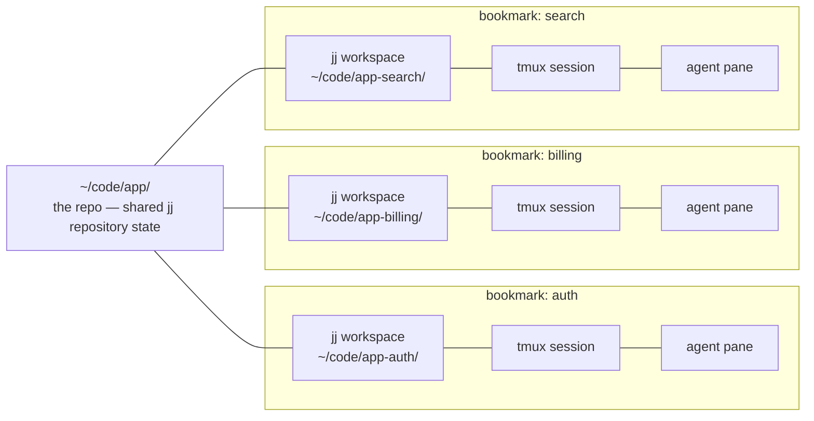
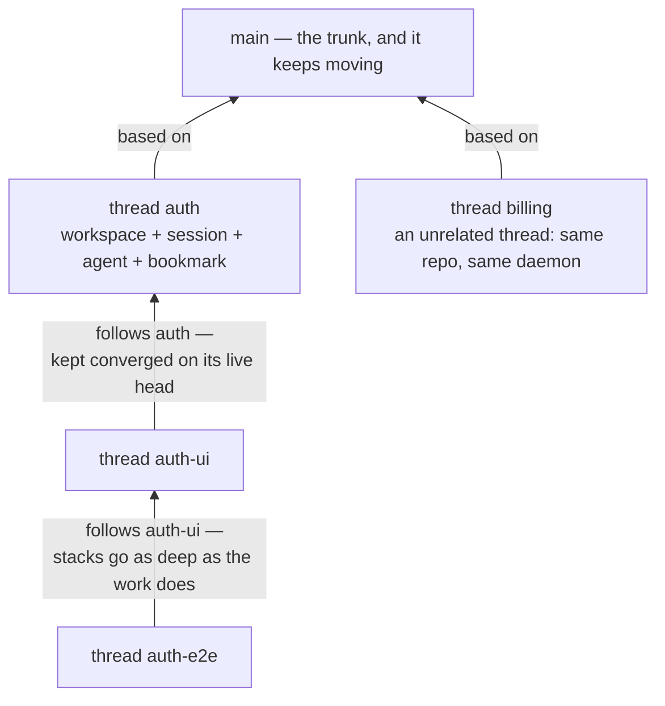

# Orientation

This chapter defines what kiki is. Later chapters define how it behaves.

## The workflow kiki automates

kiki did not invent a workflow. It formalizes one that engineers who push agents hard converge on by hand:

- one jj repo, colocated with git;
- a jj workspace per line of work, so parallel edits never collide;
- a tmux session per workspace, so every line of work keeps its own terminal;
- an agent — Claude Code or Codex — alive in a pane of each session;
- at most one chain of revisions in flight per workspace, named by a single bookmark.

Every column of that picture pulls its weight: isolation from jj workspaces, persistence from tmux, initiative from the agents. The trouble is the glue. Which workspace pairs with which session, which bookmark names which chain, which agent is waiting on what — all of it lives in the engineer's head, and the tax compounds with every added line of work:

- **Where is that work?** Nothing maps a half-remembered change to the workspace that holds it.
- **Who needs me right now?** An agent blocked on a permission prompt in session three looks exactly like an agent making progress.
- **What is in flight?** There is no single view of the tree of work; assembling one means visiting every session.
- **Another one is a ritual.** New workspace, `cd`, new session, name it, create the bookmark, launch the agent — every time, by hand.
- **Staleness is homework.** Keeping N workspaces current against a moving trunk — and against each other — is a rebase-and-conflict chore that grows with N.
- **`jj log` stops scaling.** Every workspace's revisions interleave in one log; finding your own chain means scrolling past everyone else's.
- **A second machine multiplies all of it.** The state lives in one machine's tmux server and filesystem, so moving between machines means rebuilding the picture by hand.

kiki's move is to register the hand-maintained tuple — workspace, tmux session, agent, bookmark — as one durable object with a name: the **thread**. Once the tuple is a first-class thing a daemon watches, each friction has an owner:

| Friction | What kiki does | Where |
| --- | --- | --- |
| Where is that work? | Threads are named and listed from anywhere. `kk ls` works across every registered repo; the TUI shows the same tree interactively. | [Commands](11-commands.md), [Interface](12-interface/) |
| Who needs me right now? | Every thread's agent projects a display state — `idle`, `working`, `finished`, `blocked` — surfaced in listings, the sidebar's Activity section, the tmux status line, and OS notifications. | [Interface](12-interface/), [Observability](14-observability.md) |
| What is in flight? | `kk log` renders your thread and its follows-ancestors in full and collapses everything else to one line each; `--wide` adds PR, CI, and agent state for a one-screen bird's-eye view. | [Commands](11-commands.md#kk-log) |
| Another one is a ritual | `kk new <name>` runs the whole ritual — workspace, initial change, bookmark checkpoint, tmux session, hooks, agent — as one durable, crash-recoverable saga. Inside a thread, branching off the current thread is the default. | [Threads](05-threads.md) |
| Staleness is homework | A thread can follow another thread. kiki classifies every parent change, rebases or materializes the child at a safe agent boundary, and interrupts the human only for genuine ambiguity — textual conflicts or topology it refuses to guess through. A root thread does not follow the moving trunk in v1: catching it up to `main` remains a direct `jj rebase`, which kiki then cascades through every following descendant. When a parent lands, the v1.x GitHub integration moves each child onto the exact merged trunk commit. | [Cascade](07-cascade.md) |
| `jj log` stops scaling | Stack-aware collapse. The chain you are working on renders revision by revision; sibling and unrelated threads compress to one summary line apiece. | [Commands](11-commands.md#kk-log) |
| Naming work that keeps changing shape | `kk new` without a name derives a placeholder, and v1.x metadata evolution lets kiki rename threads and describe revisions as the work reveals its shape — never overwriting prose a human wrote. | [Metadata Evolution](10-metadata.md) |
| A second machine | Deferred, deliberately. Every client is already a pure gRPC client of the daemon, so remote clients and daemon-to-daemon coordination are additive transports, not redesigns. | [Architecture](15-architecture/), [Roadmap](18-roadmap.md) |

Because a thread can follow another thread, the flat sibling picture above generalizes to the shape work actually takes — a tree:

The table names the mechanisms; whether each surface ships in the acceptance slice or as v1.x polish is recorded once, in the scope ledger below. For a scene-by-scene dramatization of the whole workflow, see the [storyboard](12-interface/storyboard.md).

## The tool

kiki (`kk`) is an agentic coding workflow coordinator. It gives a developer a first-class unit for a themed line of work: a jj-backed revision stack, an isolated workspace, a tmux session, and an agent session that can be paused, resumed, archived, and composed with related work. Publishing and transcript-backed recall build on that unit after the coordination core is proven.

kiki exists to make parallel, recursive work patterns cheap enough that a developer can get the most out of agents and collaborate with them. Today, switching between agent-led lines of inquiry means stashes, branches, rebases, lost terminals, and reconstructed context. kiki makes the coordination machinery ambient: threads branch from other threads, follow live ancestor changes, and expose enough durable state that the human can see what needs attention.

## Principles

- kiki coordinates ambiently. Developers may still use `jj`, `tmux`, and `gh` directly.
- Threads provide cooperative isolation. v1 separates workspaces to prevent accidental interference; it does not sandbox same-UID processes.
- Human-authored prose is preserved. kiki may draft names, descriptions, and PR text, but it must not silently overwrite deliberate human edits.
- Transcript data, when transcript capture ships, is stored locally and never feeds publication. An explicitly requested reopen catch-up may send selected local rows to the configured model provider; that egress requires consent.
- Cascade safety matters more than eagerness. jj may evolve descendant commits immediately in repository state; kiki materializes the resulting working-copy state at agent boundaries or quiescence, not mid-edit. Parent live-head advances that require an explicit rebase use the same boundary.

## v1 contract

The acceptance slice is successful when kiki can create, switch, coordinate, archive, reopen, repair, and inspect agentic work threads safely. It deliberately tests the coordination primitive before adding publication, conversational memory, or a rich UI.

This chapter is the book's scope ledger. When another chapter needs to say whether a surface is acceptance slice or v1.x polish, it links here; no other chapter keeps a competing list. Promoting or demoting a surface is an edit to this chapter alone.

The acceptance slice includes:

- `kk init`, `kk repo unregister`, `kk new`, `kk switch`, `kk ls`, `kk close`, `kk reopen`, and `kk repair`
- `kk log`, `kk status`, `kk thread detach`, `kk thread audit`, and approval-gated `kk audit log`
- the minimum `kk config get|show` inspection surface and configuration needed to select the harness and relocate state or workspaces
- a per-user daemon, per-repo registration, durable lifecycle sagas, and restart recovery
- stable thread identity, a workspace `@` as the live thread head, and a bookmark as a checkpoint/publication projection
- a deliberately linear owned-stack contract that stops at ambiguous topology
- jj workspace and tmux session lifecycle, including recoverable close and creation failure states
- the pluggable harness boundary, with the `claude-code` and `codex` adapters implemented
- exclusive managed-hook setup, batch-aware cascade delivery, reconciliation/materialization, acknowledgement, and conflict recovery
- broad projection-divergence detection, narrow automatic repair, and explicit human-directed repair for ambiguous cases
- SQLite-backed scoped and unscoped operational audit and the two-phase one-shot human-approval path needed by consequential operations

## v1.x polish

These deepen v1 but must not block the acceptance slice unless explicitly promoted:

- stack-aware GitHub publishing through `gh`, with authentication checked when publishing rather than at registration
- transcript capture, human transcript reads, consented opt-in reopen catch-up, same-thread MCP consent, and provider-consent management
- overlay TUI, persistent sidebar, status-line polish, and the full notification vocabulary
- metadata ownership tracking followed by AI auto-describe and auto-rename execution
- PR merge polling, comments, CI presentation, and auto-archive
- narrow same-thread read-only transcript MCP reads, after the human transcript surface is stable
- full layered configuration mutation through `set|unset|edit`, repo-shared and per-thread layers, and feature-specific sections
- additional harness/version diagnostics, non-core op-log compatibility cases, and additional `kk thread` management commands

## Out of scope for v1

- filesystem sandboxing or security isolation between threads
- resource caps for agents
- harness adapters beyond `claude-code` and `codex`
- broad MCP substrate for cross-thread agent messaging or spawning
- webhooks; later GitHub integration may poll instead
- full-screen multiplexer behavior beyond tmux integration

## Non-goals

v1 leaves these problems alone:

- kiki does not sandbox agents from each other. Per-thread workspaces provide cooperative separation only.
- kiki does not manage CPU, memory, token, or model spend.
- kiki does not block direct use of `jj`, `gh`, or `tmux`.
- kiki does not mirror the full `jj` CLI surface. When users need arbitrary jj behavior, they should run `jj`.
- kiki does not publish local transcript prose, summarize it into PRs, or feed it into auto-describe or auto-rename. Consented reopen catch-up is model input, not publication.
- kiki does not defend against an actively malicious same-UID process that can read files and invoke `kk`.
