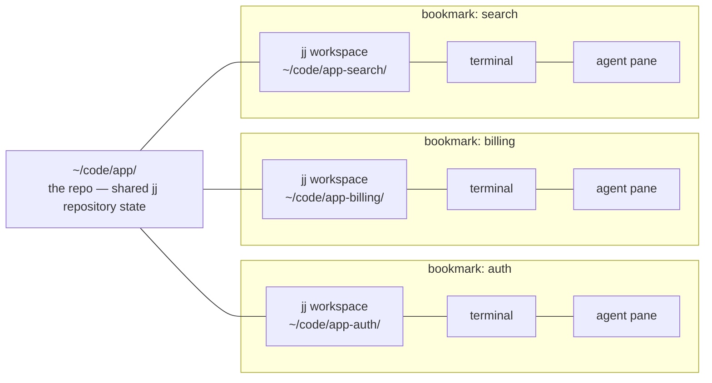
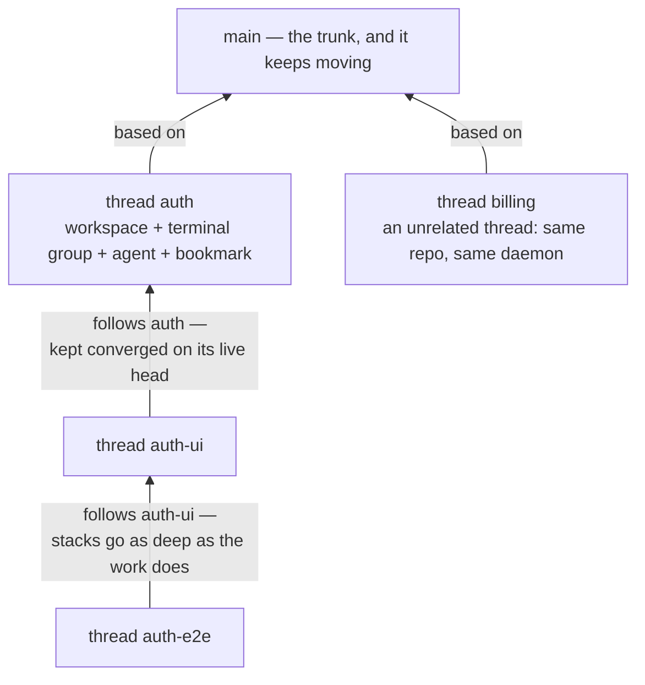

# Orientation

This chapter defines what kiki is. Later chapters define how it behaves.

## The workflow kiki automates

Kiki automates this setup for parallel agent work:

- one [jj](appendix-a-glossary.md#ext-jj) repo, colocated with [Git](appendix-a-glossary.md#ext-git) (both tools share one checkout; jj is a version-control tool like Git);
- a jj [workspace](appendix-a-glossary.md#ext-workspace) per line of work, so parallel edits never collide. A workspace is a separate copy of the files with its own current position in history;
- a persistent terminal per workspace, so every line of work keeps its own terminal. By hand, this is usually a [tmux](https://github.com/tmux/tmux) session;
- an agent, [Claude Code](appendix-a-glossary.md#ext-claude-code) or [Codex](appendix-a-glossary.md#ext-codex), alive in a [pane](appendix-a-glossary.md#ext-pane) of each terminal;
- at most one chain of [revisions](appendix-a-glossary.md#ext-revision) in flight per workspace, named by a single [bookmark](appendix-a-glossary.md#ext-bookmark) (jj's named pointer to a commit).

The workspaces separate file edits. The [terminal multiplexer](appendix-a-glossary.md#ext-terminal-multiplexer) keeps terminals running, and the agents work in those terminals.

Managing the connections between these tools takes repeated work:

- Find the workspace that contains a particular change.
- Check whether an agent is working or waiting for a permission prompt.
- Visit the terminals to see all work in progress.
- Create a workspace, terminal, bookmark, and agent session for each new task.
- Keep workspaces current as their parent revisions change, including any
  [rebases](appendix-a-glossary.md#ext-rebase) and
  [conflicts](appendix-a-glossary.md#ext-conflict).
- Find the relevant chain in a `jj log` that includes every workspace's revisions.
- Rebuild this view when moving to another machine, because the terminal and
  filesystem state are local.

Kiki records each workspace, terminal, agent, and bookmark together as a named,
persistent [thread](appendix-a-glossary.md#thread).

For the terminal, kiki standardizes on [Herdr](https://github.com/herdrdev/herdr). It runs one [dedicated Herdr server](appendix-a-glossary.md#dedicated-herdr-server), with one Herdr workspace per thread. kiki calls that Herdr workspace a **[terminal group](appendix-a-glossary.md#terminal-group)**.

A [daemon](appendix-a-glossary.md#ext-daemon), or background program, watches the registered threads and handles this bookkeeping:

| Friction                              | What kiki does                                                                                                                                                                                                                                                                                                                                                                                                                                                                                                                                                                                                                                                                                                               | Where                                                            |
| ------------------------------------- | ---------------------------------------------------------------------------------------------------------------------------------------------------------------------------------------------------------------------------------------------------------------------------------------------------------------------------------------------------------------------------------------------------------------------------------------------------------------------------------------------------------------------------------------------------------------------------------------------------------------------------------------------------------------------------------------------------------------------------- | ---------------------------------------------------------------- |
| Where is that work?                   | Threads are named and listed from anywhere. `kk ls` works across every registered repo. The TUI (kiki's interactive text screen) shows the same tree interactively.                                                                                                                                                                                                                                                                                                                                                                                                                                                                                                                                                          | [Commands](09-commands.md), [Interface](10-interface/)           |
| Who needs me right now?               | Every thread's agent projects a [display state](appendix-a-glossary.md#agent-display-states): `idle`, `working`, `finished`, or `blocked`. kiki shows it in listings, Herdr's sidebar, the overlay's Activity section, and OS notifications. With no UI attached, the same states reach a script through `kk events` and `--json` output.                                                                                                                                                                                                                                                                                                                                                                                    | [Interface](10-interface/), [Observability](12-observability.md) |
| What is in flight?                    | `kk log` renders your thread and its follows-ancestors in full and collapses everything else to one line each. `--wide` adds PR, CI, and agent state for a one-screen bird's-eye view.                                                                                                                                                                                                                                                                                                                                                                                                                                                                                                                                       | [Commands](09-commands.md#kk-log)                                |
| Starting another task                 | `kk new <name>` creates the workspace, initial change, bookmark checkpoint, hooks, terminal group, and agent through one durable, crash-recoverable [saga](appendix-a-glossary.md#saga). Inside a thread, branching off the current thread is the default.                                                                                                                                                                                                                                                                                                                                                                                                                                                                   | [Threads](03-threads.md)                                         |
| Updating stale workspaces             | A thread can [follow](appendix-a-glossary.md#follows) another thread. kiki classifies every parent change. It rebases or [materializes](appendix-a-glossary.md#materialization) the child at a safe agent boundary. It does not guess at textual conflicts or ambiguous revision topology. It stops and reports them as states and events for a human, or for a script running kiki [headless](appendix-a-glossary.md#headless), to resolve. A root thread does not follow the moving trunk in v1: catching it up to `main` remains a direct `jj rebase`, which kiki then cascades through every following descendant. When a parent lands, the v1.x GitHub integration moves each child onto the exact merged trunk commit. | [Cascade](05-cascade.md)                                         |
| `jj log` stops scaling                | [Stack-aware collapse](appendix-a-glossary.md#stack-aware-collapse). The chain you are working on renders revision by revision. Sibling and unrelated threads compress to one summary line apiece.                                                                                                                                                                                                                                                                                                                                                                                                                                                                                                                           | [Commands](09-commands.md#kk-log)                                |
| Naming work that keeps changing shape | `kk new` without a name gives the thread the placeholder `unnamed-<short-hex>`. Deriving a name from the first prompt is v1.x. v1.x metadata evolution also lets kiki rename threads and describe revisions as the work reveals its shape. It never overwrites prose a human wrote.                                                                                                                                                                                                                                                                                                                                                                                                                                          | [Metadata Evolution](08-metadata.md)                             |
| A second machine                      | Planned after v1. A user-defined profile can span hosts. Each host runs its own threads and checks which devices can reach them.                                                                                                                                                                                                                                                                                                                                                                                                                                                                                                                                                                                             | [Remote access](13-architecture/remote-access.md)                |

Follows relationships can connect the threads into a tree:

The table names the mechanisms. Whether each surface ships in the [acceptance slice](appendix-a-glossary.md#acceptance-slice) or as [v1.x polish](appendix-a-glossary.md#v1-x-polish) is recorded once, in the scope ledger below. The [storyboard](10-interface/storyboard.md) walks through the workflow.

## The tool

kiki (`kk`) coordinates agentic coding work: work done by AI coding agents. It gives a developer one named unit for a line of work, the [thread](appendix-a-glossary.md#thread). A thread is:

- a chain of [jj](appendix-a-glossary.md#ext-jj) [revisions](appendix-a-glossary.md#ext-revision);
- its own [workspace](appendix-a-glossary.md#workspace);
- its own [terminal group](appendix-a-glossary.md#terminal-group);
- its own agent.

A thread can be paused, resumed, archived, and stacked on top of related work. Publishing to GitHub and transcript-backed recall build on that unit once the coordination core is proven.

Kiki tracks work that would otherwise require checking terminals and revision histories by hand:

- threads branch from threads;
- children [follow](appendix-a-glossary.md#follows) their parents' live changes;
- enough state survives on disk that you can always see what needs you.

## Principles

- **kiki coordinates in the background.** You may always use `jj`, `gh` (the [GitHub command-line tool](appendix-a-glossary.md#ext-gh)), and [Herdr](appendix-a-glossary.md#herdr)'s own terminal controls directly. kiki watches and reacts; it does not stand in the way. The book calls this posture the [ambient coordinator](appendix-a-glossary.md#ambient-coordinator).
- **The terminal is Herdr's; the thread is kiki's.** Herdr owns [panes](appendix-a-glossary.md#ext-pane), layout, and what you see. It never decides which [thread](appendix-a-glossary.md#thread) a terminal belongs to, whether an agent is ready, or whether files are safe to delete.
- **kiki runs headless.** No command needs an attached terminal client, the overlay, or a desktop session. The `kk` CLI and the daemon's service are the complete surface, and the interactive screens are views of it. By default kiki stops and asks a human before a consequential step. An [automation policy](appendix-a-glossary.md#automation-policy) that the owner has activated can approve the same step with no human present. The cases that would interrupt a person then surface as events and states instead. See [Automation policy](04-authority.md#automation-policy).
- **Workspaces separate edits.** Separate [workspaces](appendix-a-glossary.md#workspace) prevent accidents between parallel agents. They are not a security [sandbox](<https://en.wikipedia.org/wiki/Sandbox_(computer_security)>) against processes running as your user.
- **Your words are yours.** kiki may draft names, descriptions, and PR text (a PR is a [pull request](appendix-a-glossary.md#ext-pull-request)), but it must not silently overwrite something a human wrote.
- **Transcript data stays out of what kiki publishes.** Transcript data, when transcript capture ships, is stored locally and never feeds anything kiki publishes. The one exception is explicit: a [reopen catch-up](appendix-a-glossary.md#catch-up) you ask for may send selected rows to the configured model provider, and only after you consent. See [thread transcript](appendix-a-glossary.md#thread-transcript).
- **Workspace changes wait for a safe boundary.** [jj](appendix-a-glossary.md#ext-jj) may rewrite a child thread's commits in the repository immediately. But kiki changes the child's files, and informs its agent, only at a safe moment. A safe moment is an agent tool boundary or a moment the [harness](appendix-a-glossary.md#harness) proves the agent idle. It is never mid-edit. Explicit [rebases](appendix-a-glossary.md#ext-rebase) for a parent's new commits wait for the same moment. See [safe boundary](appendix-a-glossary.md#safe-boundary).

## v1 contract

v1 is done when kiki can create, switch, coordinate, archive, reopen, repair, and inspect [threads](appendix-a-glossary.md#thread) safely. It deliberately proves the coordination core before adding publishing, conversational memory, or a rich UI. That proving set is called the **[acceptance slice](appendix-a-glossary.md#acceptance-slice)**.

This chapter is the book's single scope ledger: the one list of what ships when.

- When another chapter needs to say whether a feature ships in the acceptance slice or as v1.x polish, it links here.
- No other chapter keeps a competing list.
- Promoting or demoting a feature is an edit to this chapter alone.

The acceptance slice includes:

- `kk init`, `kk repo unregister`, `kk new`, `kk attach`, `kk switch`, `kk ls`, `kk close`, `kk reopen`, and `kk repair`
- `kk log`, `kk status`, [`kk thread snapshot`](09-commands.md#kk-thread-snapshot), `kk thread detach`, `kk thread audit`, and approval-gated `kk audit log`
- headless operation without a UI, as an [invariant](02-invariants.md#kiki-runs-headless): a full thread lifecycle with zero attached Herdr clients, and no prompt without a terminal
- the scripting surface: `kk daemon install`, `--json` on every read command and on every command's final result, [`kk events`](09-commands.md#kk-events), and the fixed [exit codes](09-commands.md#exit-codes)
- [`kk prompt`](09-commands.md#kk-prompt) to submit a later user turn to the same running agent, with a real harness proof for each supported version
- two headless additions that land at Stage 2 of [Build Sequencing](15-build-sequencing.md): [`kk wait`](09-commands.md#kk-wait), and the `command` notification provider that runs a program for each `loud` event
- unattended approval: the [automation policy](04-authority.md#automation-policy) engine with its [risk labels](appendix-a-glossary.md#risk-label), [`PolicyApproval`](appendix-a-glossary.md#policy-approval), [automation credentials](appendix-a-glossary.md#automation-credential), and [`kk automation`](09-commands.md#kk-automation). These are in the slice, at Stage 1 of [Build Sequencing](15-build-sequencing.md), because kiki's own end-to-end tests need unattended approvals
- the minimum `kk config get|show` inspection surface and configuration needed to select the [harness](appendix-a-glossary.md#harness), select the [Herdr](appendix-a-glossary.md#herdr) executable and server name, relocate state or workspaces, and set per-event notification behavior
- a per-user [daemon](appendix-a-glossary.md#ext-daemon) started under the user's service manager, or run as `kkd --foreground` under the operator's own supervisor on a host with no user service manager, per-repo registration, durable lifecycle [sagas](appendix-a-glossary.md#saga), and restart recovery
- stable thread identity, a [workspace](appendix-a-glossary.md#workspace) `@` as the live [thread head](appendix-a-glossary.md#thread-head), and a [bookmark](appendix-a-glossary.md#bookmark) as a checkpoint/publication [projection](appendix-a-glossary.md#projection) tracked through jj's [native rewrite successors](appendix-a-glossary.md#native-successor)
- a deliberately linear [owned-stack](appendix-a-glossary.md#owned-stack) contract that stops at ambiguous topology
- jj workspace lifecycle and [terminal-group](appendix-a-glossary.md#terminal-group) lifecycle on one [dedicated Herdr server](appendix-a-glossary.md#dedicated-herdr-server), including recoverable close and creation failure states
- journaled terminal provisioning through the gated [pane launcher](appendix-a-glossary.md#pane-launcher), so a lost reply or crash never yields two agents
- terminal restore as reconciliation: [server-instance](appendix-a-glossary.md#server-instance) tracking, snapshot resync after event loss, and no thread reported `Active` from a restored pane
- process supervision: fixed-point [quiescence proof](appendix-a-glossary.md#process-quiescence-proof), [verified resume](appendix-a-glossary.md#verified-resume), [verified exit](appendix-a-glossary.md#verified-exit) before deletion, and [orphan](appendix-a-glossary.md#orphan) detection before replacement, materialization, or deletion
- the thread's label in Herdr's sidebar, and attention notifications for the events the acceptance slice can raise: a blocked or crashed agent, a conflicted cascade, an exhausted delivery, a followed parent abandoned, a failed lifecycle operation, and a [projection issue](appendix-a-glossary.md#projection-issue)
  - An agent reporting its goal complete is also in the slice, as a quieter `soft` event: a status mark plus an overlay toast.
  - An agent is `blocked` in two ways: it crashed, or it is waiting on a permission prompt.
  - Crash detection ships for every supported harness.
  - Permission-prompt detection depends on the harness adapter's `attention_events` capability, which needs a named harness event and a passing proof step. For a harness without that proof, permission-prompt detection is v1.x.
- [caller-local](appendix-a-glossary.md#caller-local-focus) `kk switch`, which requires Herdr's [client-targeted focus](appendix-a-glossary.md#client-targeted-focus) capability, plus the explicitly global `kk switch --all-clients`
- the pluggable harness boundary, with the `claude-code` and `codex` adapters implemented
  - Each adapter must pass its proofs first (see [Build Sequencing](15-build-sequencing.md)).
  - If the session-start hook proof fails for a harness, that harness is unsupported.
  - If the `RestartStartup` delivery proof fails for a harness, that harness ships managed sessions without cascade delivery, so its threads cannot follow. That scope cut is recorded as a new decision record.
- exclusive managed-[hook](appendix-a-glossary.md#ext-hook) setup, batch-aware [cascade](appendix-a-glossary.md#cascade-reconciliation) delivery, reconciliation/[materialization](appendix-a-glossary.md#materialization), acknowledgement, and conflict recovery
- broad [projection-divergence](appendix-a-glossary.md#projection-divergence) detection, narrow automatic repair, and explicit repair through `kk repair` for ambiguous cases, where a caller picks the plan and kiki never guesses
- [SQLite](appendix-a-glossary.md#ext-sqlite)-backed scoped and unscoped operational audit and the two-phase one-shot [human-approval](appendix-a-glossary.md#human-approval) path needed by consequential operations, with a [policy approval](04-authority.md#policyapproval) as the unattended form of the same one-shot approval

The Herdr-backed items above are adopted as contract, not yet proven. One of them waits on Herdr itself: caller-local switching needs the client-targeted focus extension.

Two other chapters track this:

- [Terminal runtime](13-architecture/terminal-runtime.md#what-exists-what-kiki-builds-what-herdr-must-add) separates what Herdr provides today, what kiki's adapter builds, what must land upstream, and which gates are still open.
- [Build Sequencing](15-build-sequencing.md) orders the proofs.

## v1.x polish

These deepen v1 but must not block the [acceptance slice](appendix-a-glossary.md#acceptance-slice) unless explicitly promoted:

- stack-aware GitHub publishing through `gh`, with authentication checked when publishing, not at registration
- transcript capture, human transcript reads, consented opt-in [reopen catch-up](appendix-a-glossary.md#catch-up), same-thread MCP consent, and provider-consent management (MCP is the [Model Context Protocol](appendix-a-glossary.md#ext-mcp))
- [overlay TUI](appendix-a-glossary.md#overlay-tui), the `shell` and `ui` [role panes](appendix-a-glossary.md#role-pane), [Herdr sidebar](appendix-a-glossary.md#herdr-sidebar-projection) tokens beyond the thread label, and the full notification vocabulary
- deriving a placeholder thread name from the first prompt. In the acceptance slice, a thread created without a name is `unnamed-<short-hex>`
- metadata ownership tracking followed by AI [auto-describe](appendix-a-glossary.md#auto-describe) and [auto-rename](appendix-a-glossary.md#auto-rename) execution
- PR merge polling, comments, CI presentation, and auto-archive (a PR is a [pull request](appendix-a-glossary.md#ext-pull-request); CI is [continuous integration](appendix-a-glossary.md#ext-ci))
- narrow same-thread read-only transcript MCP reads, after the human transcript surface is stable
- full layered configuration mutation through `set|unset|edit`, repo-shared and per-thread layers, and feature-specific sections
- additional harness/version diagnostics and non-core op-log compatibility cases
- additional commands: `kk publish`, `kk thread transcript`, `kk thread comments`, `kk thread destroy`, `kk thread interrupt`, `kk thread restart --harness`, `kk thread describe --refresh`, `kk doctor`, and `kk privacy consent`
- automation policy rules for `publish` and for provider-egress consent (`consent:<purpose>`). Each arrives with the feature it gates
- keybinding-invoked navigation and the overlay entry point. Until the overlay ships, and whenever no overlay is available, bare `kk` prints the `kk ls` listing

## Out of scope for v1

- filesystem sandboxing or security isolation between [threads](appendix-a-glossary.md#thread)
- resource caps for agents
- [harness](appendix-a-glossary.md#harness) adapters beyond `claude-code` and `codex`
- broad MCP substrate for cross-thread agent messaging or spawning
- webhooks; later GitHub integration may poll instead
- terminal multiplexing itself: [Herdr](appendix-a-glossary.md#herdr) owns panes, layout, input, and rendering, and kiki does not fork it or embed its code
- terminal runtimes other than Herdr
- [follows](appendix-a-glossary.md#follows) graph surgery: `kk thread attach` and `kk thread reparent`
- remote terminal hosting, Windows, and live terminal-server handoff, each gated on evidence in the [Roadmap](16-roadmap.md)

## Non-goals

v1 leaves these problems alone:

- kiki does not sandbox agents from each other. Per-thread [workspaces](appendix-a-glossary.md#workspace) provide cooperative separation only.
- kiki does not manage CPU, memory, token, or model spend.
- kiki does not block direct use of `jj`, `gh`, or Herdr.
- kiki does not mirror the full `jj` CLI surface. When users need arbitrary jj behavior, they should run `jj`.
- kiki does not publish local transcript prose, summarize it into PRs, or feed it into [auto-describe](appendix-a-glossary.md#auto-describe) or [auto-rename](appendix-a-glossary.md#auto-rename). Consented [reopen catch-up](appendix-a-glossary.md#catch-up) is model input, not publication.
- kiki does not answer a harness's own permission prompt, with or without an automation policy. On a headless host the operator sets the harness's own permission settings.
- kiki does not defend against an actively malicious same-UID process that can read files and invoke `kk`. A same-UID process is one that runs as the same user account.
