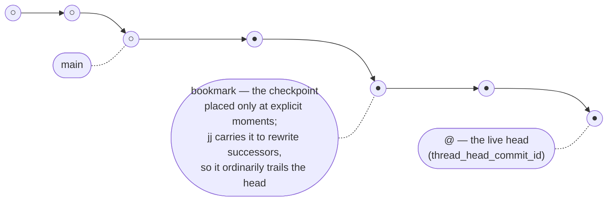
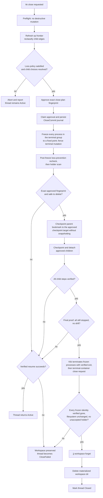
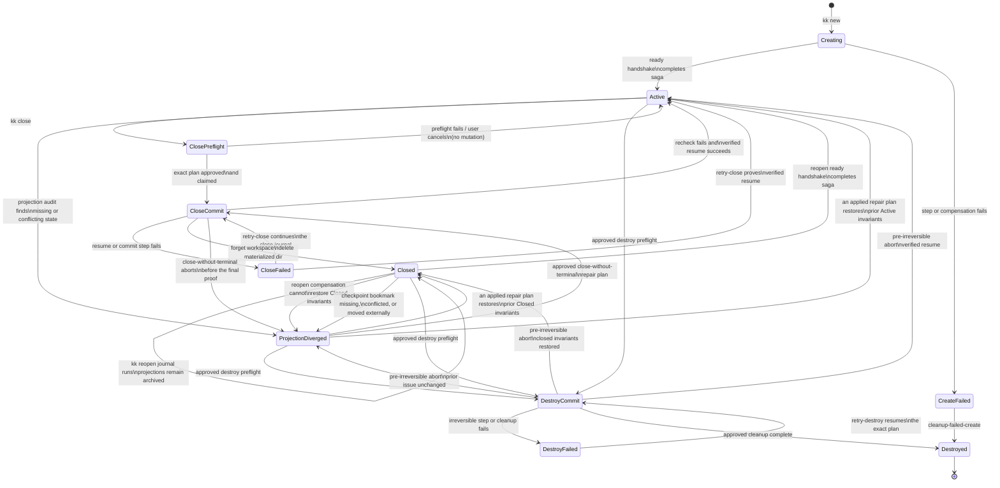

# Threads

A [thread](appendix-a-glossary.md#thread) is kiki's unit of work. Bookmarks, jj workspaces, terminal groups, and agent processes all hang off that unit. ([jj](https://docs.jj-vcs.dev/latest/) is the version-control tool kiki drives.)

In this book an unqualified "workspace" is always a [jj workspace](https://docs.jj-vcs.dev/latest/working-copy/). The per-thread terminal home is a **terminal group**: one [Herdr](https://github.com/herdrdev/herdr) workspace on kiki's [dedicated Herdr server](appendix-a-glossary.md#dedicated-herdr-server) (see [Terminal runtime](13-architecture/terminal-runtime.md)).

## Thread identity

Each thread has a stable sqlite `thread_id`. That id never changes. It is the join key for credentials, audit rows, [transcript](appendix-a-glossary.md#thread-transcript) rows, [PR](https://docs.github.com/en/pull-requests) links, lifecycle state, and [follows](appendix-a-glossary.md#follows) links.

A [projection](appendix-a-glossary.md#projection) is an external object that stands in for the thread. Mutable projections include:

- jj workspace path: a [workspace](appendix-a-glossary.md#workspace) is a separate jj working copy with its own files
- jj bookmark name: a [bookmark](appendix-a-glossary.md#bookmark) is a named pointer to a commit, like a git branch
- [terminal group](appendix-a-glossary.md#terminal-group): the thread's Herdr workspace and its [role panes](appendix-a-glossary.md#role-pane), which keep running when no terminal client is attached
- harness session id: the [harness](appendix-a-glossary.md#harness) is the coding agent ([Claude Code](https://docs.claude.com/en/docs/claude-code/overview) or [Codex](https://github.com/openai/codex))

### The live head

An active thread's [live head](appendix-a-glossary.md#live-head) is the exact `@` commit of its managed workspace. In jj, `@` names the [working-copy commit](https://docs.jj-vcs.dev/latest/glossary/), the page you are on right now.

Kiki stores the last `@` it observed as `thread_head_commit_id`. That stored value is a cache of a workspace-local fact, not a second source of truth. Every watcher or lifecycle transaction that observes a new `@` updates the cache. It records the exact jj [operation](https://docs.jj-vcs.dev/latest/operation-log/) view the value was read from.

### The bookmark is a checkpoint

The thread bookmark has a different job. It is the durable checkpoint kiki uses for publication and for recreating a workspace after close.

Think of the bookmark as a bookmark left between pages, while `@` is the page you are reading now. The bookmark is never the live head. It is never a follows synchronization target.

Kiki places the bookmark only at an explicit checkpoint (a [checkpoint placement](appendix-a-glossary.md#checkpoint-placement)):

- successful creation, after the initial working-copy commit is known;
- publish, immediately before pushing;
- close, before forgetting the workspace;
- detach, so the newly independent thread has a reopenable checkpoint;
- an applied bookmark [repair plan](appendix-a-glossary.md#repair-plan). The plan may restore the expected target, adopt or choose another exact commit on the owned chain, or make a hidden expected target visible again. [Who may move the bookmark where](#who-may-move-the-bookmark-where) gives the limits.

The two commits are easy to confuse and must not be:

### What a checkpoint does

At a checkpoint, kiki does all of the following in one journaled lifecycle action:

1. It pins one exact operation.
2. It reads the exact workspace `@` in that operation.
3. It chooses the [checkpoint target](appendix-a-glossary.md#checkpoint-target) by the rule below.
4. It stores the head as `thread_head_commit_id`, and the target as `checkpoint_commit_id` and `bookmark_expected_commit_id`.
5. It appends an immutable placement row.
6. It moves the bookmark to that exact target.

The bookmark move follows strict rules:

- It is pinned to that exact operation id and passes `--ignore-working-copy`. So it cannot [snapshot](https://docs.jj-vcs.dev/latest/working-copy/) the managed working copy. (A snapshot is jj recording the current files into the working-copy commit.)
- It can still leave two operation heads when some other operation lands at the same moment. The journal that made the placement then owns the first integration of those heads. For an existing managed bookmark it re-places deterministically. Initial creation stops on a competing claim to the name.
- `--at-op=@` is not an acceptable substitute. It snapshots, and it fails when operation heads have [diverged](https://docs.jj-vcs.dev/latest/technical/concurrency/).
- Kiki then verifies the resulting bookmark target and operation.
- Kiki never resolves `@` a second time inside the mutating command.

**The checkpoint target.** The target is normally the live head. An empty, undescribed head is skipped:

1. When the head is not both empty and undescribed, the target is the head.
2. Otherwise kiki walks back from the head along the [owned chain](appendix-a-glossary.md#owned-stack), one parent at a time. The target is the nearest commit that is not both empty and undescribed.
3. If the walk reaches the expected target first, the bookmark stays where it is. Nothing is placed.
4. If the walk leaves the owned chain without finding either, the checkpoint refuses with "nothing to checkpoint".

The reason is that jj leaves an empty, undescribed commit behind after `jj commit`, and creates one whenever a workspace is added. A bookmark on it would publish or reopen onto nothing.

Creation is the one exception. It places the bookmark on the new thread's first commit, which is empty. No earlier commit of the thread exists yet.

**Preparing a checkpoint.** Close, detach, and publish probe the workspace without writing to jj. They pin a clean head or return the next step. For fresh tracked edits the caller can request [`kk thread snapshot`](09-commands.md#kk-thread-snapshot), then run the original command again. A stale or uncertain workspace takes the ordinary reconciliation or recovery path.

### Who may move the bookmark where

One rule says where each kind of move may put the bookmark. The rest of the book repeats this rule and does not add to it.

- **A checkpoint only moves the bookmark forward.** Creation, publish, close, and detach move it forward along the owned chain. A checkpoint never moves the bookmark backward or sideways, and it never passes jj's `--allow-backwards` flag.
- **`adopt-bookmark` and `choose-bookmark-target` may place it anywhere on the chain.** These approved repair plans may place the bookmark on the live head or on any commit on the validated owned chain. That includes a commit behind the expected target. These plans may pass `--allow-backwards`.
- **`restore-bookmark` puts it back on the expected target.** jj may see that as a backward move, so this plan may pass `--allow-backwards`. It still needs no approval in the thread's own context; applied to a different thread, it needs a one-shot approval. It is offered only while the expected target is visible.
- **`unhide-checkpoint` may also pass the flag.** It makes a hidden expected target visible again and places the bookmark on it.
- **Kiki never places the bookmark off the owned chain.** v1 has no plan for that. The shape is first fixed with jj, for example with a rebase that puts the commit on the chain. Then an adopt or choose plan is applied.

A checkpoint therefore refuses when its target is neither the expected target nor a descendant of it. That happens in two common cases:

- the human has moved `@` to an earlier commit with `jj edit`;
- the human has moved `@` onto another line with `jj new <elsewhere>`, or has moved the bookmarked commit somewhere else with `jj rebase -r`.

Placing the bookmark there would move it backward or sideways and strand the later revisions. Kiki reports the relationship as `ahead` or `diverged` and stops. Publish, close, and detach stay blocked until [`choose-bookmark-target`](appendix-a-glossary.md#choose-bookmark-target) is applied. A backward move is never a side effect of close, publish, or detach.

The plans themselves are listed in [Bookmark plans](#bookmark-plans) below.

### What happens to the bookmark between checkpoints

A bookmark can change between checkpoints. Kiki distinguishes five cases:

| What happened                                                                                                                                                                           | What jj does to the bookmark                 | What kiki records                                                                                                                   |
| --------------------------------------------------------------------------------------------------------------------------------------------------------------------------------------- | -------------------------------------------- | ----------------------------------------------------------------------------------------------------------------------------------- |
| **Native successor.** The checkpointed commit is rewritten: a working-copy snapshot, `describe`, a rebase, an ancestor rewrite from another workspace.                                  | carries the bookmark to the successor commit | advances `bookmark_expected_commit_id`, appends a succession row with the operation's predecessor evidence; no issue                |
| **Head advance.** `jj new` or `jj commit` gives `@` a new revision.                                                                                                                     | leaves the bookmark where it was             | nothing changes for the bookmark; the relationship stays `current` while the new head is empty and undescribed, then reads `behind` |
| **Explicit placement.** One of the checkpoints listed above.                                                                                                                            | kiki moves it                                | a new immutable placement row; `checkpoint_commit_id` and `bookmark_expected_commit_id` both become the placed commit               |
| **External movement.** Anything else: `jj bookmark move`, a target with no predecessor evidence, divergent successors, a conflicted bookmark, deletion, an abandoned checkpoint commit. | whatever the command did                     | a `BookmarkMoved`, `BookmarkConflicted`, `BookmarkMissing`, or `CheckpointAbandoned` projection issue                               |
| **Undo.** `jj undo` or an operation restore reverts recorded operations and returns the bookmark to a commit that an earlier row recorded as this thread's expected target.             | puts the bookmark back on the earlier commit | pops the expected target back to that commit and marks the reverted rows `Reverted`; no issue                                       |

The undo rule covers the thread's whole placement and succession history, not only the current placement. So it also covers a human `jj undo` of kiki's own placement operation. The expected target pops back to the commit the earlier row recorded, and the reverted placement row is marked `Reverted`.

Kiki decides this from evidence, not from the command name. So the rule holds whoever made the move. The expected target pops back when both of these hold at the observed operation:

- the bookmark is exactly on a commit that an earlier placement or succession row recorded as this thread's expected target; and
- no successor recorded after that row is still visible.

A real `jj undo` or `jj op restore` hides the later successors. A move back to an earlier recorded target while a later recorded successor is still visible is [`BookmarkMoved`](appendix-a-glossary.md#bookmarkmoved). This rule needs a proof test on the pinned jj version.

Two stored values come out of this, and they mean different things:

- `checkpoint_commit_id` is the commit where kiki last _placed_ the bookmark. It is kept as history.
- `bookmark_expected_commit_id` is where kiki expects the bookmark _now_. It is the placed commit carried forward through every [native successor](appendix-a-glossary.md#native-successor) kiki has proved. See [expected bookmark target](appendix-a-glossary.md#expected-bookmark-target).

The projection audit compares the observed bookmark with the expected target, never with the placement.

#### When a native successor is accepted

A native successor is accepted only when all of this holds in one exact operation:

- the bookmark has a single, unconflicted target;
- that target records the previous expected commit as a [predecessor](https://docs.jj-vcs.dev/latest/glossary/);
- the previous expected commit is no longer visible;
- the change is not [divergent](https://docs.jj-vcs.dev/latest/glossary/).

The conflict test comes first. A conflicted bookmark is [`BookmarkConflicted`](appendix-a-glossary.md#bookmarkconflicted) even when one of its targets is the expected commit.

Which successors count depends on the change and the thread's state:

- A successor in the same change is always acceptable.
- A successor in a different change is what `jj split` produces, or what squashing the bookmarked commit into its parent produces. For an active thread it is accepted only when it is the live head or lies on the validated owned chain.
- The base is not on the owned chain. The chain starts just after the base. So a successor that lands on the base, on a parent thread's commit, or on trunk is [`BookmarkMoved`](appendix-a-glossary.md#bookmarkmoved). Squashing a thread's only commit into the base is one way to get there.
- For a closed thread only a same-change successor, or an undo under the undo rule above, is accepted. The archived `thread_head_commit_id` advances with it, so the two stay equal.
- Everything else is external movement.

Three cases need their own rules:

- **A deleted bookmark.** When the bookmark name is gone and the expected target is still visible, the issue is [`BookmarkMissing`](appendix-a-glossary.md#bookmarkmissing).
- **An abandoned checkpoint.** `CheckpointAbandoned` means three things hold at the observed operation: the bookmark is absent, the expected target is hidden, and no visible successor is accepted by the rule above. `jj abandon` of the bookmarked commit does this. It hides the commit and deletes the bookmark that sat on it. A fetch that finds a merged pull request's branch deleted can do the same. A bookmark that is still present, on a commit kiki does not accept, is `BookmarkMoved`, even when the expected target is hidden; [`choose-bookmark-target`](appendix-a-glossary.md#choose-bookmark-target) is its exit.
- **A rename.** A `jj bookmark rename` is the one name change kiki normalizes on its own. It does so when one exact operation shows all of this: the thread's bookmark name is gone, and exactly one new local name, used by no other thread, is on the expected target or on a successor of it that the rule above accepts in the same operation. Kiki then adopts the new name as the thread's bookmark projection and journals the normalization. Any less certain disappearance is `BookmarkMissing`.

Successor tracking pauses while a bookmark issue is open. Suppose the expected target becomes hidden during that pause. The open issue then stays as it is, and kiki adds no second issue. [`restore-bookmark`](appendix-a-glossary.md#restore-bookmark) is withdrawn, and [`choose-bookmark-target`](appendix-a-glossary.md#choose-bookmark-target) is the exit.

#### Classification and status

Classification runs on every operation, kiki's own included. When a kiki rebase carries a bookmark, kiki records that succession like any other.

An open bookmark issue resolves by itself when a later operation shows the bookmark unconflicted on the expected target. No repair plan ever places a bookmark on a commit that is not visible. `restore-bookmark` is offered only while the expected target is visible. [`unhide-checkpoint`](appendix-a-glossary.md#unhide-checkpoint) first makes the hidden commit visible again and only then places the bookmark.

Status must show the relationship between the expected target and the live head (the [checkpoint relationship](appendix-a-glossary.md#checkpoint-relationship)):

- `current`: the expected target equals the head, or equals the commit the [checkpoint target](appendix-a-glossary.md#checkpoint-target) rule picks for that head. The second case is an empty, undescribed head, or a run of them, sitting above the expected target;
- `behind`: the head is any other descendant;
- `ahead`: the head is an ancestor;
- `diverged`.

These tests need only a single-parent path between the two commits. The stricter owned-stack conditions below apply to explicit rebases.

A thread that reads `ahead` or `diverged` may have no open issue at all. Its exit is still `choose-bookmark-target`, as [Who may move the bookmark where](#who-may-move-the-bookmark-where) says.

Kiki must not "helpfully" place the bookmark after each jj operation. Tracking a native successor is not a placement. It never moves the bookmark. It only records where jj moved it.

## Creation

`kk new` is a durable creation [saga](appendix-a-glossary.md#saga). A saga is a multi-step operation with a journal. Like a checklist that survives a power cut, it records each step so a crash never loses track of what was done.

`kk new` creates:

- a sqlite thread row
- a jj [workspace](appendix-a-glossary.md#workspace)
- an initial jj working-copy change, plus a [bookmark](appendix-a-glossary.md#bookmark) checkpoint at its exact commit
- a [terminal group](appendix-a-glossary.md#terminal-group), one Herdr workspace on kiki's dedicated server, rooted in the jj workspace
- an `agent` [role pane](appendix-a-glossary.md#role-pane) whose direct child is the kiki [pane launcher](appendix-a-glossary.md#pane-launcher), which hosts the [harness](appendix-a-glossary.md#harness) process
- a v1.x `shell` role pane in the same tab, when that UI feature is enabled
- a v1.x optional `ui` role pane, when that UI feature is enabled
- a per-thread hook credential and hook configuration, installed before the harness can run

### How the saga recovers

The saga starts by inserting a `Creating` thread row and a step journal.

Every external step and every compensation (undo step) is exactly-once in effect. One of two things makes that true. Either the step itself is safe to repeat, or a journal and a single-claim gate make a repeat harmless. Terminal provisioning is an example of the second kind.

- On [daemon](<https://en.wikipedia.org/wiki/Daemon_(computing)>) restart, kiki resumes the journal, or [compensates](appendix-a-glossary.md#compensation) completed steps in reverse order.
- A failure becomes `CreateFailed`, and the journal and diagnostic are kept.
- Kiki never reports a failed thread as absent merely because best-effort cleanup ran.

### The order of steps

The normative order is:

1. **Allocate identities.** Allocate the stable thread, workspace, and bookmark identities and the terminal `provision_id`. Persist the exact chosen base and any follows anchors.
2. **Create the workspace.** Create the jj workspace at that exact base.
3. **Record the head.** Read the new workspace's exact `@` and persist it as `thread_head_commit_id`. (`jj workspace add` creates the workspace and its initial working-copy commit in one pinned command.)
4. **Create the bookmark.** Check for name collisions during preflight and recheck at placement. Prove the chosen local name is absent on the agreed frontier. Before calling `jj bookmark create` for the exact initial head, journal the invocation identity, name, target and starting operation. Verify the attributed operation introduced that name and persist the placement. On retry, only that operation proves this journal created it. A pre-existing name, a competing creation on another head, or ambiguous attribution stops creation. Preserve the foreign bookmark even if it names the same commit. Compensation may remove only a placement still proved to belong to this journal.
   - The bookmark is deliberately created **after** the initial working-copy change, because a bookmark does not follow a later `jj new`.
   - The next working-copy snapshot rewrites that commit and the bookmark follows it. That is native successor tracking, not drift.
5. **Issue the credential.** Issue the [thread-scoped credential](appendix-a-glossary.md#threadscoped-credential) and install the launch-scoped harness configuration.
6. **Provision the terminal group.** Run the [orphan scan](13-architecture/terminal-runtime.md#orphans) for the thread's workspace path. Then provision the terminal group with the journaled [provisioning protocol](13-architecture/terminal-runtime.md#provisioning).
   - Every role pane's direct child is a pane launcher. It is started by direct argv (an exact argument list, not a shell command line) with an explicit [working directory](https://en.wikipedia.org/wiki/Working_directory) and [environment](https://en.wikipedia.org/wiki/Environment_variable).
   - Each launcher's report is accepted only after [`kkd`](appendix-a-glossary.md#kkd) verifies its process identity from the OS.
   - Each launcher blocks on its gate. No harness runs yet.
   - A lost reply or a crash here is reconciled from launcher reports and a fresh runtime snapshot. It is never repaired by blindly repeating the create call.
7. **Open the launch gate.** Open the [launch gate](appendix-a-glossary.md#launch-gate) as the last external step.
   - The `agent` launcher cannot start the harness until two transactions have committed.
     - The first accepted exactly one launcher for this provision, recorded its process identity, and marked the [terminal binding](appendix-a-glossary.md#terminal-binding) `Bound`.
     - The second recorded the new [incarnation](appendix-a-glossary.md#incarnation) and activated its one-use database-backed gate.
   - The thread stays `Creating` during this.
   - The launcher then creates the harness as its child. The child is held until `kkd` has verified and recorded the child's process identity. The launcher then releases it with the already validated settings.
   - The launcher stays alive as the role's supervisor.
   - [`kk-hook`](appendix-a-glossary.md#kk-hook) reports the [ready handshake](appendix-a-glossary.md#ready-handshake) from the harness's session-start event.
   - `harness_started_at` was recorded when the child was verified. The handshake transaction re-reads the launcher's identity and the [server instance](appendix-a-glossary.md#server-instance), records readiness, completes the saga, and promotes the thread to `Active`.
   - A start or handshake failure becomes `CreateFailed`. So does a launch that reaches no ready handshake within `[timeouts] ready_handshake`.
   - Kiki may crash while the authorized process exists but before the handshake. The recorded process identities then let restart recovery adopt or terminate exactly that process.
   - Recovery never infers success from an activated gate, a Herdr reply, or a visible pane.

### When a step fails

If a step fails, kiki records the error before attempting reverse-order compensation.

Automatic compensation may close the provisioned group and remove the new workspace only while all three of these hold:

- the launch gate was never activated;
- [`ProcessSupervisor`](appendix-a-glossary.md#processsupervisor) shows the group holds nothing but kiki's own blocked launchers;
- the workspace still equals its initial [materialization](appendix-a-glossary.md#materialization).

Things change once a harness may have run, or the human has opened a pane in the visible `Creating` group. The saga then stops in `CreateFailed` with every projection intact. Cleanup is the approved [`cleanup-failed-create`](appendix-a-glossary.md#cleanup-failed-create) repair plan, which uses the close machinery. A failed reopen's counterpart is [`cleanup-failed-reopen`](appendix-a-glossary.md#cleanup-failed-reopen).

`kk repair` applies that plan. `CreateFailed` has no retry plan: nothing resumes a failed creation into `Active`. `cleanup-failed-create` is the only repair plan, and it ends the thread as `Destroyed`. Once `kk thread destroy` ships, destroy is also possible. After that, `kk new` is run again. `kk repair` may also resume a cleanup that stopped part way, from the recorded step. It never infers completion from the mere presence or absence of one projection.

### Options and results

When run inside an existing thread, `kk new` follows the current thread by default. `--no-follow` suppresses that default. `--follows <parent>` selects an explicit parent. A request to follow is refused, with that reason, when the new thread's harness failed its `RestartStartup` proof (see [Cascade](05-cascade.md#creating-a-follows-edge)).

Successful creation leaves all required v1 projections and an `Active` row. Unsuccessful creation leaves a `CreateFailed` row that `cleanup-failed-create` can clean up, even when compensation removed every external projection. It is not retried; `kk new` is run again. This is a saga guarantee, not cross-system atomicity.

`kk new [<name>]` takes an optional name. In the acceptance slice, a thread created without a name is called `unnamed-<short-hex>`, even when it has an initial prompt. Deriving a placeholder name from the prompt is v1.x work. The placeholder is kiki-owned metadata and follows the metadata ownership rules.

`kk new --harness <name>` selects the harness for the thread. v1 accepts `claude-code` and `codex`. An unsupported harness name returns a clear error.

The follows graph is a DAG: a [graph with no cycles](https://en.wikipedia.org/wiki/Directed_acyclic_graph). kiki rejects a [follows edge](appendix-a-glossary.md#follows-edge) that would introduce a cycle.

### Recorded anchors

Creating a thread records its exact [owned-stack base](appendix-a-glossary.md#owned-stack-base). Creating a follows edge also records the parent's exact `thread_head_commit_id`. That value is used as the child's initial [synchronized base](appendix-a-glossary.md#synchronized-base).

The owned-stack base stays on the thread when a follows edge is detached. It advances only when a completed reconciliation records a new synchronized base.

Those anchors let later op-view classification tell three cases apart:

- jj-native successor evolution;
- a new live parent head that requires an explicit advance;
- out-of-band topology divergence.

Bookmark names remain handles, not synchronization targets. Every reconciliation pins exact commit and operation ids before it starts.

### V1 owned-stack contract

An [owned stack](appendix-a-glossary.md#owned-stack) is the set of revisions a thread owns. It is strictly the single-parent linear chain that runs from just after the exact synchronized base through the thread's exact live head.

Immediately before an explicit parent advance, kiki proves all of the following:

- the recorded base is an ancestor of the live head;
- exactly one child of that base sits on the path to the head;
- every revision on the path has exactly one parent and one successor on the path, except at the two ends;
- every descendant outside the path is accounted for by a valid registered follows child and its own linear chain.

Merge commits, multiple candidate roots, conflicts, or descendants outside the registered follows graph make the topology ambiguous. Kiki records [`TopologyDiverged`](appendix-a-glossary.md#topologydiverged). It does not synthesize an owned [revset](https://docs.jj-vcs.dev/latest/revsets/) (a jj expression selecting a set of revisions) and does not attempt a rebase. The rebase source is the exact validated chain, never an open-ended descendants revset.

V1 ownership is deliberately structural. Every revision on that exact validated chain is part of the thread's owned stack. Kiki does not persist or infer a separate “root change” identity.

- An external linear insertion on the path is therefore included.
- A user who does not want later follows reconciliation to move that chain must detach before introducing such topology.
- Split, squash, and abandon need no root-membership update. They either leave one valid chain or cause validation to report an error.

Users may spawn any number of sibling threads. v1 does not rate-limit human-created threads.

## Workspace layout

Each thread's jj [workspace](appendix-a-glossary.md#workspace) lives on disk as a sibling of the registered repo. The default path is `<parent>/<repo>-kiki-<slug>/`:

- `<parent>` is the directory containing the repo;
- `<repo>` is the repo's directory name;
- `<slug>` is the thread's bookmark slug.

So a thread `cascade-recovery` in `~/code/kiki` materializes at `~/code/kiki-kiki-cascade-recovery/`.

You can override this default via `[paths] workspaces_root` (see [Configuration](11-configuration.md)). When set, kiki uses `<workspaces_root>/<repo>-kiki-<slug>/`.

Sibling-of-repo is the default for two reasons. It matches jj's natural `jj workspace add ../<name>` ergonomics. And it keeps the workspace discoverable next to the repo without nesting one working copy inside another.

Per-thread files live in these places:

- **Hook credential.** `~/.config/kiki/repos/<repo_id>/credentials/<thread_id>`, with mode `0600` ([readable only by the owning user](https://en.wikipedia.org/wiki/File-system_permissions)).
- **Launch-scoped harness settings.** Under `~/.config/kiki/repos/<repo_id>/harness/<thread_id>/`. This is Claude Code's generated settings file or Codex's generated `CODEX_HOME`.
- **Client error logs.** `~/.config/kiki/repos/<repo_id>/errors/<thread_id>.log`.

Two rules limit what kiki writes inside a workspace:

- If the Claude Code adapter cannot use isolated launch settings, it may merge a hash-owned fragment into `<workspace>/.claude/settings.local.json`. It stores the prior bytes and restoration metadata outside the workspace. It never writes tracked `<workspace>/.claude/settings.json`.
- The Codex adapter never writes anything under `<workspace>/.codex/`.

## Workspace isolation

Per-thread workspaces prevent accidental file interference during normal cooperative use. They do not prevent a same-UID process (one running as the same OS user) from reading or writing sibling workspaces, `~/.config/kiki`, or shared jj repository state.

All workspaces share jj repository state. So a rewrite of an ancestor commit in one workspace may immediately evolve another thread's recorded working-copy commit. That other workspace's files stay [stale](https://docs.jj-vcs.dev/latest/working-copy/) in the meantime. This is expected.

Kiki surfaces the thread as cascade-pending. It first probes for unsnapshotted edits (file changes jj has not yet recorded). It then [materializes](appendix-a-glossary.md#materialization) the thread's current evolved jj state at the managed agent's next [safe boundary](appendix-a-glossary.md#safe-boundary). See [Cascade](05-cascade.md).

## Detach checkpoint

`kk thread detach [<thread>]` makes a [following](appendix-a-glossary.md#follows) thread independent. With no argument it acts on the contextual thread. It is a journaled checkpoint operation, not a bare edge deletion. Under the thread's [lifecycle lock](appendix-a-glossary.md#lifecycle-lock) it:

1. synchronously advances the repository watcher to the complete current operation-head frontier (the [operation frontier](appendix-a-glossary.md#operation-frontier)) and pins the resulting view;
2. compares the parent's exact head in that view with the edge's [last synchronized base](appendix-a-glossary.md#synchronized-base), and creates any missing reconciliation intent;
3. requires every resulting or already-pending transition to be reconciled first. Pending parent work is discarded only with `--discard-pending`, which needs a one-shot approval;
4. checkpoints the child, in four parts:
   - it requires a clean, freshly verified workspace and names any preparation the caller needs;
   - it reads the child's exact live head from the resulting pinned view;
   - it validates the single-parent path from its base;
   - it checkpoints its bookmark to the [checkpoint target](appendix-a-glossary.md#checkpoint-target) for that head, without snapshotting the working copy;
5. deletes the [follows edge](appendix-a-glossary.md#follows-edge) only after the checkpoint is verified, while keeping the child's exact [owned-stack base](appendix-a-glossary.md#owned-stack-base) anchor for later status, reopen, and destroy safety.

The checkpoint and the edge deletion are separate effects: one external, one in the database. So the [lifecycle journal](appendix-a-glossary.md#lifecycle-journal) makes both [idempotent](https://en.wikipedia.org/wiki/Idempotence) (safe to repeat).

Suppose kiki crashes after the bookmark move but before the edge deletion. Recovery retries the exact same checkpoint and then removes the edge. It never assumes that the absence of a pending intent proves the watcher had caught up.

## Close

`kk close` archives a thread without deleting tracked jj work.

Close has to be careful because it deletes a directory. A process that is still running could write a file there after kiki looked. So close first pauses every process in the thread's terminal group, checks the files several times, and deletes only when every check agrees.

### The two phases

Close runs in two journaled phases.

**1. Preflight** observes the repo and workspace without changing either. It does these things:

- It catches up the watcher using pinned reads of the complete frontier. If the heads need integration, preflight stops and reports it.
- It classifies the closing thread's link to its own parent and every link from a child. It records the exact frontier, edge identities, and pending intent IDs in the proposed plan. Pending work must finish through its normal protocol, or the caller must explicitly request an eligible discard.
- It requires [agent quiescence](appendix-a-glossary.md#agent-quiescence) where the harness adapter can prove it. If the agent is working, preflight says so and stops. The caller then waits and runs the close again. A person can also interrupt the agent in its pane, and a script can wait with [`kk wait --for quiescent`](09-commands.md#kk-wait).
- For a harness version that cannot prove quiescence, preflight proceeds. It warns that a working agent will make the [approval drift](appendix-a-glossary.md#approval-drift).
- It requires a clean pinned head for every checkpoint the plan covers. It reports any workspace needing separate preparation.
- It inventories loss-sensitive files, every process in the terminal group, and every other [holder](appendix-a-glossary.md#holder) of the workspace.
- It then produces the exact [close-plan fingerprint](appendix-a-glossary.md#close-plan-fingerprint) that is presented for one-shot approval.

**2. Commit** does the work, in this order:

1. **Freeze.** It [freezes](appendix-a-glossary.md#freeze) (pauses) every process in the terminal group and establishes the [process quiescence proof](appendix-a-glossary.md#process-quiescence-proof).
2. **Post-freeze recheck.** It repeats the frontier refresh and the loss-prevention checks against the frozen workspace (the [post-freeze recheck](appendix-a-glossary.md#post-freeze-recheck)).
3. **Holder scan.** It scans for [holders](appendix-a-glossary.md#holder) of the workspace outside the frozen set.
4. **Checkpoint.** It checkpoints the parent bookmark to the exact approved checkpoint target.
5. **Settle follows links.** Carry out the approved child checkpoints and detaches and end the closing thread's own live subscription. Journal the exact edge and intent outcomes.
6. **Final proof.** It runs the [final proof](appendix-a-glossary.md#final-proof). Nothing is terminated before it.
7. **Kiki-side termination with verified exit.** Kiki itself terminates the frozen processes while they are still stopped, and verifies their exit.
8. **Terminal-container close request.** It asks the runtime to close the terminal group.
9. **Post-exit filesystem recheck.** It rechecks the filesystem.
10. **Workspace forget.** It forgets the jj workspace (removes jj's record of it).
11. **Directory delete.** It deletes the materialized workspace directory and marks the thread closed.

This one list is the order for every close. [`close-without-terminal`](appendix-a-glossary.md#close-without-terminal) uses the same list, preceded by its own preflight inventory and approval.

The sections below give the rules for each part.

### The approval and its fingerprint

Entering `CloseCommit` atomically claims the approval and creates a durable lifecycle-operation record containing the approved plan fingerprint. This happens before any process is frozen.

The [fingerprint](https://en.wikipedia.org/wiki/Cryptographic_hash_function) covers:

- the exact thread head;
- the operation evidence relevant to this thread and its child edges;
- the workspace state: its inventory and byte fingerprint;
- the set of terminal containers the plan lists;
- the identity of each role's [pane launcher](appendix-a-glossary.md#pane-launcher);
- the set of [holders](appendix-a-glossary.md#holder) outside those containers, with any holders the caller accepts by name with `--accept-holder <pid>` (see [accepted holder](appendix-a-glossary.md#accepted-holder));
- the expected projections;
- the children: every child-edge decision;
- the checkpoint target;
- the security-relevant flags.

The fingerprint does not cover the list of processes inside each container. Those processes are covered by container scope instead. The plan card says that the approval covers every process in the listed containers, and kiki records the exact processes at freeze time. Suppose a process joins a listed container between preflight and the freeze. It is covered, and it is terminated under that container-scope statement. It is not drift.

Unrelated operations elsewhere in the repo do not invalidate the fingerprint merely because the global frontier changed. The synchronous refresh determines whether they changed any plan input.

### Freezing the processes

Freezing covers every process in the terminal group, not just the agent pane's foreground [process group](https://en.wikipedia.org/wiki/Process_group). It covers [`user` panes](appendix-a-glossary.md#user-pane) and tabs the same as role panes.

The proof belongs to [`ProcessSupervisor`](appendix-a-glossary.md#processsupervisor), which reads the OS. The terminal runtime contributes only the list of pane root processes. Its replies prove nothing.

The supervisor works in this order:

1. It records every pane root and every process identity kiki recorded for the binding, as `(pid, start_time, session_id, process_group_id)`.
2. It records each process's prior stop state before [signalling](<https://en.wikipedia.org/wiki/Signal_(IPC)>) it.
3. It stops the known members.
4. It repeatedly discovers and stops new descendants, session members, and process-group members. Discovery may grow the set on every round.
5. The proof holds only when two consecutive complete samples are identical and every member is observed stopped. The set must settle within `[timeouts] freeze_stabilize`, or the result is `Unknown`.
6. Kiki then lists same-UID processes whose [cwd](https://en.wikipedia.org/wiki/Working_directory), root, mapped file, or open [file descriptor](https://en.wikipedia.org/wiki/File_descriptor) refers to the workspace. Any holder outside the proven-frozen set makes quiescence `Unknown`.
7. A filesystem watch is armed. It stays armed through the checkpoint and the child work.

#### Fencing the terminal

The terminal server is itself a parent that can start a new process in the group at any moment. A user splitting a pane is enough. Kiki therefore fences terminal mutation for the duration:

- Where the runtime offers a [mutation fence](appendix-a-glossary.md#mutation-fence), kiki uses it.
- Otherwise kiki records the group's pane and tab set with the [frozen set](appendix-a-glossary.md#frozen-set) and treats any change as drift.

#### What counts as drift

Any of these takes the [verified-resume](appendix-a-glossary.md#verified-resume) path when the post-freeze recheck or the final proof finds it:

- a filesystem event;
- fingerprint drift;
- a membership change;
- a new holder;
- a terminal change.

A **membership change** means one of three things: the set of containers changed, a role launcher's identity changed, or the holders outside the listed containers changed. Before the freeze, a new process inside a listed container is not a membership change. After the freeze, each listed container must hold exactly the processes recorded at freeze.

Two limits apply:

- A process may detach from every tracked relationship and acquire the workspace only after those proofs. That case is outside the documented cooperative, non-security guarantee.
- A supervisor that cannot enumerate identities and open holders, reach a fixed point, or prove stopped state returns `Unknown` and may not delete the workspace.

The full algorithm is in [Terminal runtime · Process supervision](13-architecture/terminal-runtime.md#process-supervision).

### The post-freeze recheck

The [post-freeze recheck](appendix-a-glossary.md#post-freeze-recheck) binds its decision to the exact approved fingerprint. “Still safe, but different” is approval drift, not permission to improvise.

On drift, kiki does the following:

1. It resumes the processes that were running before the freeze. It leaves processes that were already stopped untouched.
2. It verifies that every member still has its recorded identity, that the terminal group still has every role pane that was live at freeze time, and that the agent launcher answers.
3. It returns to `Active` with the original verified binding. Check prior readiness when applicable and preserve `Crashed` if the harness had already exited. A reused PID with a different start time fails the proof.
4. It presents a fresh plan for a new approval.

The set of roles that had already ended before the freeze is part of the frozen record. Verified resume proves only the roles that were live at freeze time. So a pane the user closed earlier does not fail the resume.

An unsafe or indeterminate recheck follows the same verified-resume path. So does any single step that runs longer than `[timeouts] frozen_step` while the processes are frozen, as long as termination has not begun.

If resume fails, or kiki cannot prove restoration, the workspace remains present and the lifecycle becomes `CloseFailed`. A dead or partially resumed terminal group must never be labeled `Active`.

The exit from `CloseFailed` is the [`retry-close`](appendix-a-glossary.md#retry-close) repair plan. It continues the same close journal from its recorded step:

- When the close stopped before a valid final proof, it retries the verified resume. The thread returns to `Active` only when that resume is proved.
- Otherwise it re-proves the frozen set and the approved fingerprint and carries the close forward to `Closed`.

### Checkpoint, child work, and the final proof

After the exact post-freeze recheck succeeds, kiki records it and runs the holder scan. It then checkpoints the parent bookmark to the approved checkpoint target, using the non-snapshotting exact-commit mechanism. On entering `Closed`, the archived `thread_head_commit_id` is that target, so the two are equal.

While the parent stays frozen, each automatic child checkpoint/detach applies the approved result of the synchronous protocol in [Detach checkpoint](#detach-checkpoint). Each one verifies the edge deletion.

The closing thread and every affected child need a clean pinned head at approval. A new tracked edit invalidates the plan. Release the locks before the caller prepares the affected workspace and begins a fresh close.

Kiki then runs the **[final proof](appendix-a-glossary.md#final-proof)**. It runs immediately before the first step that cannot be resumed from. The final proof checks:

- process membership, as defined below;
- the armed filesystem generation;
- the workspace fingerprint;
- the external-holder set;
- the terminal group's pane set.

The final proof also does three more things:

- It re-asserts that every member is still stopped.
- It confirms from a fresh observation that each listed terminal container still holds the recorded launcher, if it had one, and exactly the processes recorded at freeze.
- It journals the filesystem generation and fingerprint it saw.

### Ending the frozen processes

Only after every child step and that final proof succeed does kiki end the frozen processes. It does so itself.

The reason is this. A stopped process cannot act on a [hangup](<https://en.wikipedia.org/wiki/Signal_(IPC)>) (the signal sent when its terminal closes), and a hangup can wake it. A process that woke with a handler could write after the final proof. So kiki does not let the terminal's close be what ends them.

Kiki takes each frozen identity in turn and:

1. confirms it is still stopped and still the recorded process;
2. kills it;
3. verifies it is gone, waiting up to `[timeouts] verified_exit`.

It then asks the runtime to close the terminal group. That request is cleanup. Its reply is a request acknowledgement, not an outcome. See [verified exit](appendix-a-glossary.md#verified-exit).

The approval covers every process in the listed terminal containers at freeze time, and the rendered plan says so beside the preflight inventory. A process that joined a listed container between preflight and the freeze is covered, not drift.

### The post-exit recheck and deletion

Last, the [post-exit filesystem recheck](appendix-a-glossary.md#post-exit-filesystem-recheck) confirms that the workspace's generation and fingerprint still equal the values the final proof journaled. The holder scan runs once more.

Kiki forgets the jj workspace and deletes its directory only after all three of these hold:

- every frozen identity is verified gone;
- the recheck matches;
- no holder remains other than those the approved plan accepted by name.

Otherwise the files stay and the lifecycle becomes `CloseFailed`.

### Failures during commit

**A child checkpoint/detach failure** happens before the terminal group is closed.

- Kiki [compensates](appendix-a-glossary.md#compensation) already-deleted edges only when their exact pre-detach topology is still restorable.
- It resumes the parent's prior process states.
- It returns `Active` only after proving both restoration and a usable terminal group with a responsive agent launcher.
- If an edge cannot be restored exactly, or resume cannot be proved, the parent remains frozen with its workspace present and becomes `CloseFailed`. It is never left dead.

**A failure after termination has begun** likewise becomes `CloseFailed`. This covers a failure while verifying exit, requesting the group close, rechecking the files, forgetting, or deleting. It also covers a step that runs past its time limit. Once termination has begun, kiki never resumes the processes. Completed steps are recorded and remaining data is preserved where possible.

### Recovery after a daemon restart

On daemon restart, `CloseCommit` recovery consults the journal. What it does depends on how far the close got:

- **Before a valid final proof.** It attempts a verified resume.
- **After a valid final proof.** It revalidates the frozen process set, the approved fingerprint, and the child-step journal, or stops in `CloseFailed`.
- **After termination has begun.** It re-runs exit verification. It re-reads the workspace fingerprint against the journaled value, because the filesystem watch does not survive a crash. It then completes the idempotent forget/delete sequence.

Three more rules apply:

- A crash in the middle of a freeze is recovered from the write-ahead process rows. Every process kiki stopped is on record and is resumed. ([Write-ahead](https://en.wikipedia.org/wiki/Write-ahead_logging) means the row is written before the action.)
- If the terminal server itself restarted while the thread was in `CloseCommit`, the frozen set is checked against the OS by recorded identity, never against the restored layout.
- Recovery never guesses `Active` from a leftover directory or a visible pane.

### Settings files and other leftovers

Launch-scoped harness settings live outside the workspace and cannot block close by themselves. That includes a Codex thread's generated `CODEX_HOME`.

- If the Claude Code adapter had to merge kiki's fragment into `<workspace>/.claude/settings.local.json`, close may remove or restore only that hash-owned fragment.
- A file changed since installation is user territory and stops for repair.
- Kiki never writes or allowlists tracked `<workspace>/.claude/settings.json`, and it never touches `<workspace>/.codex/`.
- The hook credential and the per-thread error log live under `~/.config/kiki/repos/<repo_id>/`. They are revoked or removed independently.
- User-created untracked or ignored files that would be deleted still require explicit handling.

### Pull requests and child threads

Plain `kk close` leaves any open PR untouched. `kk close --discard-pr` is the explicit PR-closing path.

Close ends every live follows link touching the closing thread. If B follows A, include B's incoming transition and any materialized but unacknowledged delivery in B's close plan.

Wait outside the lifecycle lock for normal reconciliation and delivery. `--discard-pending` may mark an exact `Detected` intent `Superseded` only before a barrier is bound or files change. Record the close approval and discard reason. A materialized delivery must finish its normal protocol or its existing eligible repair before close proceeds. Recovery bundles and unresolved edit loss still block close.

Acquire ancestor locks first, then the closing thread and each affected child. After the freeze, recheck the frontier before cutting the edges. A new relevant transition requires a fresh plan. Journal the cut at that frontier, retain the owned-stack base and former parent for history and navigation, and delete the settled edge. Recovery replays that cut once. A pre-termination rollback must restore the exact edges and pending outcomes or enter `CloseFailed`.

Children of a closed thread auto-detach, with notification. Preflight and the post-freeze recheck both do the following:

1. synchronously process the complete current op frontier;
2. compare the parent's exact live head with every edge's [last synchronized base](appendix-a-glossary.md#synchronized-base);
3. create any missing intent.

Every resulting transition must be reconciled or explicitly discarded as part of the approved plan. Auto-detach must not silently erase a parent change merely because watcher delivery lag had not recorded it yet.

Close preserves tracked work and does not silently delete local files that jj does not track.

### What close removes from the terminal

After the frozen-workspace proof succeeds, close removes the entire terminal group. Every pane goes with it: the agent pane, the shell pane, the optional `ui` pane, and any extra panes or tabs the user added to the group.

Any process running in the shell pane dies alongside the agent. Examples are a long test, a `tail -f`, or a debugger. Long-running work that needs to outlive `kk close` belongs outside the thread's terminal group.

A `kk close` typed inside the group it closes is itself a member of the frozen set. That is safe. The approval was claimed and the journal written before the freeze, and the daemon needs nothing more from that process.

- On an aborted close, it resumes with everything else and reports the outcome.
- On a completed close, it ends with the group, and `kk ls` and the journal carry the result.

After close, when `kk close` ran outside the closed group, the invoking client moves to the parent thread's terminal group. This happens when that thread is `Active` with a bound terminal group. It uses the same [caller-local](appendix-a-glossary.md#caller-local-focus) navigation as `kk switch`. Other attached clients that were viewing the closed group land wherever Herdr places them; kiki does not steer them.

### The close flow as a diagram

## Lifecycle states

This diagram shows every [lifecycle state](appendix-a-glossary.md#thread-lifecycle-states) a thread can be in, and what moves it from one state to another.

Each failed state has one named [repair plan](appendix-a-glossary.md#repair-plan):

| Failed state or outcome   | Plan                                                                      |
| ------------------------- | ------------------------------------------------------------------------- |
| `CreateFailed`            | [`cleanup-failed-create`](appendix-a-glossary.md#cleanup-failed-create)   |
| a failed reopen           | [`cleanup-failed-reopen`](appendix-a-glossary.md#cleanup-failed-reopen)   |
| a failed terminal restart | [`cleanup-failed-restart`](appendix-a-glossary.md#cleanup-failed-restart) |
| `CloseFailed`             | [`retry-close`](appendix-a-glossary.md#retry-close)                       |
| `DestroyFailed`           | [`retry-destroy`](appendix-a-glossary.md#retry-destroy)                   |

[Commands](09-commands.md#kk-repair) owns the full table of issues, plans, and approvals.

## Projection divergence and repair

`ProjectionDiverged` is the repair-required lifecycle state. It is the state of a thread whose durable identity disagrees with one or more external [projections](appendix-a-glossary.md#projection) and needs repair. See [projection divergence](appendix-a-glossary.md#projection-divergence).

Projection audits run at these times:

- at daemon boot;
- at every `kk ls`;
- before `kk switch` or a lifecycle operation;
- after relevant jj or filesystem events;
- after every terminal-runtime resync: a reconnect, a reported event loss, or a changed [server instance](appendix-a-glossary.md#server-instance).

V1 records at least these reasons, each with expected and observed values. Each reason names the repair plans that resolve it:

| Reason                      | What it means                                                                                                                                                                                                                               | Plans                                                                                                                                                                                           |
| --------------------------- | ------------------------------------------------------------------------------------------------------------------------------------------------------------------------------------------------------------------------------------------- | ----------------------------------------------------------------------------------------------------------------------------------------------------------------------------------------------- |
| `WorkspaceDirectoryMissing` | the workspace directory is gone from disk                                                                                                                                                                                                   | [`recreate-workspace`](appendix-a-glossary.md#recreate-workspace), which recreates the directory from the checkpoint; or, once `kk thread destroy` ships, destroy                               |
| `WorkspaceRecordMissing`    | jj no longer has a record of the workspace                                                                                                                                                                                                  | [`reattach-workspace`](appendix-a-glossary.md#reattach-workspace), which recreates the jj workspace record                                                                                      |
| `WorkspacePathMismatch`     | the workspace is not at the recorded path                                                                                                                                                                                                   | kiki corrects the path by itself only when the stable jj workspace id uniquely identifies the same filesystem object; otherwise [`repoint-workspace`](appendix-a-glossary.md#repoint-workspace) |
| `BookmarkMissing`           | the bookmark name is gone and the expected target is still visible                                                                                                                                                                          | [`restore-bookmark`](appendix-a-glossary.md#restore-bookmark) or [`choose-bookmark-target`](appendix-a-glossary.md#choose-bookmark-target)                                                      |
| `BookmarkMoved`             | the bookmark changed target without native-successor evidence                                                                                                                                                                               | `restore-bookmark`, [`adopt-bookmark`](appendix-a-glossary.md#adopt-bookmark), or `choose-bookmark-target`                                                                                      |
| `BookmarkConflicted`        | the bookmark has several targets, usually from divergent successors                                                                                                                                                                         | `restore-bookmark` or `choose-bookmark-target`                                                                                                                                                  |
| `CheckpointAbandoned`       | the bookmark is absent, the expected target is hidden, and no visible successor is accepted                                                                                                                                                 | [`unhide-checkpoint`](appendix-a-glossary.md#unhide-checkpoint) or `choose-bookmark-target`                                                                                                     |
| `TerminalMissing`           | the server instance, the terminal group, or the agent role is gone or unproven; kiki never silently claims an agent is live                                                                                                                 | [`restart-terminal`](appendix-a-glossary.md#restart-terminal) or [`close-without-terminal`](appendix-a-glossary.md#close-without-terminal); or, once `kk thread destroy` ships, destroy         |
| `OrphanedProcess`           | a recorded process is alive without a current binding and outside every container on the current server instance, or a harness remnant survives under a live `agent` launcher. It blocks exactly replacement, materialization, and deletion | [`terminate-orphans`](appendix-a-glossary.md#terminate-orphans)                                                                                                                                 |

One more issue is raised for the whole repo, not for one thread. [`OperationHistoryRewritten`](appendix-a-glossary.md#operationhistoryrewritten) is resolved by the repo-level [`reanchor-history`](appendix-a-glossary.md#reanchor-history) plan. See [Commands](09-commands.md#repository-operation-history).

### A crashed harness is not a missing terminal

[`TerminalMissing`](appendix-a-glossary.md#terminalmissing) is about the terminal, not the harness.

Suppose a harness exits while its `agent` launcher is alive. That retires the [incarnation](appendix-a-glossary.md#incarnation) and shows the agent as `blocked`. The thread's lifecycle does not change.

A replacement incarnation starts on the same launcher through a fresh gate. That happens for one of two reasons:

- the cascade's delivery protocol requires one;
- a caller applies the [`restart-agent`](appendix-a-glossary.md#restart-agent) repair plan.

A replacement's gate opens only when an inventory rooted at the launcher shows no process left over from the retired harness. `TerminalMissing` is raised only when the launcher, its binding, or its server instance is gone.

### What kiki repairs by itself

Automatic repair is limited to identity-preserving normalization with exactly one possible result. For example, kiki may replace a stale lexical path with the canonical path of the same uniquely identified workspace.

Kiki does not recreate, move, or adopt revisions merely because one outcome looks likely. Every resolution, with the approval that allowed it, is written to the projection-issue row and the lifecycle journal before the thread returns to `Active`.

### What still works while a projection is broken

Projection health gates only the operations that depend on the broken projection. It does not erase still-provable facts. This per-issue capability rule prevents an unrelated bookmark problem from silently freezing the follows graph.

- **The workspace is still identified.** Suppose the stable jj workspace id and canonical path still identify exactly one workspace. Kiki then keeps observing its `@`, keeps updating `thread_head_commit_id`, and keeps classifying that thread as a follows parent. This holds even if its bookmark is missing, conflicted, or moved, or its terminal group is missing.
- **An unrecorded holder.** A workspace [holder](appendix-a-glossary.md#holder) that kiki never recorded (an editor, a file watcher) is not a [projection issue](appendix-a-glossary.md#projection-issue). It never blocks an `Active` thread. It matters only to an operation that deletes the workspace. There the plan must name it as accepted, or the result is `Unknown`.
- **`TerminalMissing`.** The thread cannot admit agent boundaries or materialize files, and lifecycle mutation is limited to its approved plans. Its unambiguous repository head remains observable.
- **[`OrphanedProcess`](appendix-a-glossary.md#orphanedprocess).** It blocks exactly three things: replacement, materialization, and deletion. The thread's unambiguous repository head remains observable.
- **A missing workspace directory or record, or an ambiguous path mismatch.** This disables head observation and all workspace mutation until repair.

### Repair rules

The issue preserves whether the coherent prior lifecycle was `Active` or `Closed`. A repair returns to that state only after proving its invariants. Every repair is a named plan. The rules for each group of plans follow.

#### Bookmark plans

There are four per-thread bookmark plans and one repo-level plan. [Commands](09-commands.md#bookmark-plans) owns the table. This is the same table:

| Plan                                                                       | Offered for                                                                                                                                                                       | Target                                                              | Approval                                                                      |
| -------------------------------------------------------------------------- | --------------------------------------------------------------------------------------------------------------------------------------------------------------------------------- | ------------------------------------------------------------------- | ----------------------------------------------------------------------------- |
| [`restore-bookmark`](appendix-a-glossary.md#restore-bookmark)              | `BookmarkMissing`, `BookmarkMoved`, `BookmarkConflicted`, only while the expected target is visible                                                                               | the expected target                                                 | none in the thread's own context; one-shot when applied to a different thread |
| [`adopt-bookmark`](appendix-a-glossary.md#adopt-bookmark)                  | `BookmarkMoved`, when the single observed target is the live head or on the owned chain                                                                                           | the observed target                                                 | one-shot                                                                      |
| [`choose-bookmark-target`](appendix-a-glossary.md#choose-bookmark-target)  | any bookmark issue: `BookmarkMissing`, `BookmarkMoved`, `BookmarkConflicted`, `CheckpointAbandoned`. Also a thread with no open issue whose relationship is `ahead` or `diverged` | the live head, or a commit on the owned chain that the caller names | one-shot                                                                      |
| [`unhide-checkpoint`](appendix-a-glossary.md#unhide-checkpoint)            | `CheckpointAbandoned`, only when unhiding would not create a divergent change                                                                                                     | the expected target, made visible again                             | one-shot                                                                      |
| [`reanchor-history`](appendix-a-glossary.md#reanchor-history) (repo level) | `OperationHistoryRewritten`                                                                                                                                                       | each listed thread's observed bookmark commit                       | one-shot, repo scope                                                          |

These rules apply to every bookmark plan:

- Each applied plan is an explicit placement. It appends a placement row and resets the expected target.
- The target must be the live head or a commit on the validated owned chain. A commit behind the expected target is allowed for `adopt-bookmark` and `choose-bookmark-target`. See [Who may move the bookmark where](#who-may-move-the-bookmark-where).
- A target off the owned chain is never placed. v1 has no plan for it. The shape is first fixed with jj, and then an adopt or choose plan is applied.
- `choose-bookmark-target` is the exit whenever the expected target is hidden. It is also the exit for `ahead` and `diverged`.

**On a closed thread**, three more rules apply:

- Adoption must validate the retained linear owned chain and every follows child. A closed thread has no live head, so the target is a commit on that retained chain.
- It must then update `checkpoint_commit_id`, `bookmark_expected_commit_id`, and the archived `thread_head_commit_id` to that exact commit.
- A commit off the retained chain is not adoptable.

**A closed thread with `CheckpointAbandoned`** is common. It is the usual result of a squash-merged pull request followed by a fetch. Kiki treats it quietly:

- The thread stays `Closed`. It does not move to `ProjectionDiverged`.
- It is reported on `kk ls --all` and `kk repair`.
- It is not a loud [attention event](appendix-a-glossary.md#attention-event).
- It blocks only `kk reopen`.
- It has three exits: `unhide-checkpoint` followed by reopen; `choose-bookmark-target` onto a visible commit of the thread's archived owned chain, followed by reopen; or destroy when that ships.

#### Workspace plans

- [`recreate-workspace`](appendix-a-glossary.md#recreate-workspace) resolves `WorkspaceDirectoryMissing`. It recreates the workspace directory from the checkpoint.
- [`reattach-workspace`](appendix-a-glossary.md#reattach-workspace) resolves `WorkspaceRecordMissing`. It recreates the jj workspace record.
- [`repoint-workspace`](appendix-a-glossary.md#repoint-workspace) resolves a `WorkspacePathMismatch` that kiki could not correct by itself. It points the thread at the path the caller gives with `--path <path>`.

#### Closing without a terminal

`TerminalMissing` may use an approved [`close-without-terminal`](appendix-a-glossary.md#close-without-terminal) repair. It uses the same order as ordinary close. Nothing is terminated before the final proof.

Its preflight does three things:

- It runs the [orphan scan](appendix-a-glossary.md#orphan-scan). No recorded process may survive outside the listed containers.
- It lists every [remnant](appendix-a-glossary.md#remnant-container) or [unbound container](appendix-a-glossary.md#unbound-container) for the thread, together with its processes. An unbound container is a terminal container on the current server instance with no current binding. That includes a group whose binding ended because its `agent` launcher died while the group itself survived. Kiki ties an unbound container to a thread in two ways only: by kiki's record of a binding that ended on the same server instance, or by OS evidence that its processes hold the thread's workspace. The processes inside such a container are terminal members, not orphans.
- It performs the same boundary-free [workspace loss inventory](appendix-a-glossary.md#loss-inventory) and exact checkpoint plan as ordinary close.

Claiming the approval transitions directly from `ProjectionDiverged` to `CloseCommit`. As journaled `CloseCommit` steps, kiki then:

1. [freezes](appendix-a-glossary.md#freeze) the processes in the listed remnant and unbound containers;
2. runs the post-freeze recheck;
3. runs the holder scan;
4. places the checkpoint;
5. performs each child step;
6. runs the final proof: each listed container holds exactly the processes recorded at freeze;
7. terminates those processes itself, with verified exit;
8. sends the terminal-container close request for each listed container;
9. runs the post-exit filesystem recheck;
10. forgets the jj workspace;
11. deletes the directory.

A failure before the final proof takes [verified resume](appendix-a-glossary.md#verified-resume) of the frozen processes. The thread then goes back to `ProjectionDiverged`, with its files and its `TerminalMissing` issue as they were. A failure after termination has begun is `CloseFailed`, as in ordinary close.

A `TerminalMissing` thread that is not closed this way must have its terminal group restarted, and a ready incarnation verified, before it returns to `Active`.

#### Restarting the terminal

A terminal restart is the approved [`restart-terminal`](appendix-a-glossary.md#restart-terminal) plan. It is a journaled lifecycle operation with its own step list.

- It uses a new `provision_id`, a rotated credential, regenerated launch settings, a new gate, and a new ready handshake.
- It never reuses or adopts a container the runtime restored, a recurring id, or a label.
- It runs in this order:
  1. Preflight inventory and plan. Preflight runs the orphan scan and stops if a recorded process survives outside the listed containers. The plan lists every remnant or unbound container tied to the thread, with its processes.
  2. The approval is claimed with the operation journal.
  3. Kiki freezes the processes in the listed containers.
  4. Kiki proves that each listed container holds exactly the processes recorded at freeze. Then it terminates them with verified exit and requests each container's close.
  5. Kiki runs the holder scan and the orphan scan again. It stops on any holder the plan did not accept by name.
  6. Only then does it provision a fresh terminal group.

Two failure rules apply:

- **The freeze returns `Unknown`.** If kiki cannot prove that the remnant processes are frozen, it takes verified resume and the plan stops.
- **A failure after provisioning.** `TerminalMissing` stays open and the thread stays `ProjectionDiverged`. This includes a launch that reaches no ready handshake within `[timeouts] ready_handshake`. The half-made group is removed by the [`cleanup-failed-restart`](appendix-a-glossary.md#cleanup-failed-restart) plan, under the same limits as `cleanup-failed-create`.

#### Resolving an orphaned process

`OrphanedProcess` resolves only by the [`terminate-orphans`](appendix-a-glossary.md#terminate-orphans) plan, under a one-shot approval. An [orphan](appendix-a-glossary.md#orphan) is one of two things:

- **A survivor.** A recorded process identity that is alive with no current binding, and that is not a member of a container on the current server instance.
- **A harness remnant.** Any descendant of a live `agent` launcher, other than the launcher itself, while no incarnation is live. A remnant need not have been recorded before.

The plan finds its targets in one of two ways. For a survivor it uses the recorded identities. For a remnant it runs freeze discovery rooted at the launcher. It records the discovered processes as `FreezeDiscovery` rows under the approval. It then terminates them with verified exit. Kiki signals only processes that are on record in one of those two ways.

#### Restarting a crashed agent

A harness that crashed under a live launcher is restored by the [`restart-agent`](appendix-a-glossary.md#restart-agent) plan.

- The plan starts a replacement incarnation on the same launcher, through a fresh gate.
- When a cascade intent is pending, the saved payload is delivered first.
- It is an ordinary same-thread operation. It needs no approval in that thread's context.

### Divergence during a lifecycle operation

Lifecycle sagas own their expected temporary projection differences.

- An unexpected mismatch during `Creating`, `CloseCommit`, or an in-progress reopen is first attached to that lifecycle journal and fails it. Kiki does not invent a `projection_resume_lifecycle` for a transitional state.
- A failed creation becomes `CreateFailed` and a failed close becomes `CloseFailed`. Neither becomes `ProjectionDiverged`.
- A reopen is different, because the thread was coherently `Closed` when it began.
  - If compensation restores the closed projections, the thread stays `Closed`.
  - If it cannot, kiki records the unresolved projection issue with `Closed` as its resume target and enters `ProjectionDiverged`.
- The former missing-directory-only `Orphaned` case is represented by `ProjectionDiverged { reason: WorkspaceDirectoryMissing }`.

A projection-diverged active thread cannot enter ordinary close until repair establishes a coherent workspace and process state. The approved `close-without-terminal` plan above is the explicit exception. Destroy remains available only when its stricter preflight below succeeds.

## Reopen

`kk reopen <thread>` is a durable [saga](appendix-a-glossary.md#saga) that restores a closed thread. Like creation, it does not claim cross-system atomicity.

The thread stays `Closed` while its `Reopen` lifecycle operation is in progress. Ordinary closed rows are hidden, but this one is not. A `Closed` thread with a `Reopen` operation in progress appears in the default `kk ls` and in the overlay, with the `…` glyph.

Reopen restores the archived checkpoint as an independent thread. The former parent's later advances create no delivery for it. Native jj rewrites still carry the checkpoint under the ordinary successor rules. The approved plan pins the exact expected bookmark target, workspace identity and path, harness, settings strategy, and catch-up choice.

The normative order is:

1. **Verify the bookmark.** Refresh the complete [operation frontier](appendix-a-glossary.md#operation-frontier). Verify the bookmark names exactly `bookmark_expected_commit_id`, the placement carried through its proven native successors. An open bookmark issue, `CheckpointAbandoned` included, blocks reopen here. Create the claimed `Reopen` journal while the thread remains `Closed`.
2. **Recreate the workspace.** Recreate the jj workspace on that exact commit. jj gives the new workspace a fresh, empty working-copy commit whose parent is the checkpoint. Persist that `@` as the candidate live head. A reopened thread therefore reads `current` until it gains content.
3. **Reissue the credential.** Reissue the [thread-scoped credential](appendix-a-glossary.md#threadscoped-credential) and reinstall the isolated per-thread hook configuration.
4. **Provision the terminal group.** Run the [orphan scan](appendix-a-glossary.md#orphan-scan). Then provision a new [terminal group](appendix-a-glossary.md#terminal-group) and the enabled role panes with the same journaled protocol as creation, without starting the harness.
5. **Open the gate.** As in creation, accept the blocked `agent` launcher and mark the binding `Bound` in one transaction. Then record the new incarnation and activate its gate in a second transaction. The thread remains `Closed` during both. Require the same settings-bound [ready handshake](appendix-a-glossary.md#ready-handshake) as creation.
6. **Become active.** In the ready-handshake transaction, record readiness and the exact live head, complete the reopen journal, and transition `Closed → Active`.

### When reopen fails

Every step is exactly-once in effect. Every step records the stable external identity needed to recognize or compensate it after restart. A daemon restart resumes the exact journal.

If a step or handshake fails, reverse compensation removes only reopen-created projections and revokes the new credential. It works within the same limits as creation. Once the gate was activated, or the group holds anything but kiki's blocked launchers, kiki stops and leaves cleanup to the approved [`cleanup-failed-reopen`](appendix-a-glossary.md#cleanup-failed-reopen) plan.

The thread remains `Closed` only if compensation proves the original closed invariants:

- no workspace;
- no terminal group;
- no surviving recorded process;
- the bookmark still on its expected target.

If that proof fails, the journal records the mismatch and the thread becomes `ProjectionDiverged` with `Closed` as its repair target. It is never mislabeled as an ordinary archive or a live thread.

### Catch-up

When the v1.x transcript feature ships, `kk reopen --catch-up` may preview and compose a short message from non-synthesized rows. It may do so only after the user has opted into [provider egress](appendix-a-glossary.md#provider-egress) (sending data to the model provider).

The catch-up is recorded as kiki-authored synthesized content. It is stored locally, but it may be sent to the configured model provider. It must not be described as local-only execution.

## Destroy

`kk thread destroy <thread>` is an approved, journaled destruction of kiki's thread record and local projections. It preserves every jj revision.

Deleting the local bookmark, workspace, transcript, and thread identity is still consequential. But “destroy thread” is not implicit permission to abandon history.

### Destroy states

Before this deferred command ships, the lifecycle schema and shared vocabulary must include `DestroyCommit` and `DestroyFailed` as shown above. The rules are:

- Claiming an approved plan enters `DestroyCommit`.
- The first irreversible step is terminating processes. When there is nothing to terminate, it is bookmark deletion.
- A drift or failure before the first irreversible step may cancel only after restoring and verifying the prior `Active`, `Closed`, or `ProjectionDiverged` invariants.
- Any failure after the first irreversible step enters `DestroyFailed`.
- From `DestroyFailed`, the [`retry-destroy`](appendix-a-glossary.md#retry-destroy) repair plan may only finish that exact plan. It may not relabel the thread `Active` or `Closed`.

This required [migration](https://en.wikipedia.org/wiki/Schema_migration) prevents a partially destroyed thread from hiding behind an unrelated existing lifecycle state.

### Destroy preflight

Preflight first refreshes the complete operation frontier. It then pins all of the following into the approval digest (a hash of the plan):

- the thread's retained [owned-stack base](appendix-a-glossary.md#owned-stack-base);
- exact head;
- checkpoint;
- expected bookmark target;
- bookmark;
- workspace and terminal projections;
- [follows edges](appendix-a-glossary.md#follows-edge);
- descendants;
- PR link;
- unresolved recovery data.

Destroy always refuses while the thread has a follows child or an unresolved sync/recovery intent. The user must reconcile and detach children first.

A transitional `Creating` thread, or failed-creation cleanup, uses its lifecycle compensation plan instead. It does not assume a complete owned stack exists.

### Abandoning revisions

Destroy preserves every jj revision. Only the thread's own verified bookmark is removed. A user who wants to abandon commits can use jj directly. Other bookmarks may point to any commit on the thread's chain.

### The order of destroy steps

Active destroy uses the same proven process quiescence and workspace inventory machinery as close.

The approval covers deletion of the named workspace paths. An omitted untracked path remains protected.

Kiki then, in journaled order:

1. [freezes](appendix-a-glossary.md#freeze) an active terminal group, and every listed remnant or unbound container, and runs the post-freeze recheck against the approved digest;
2. runs the holder scan;
3. runs the final proof, terminates the frozen processes with verified exit, requests the close of each container, and runs the post-exit filesystem recheck. This is the same order as close, and all of it happens before any jj mutation;
4. deletes the local thread bookmark by name (bookmarks are deleted, not “abandoned”);
5. forgets and deletes the workspace projections and revokes credentials;
6. tombstones the thread row and deletes transcript rows unless `--keep-log` was approved.

### Drift, failures, and what destroy leaves alone

- Digest drift found before any process is terminated resumes the original active terminal group and requires a fresh approval.
- Terminating processes is destroy's first irreversible step. A failure at or after it becomes a repairable failed lifecycle operation. That includes a failure after bookmark deletion. It never returns to `Active` or `Closed` by inference.
- Remote bookmarks and PRs are untouched. Changing them is a separate externally visible plan.
- Loss-safety bundles under the repo's centralized `recovery/` directory are not deleted automatically. Destroy prints their paths so the user can handle them manually.

`--keep-log` retains transcript rows for explicit destroyed-thread views.
