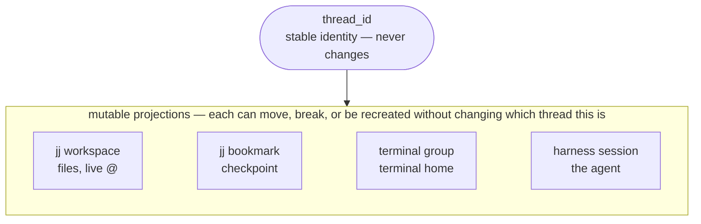
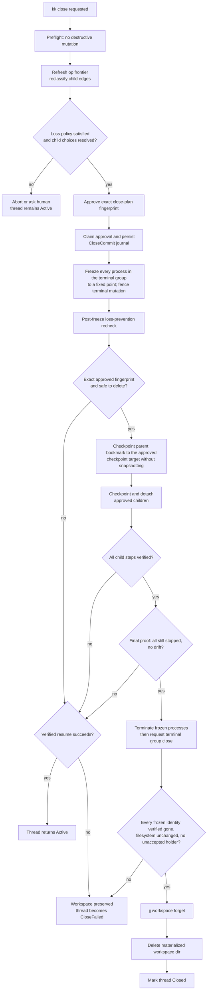
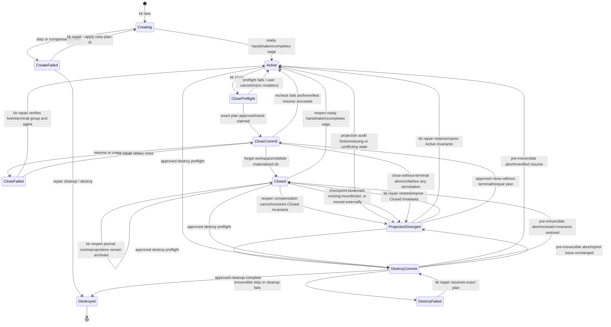

# Threads

A thread is kiki's unit of work. Bookmarks, jj workspaces, terminal groups, and agent processes all hang off that unit.

In this book an unqualified "workspace" is always a jj workspace. The per-thread terminal home is a **terminal group** — one Herdr workspace on kiki's dedicated Herdr server (see [Terminal runtime](13-architecture/terminal-runtime.md)).

## Thread identity

Each thread has a stable sqlite `thread_id`. That id never changes. It is the join key for credentials, audit rows, transcript rows, PR links, lifecycle state, and follows links.

A projection is an external object that stands in for the thread. Mutable projections include:

- jj workspace path — a workspace is a separate jj working copy with its own files
- jj bookmark name — a bookmark is a named pointer to a commit, like a git branch
- terminal group — the thread's Herdr workspace and its role panes, which keep running when no terminal client is attached
- harness session id — the harness is the coding agent (Claude Code or Codex)

An active thread's live head is the exact `@` commit of its managed workspace. In jj, `@` names the working-copy commit — the page you are on right now. Kiki stores the last `@` it observed as `thread_head_commit_id`. That stored value is a cache of a workspace-local fact, not a second source of truth. Every watcher or lifecycle transaction that observes a new `@` updates the cache with the exact jj operation view it was read from.

The thread bookmark has a different job. It is the durable checkpoint kiki uses for publication and for recreating a workspace after close. Think of the bookmark as a bookmark left between pages, while `@` is the page you are reading now. The bookmark is never the live head, and it is never a follows synchronization target. Kiki places it only at an explicit checkpoint:

- successful creation, after the initial working-copy commit is known;
- publish, immediately before pushing;
- close, before forgetting the workspace;
- detach, so the newly independent thread has a reopenable checkpoint;
- an applied bookmark repair plan, whether it restores the expected target or adopts another exact commit.

The two commits are easy to confuse and must not be:

At a checkpoint, kiki does five things in one journaled lifecycle action: it pins one exact operation, reads the exact workspace `@` in that operation, chooses the checkpoint target by the rule below, stores the head as `thread_head_commit_id` and the target as `checkpoint_commit_id` and `bookmark_expected_commit_id`, appends an immutable placement row, and moves the bookmark to that exact target. The bookmark mutation is pinned to that exact operation id and passes `--ignore-working-copy`, so it cannot snapshot the managed working copy. It can still leave two operation heads when some other operation lands at the same moment; the journal that made the placement then owns the first integration of those heads and re-places deterministically instead of raising an issue. `--at-op=@` is not an acceptable substitute: it snapshots, and it fails when operation heads have diverged. Kiki then verifies the resulting bookmark target and operation. It never resolves `@` a second time inside the mutating command.

**The checkpoint target.** The target is the live head, with one exception: when the live head is an empty, undescribed working-copy commit whose parent is on the owned chain, the target is that parent. jj leaves exactly such a commit behind after `jj commit` and creates one whenever a workspace is added, and a bookmark on it would publish or reopen onto nothing. Creation's initial commit has the thread's base as its parent, so its target is the head itself.

**No backward placements.** A checkpoint refuses when its target is neither the expected target nor a descendant of it. That happens when the human has moved `@` to an earlier commit with `jj edit`, or onto another line with `jj new <elsewhere>`: placing the bookmark there would move it backward or sideways and strand the later revisions. Kiki reports the relationship as `ahead` or `diverged` and stops. Moving the bookmark backward or sideways is a separately approved repair plan, never a side effect of close, publish, or detach.

Before a checkpoint that will be followed by deletion or publication — close, detach, publish — preflight takes the **boundary snapshot**: under the thread lock, with the agent quiescent wherever that can be proved, kiki snapshots the managed working copy so that the pinned head contains every tracked edit. The checkpoint itself still never snapshots.

### What happens to the bookmark between checkpoints

jj does not leave a bookmark alone between checkpoints, and kiki does not pretend otherwise. Four different things can happen, and kiki keeps them apart:

| What happened                                                                                                                                           | What jj does to the bookmark                 | What kiki records                                                                                                                   |
| ------------------------------------------------------------------------------------------------------------------------------------------------------- | -------------------------------------------- | ----------------------------------------------------------------------------------------------------------------------------------- |
| **Native successor.** The checkpointed commit is rewritten: a working-copy snapshot, `describe`, a rebase, an ancestor rewrite from another workspace.  | carries the bookmark to the successor commit | advances `bookmark_expected_commit_id`, appends a succession row with the operation's predecessor evidence; no issue                |
| **Head advance.** `jj new` or `jj commit` gives `@` a new revision.                                                                                     | leaves the bookmark where it was             | nothing changes for the bookmark; the relationship stays `current` while the new head is empty and undescribed, then reads `behind` |
| **Explicit placement.** One of the checkpoints listed above.                                                                                            | kiki moves it                                | a new immutable placement row; `checkpoint_commit_id` and `bookmark_expected_commit_id` both become the placed commit               |
| **External movement.** Anything else: `jj bookmark move`, a target with no predecessor evidence, divergent successors, a conflicted bookmark, deletion. | whatever the command did                     | a `BookmarkMoved`, `BookmarkConflicted`, or `BookmarkMissing` projection issue                                                      |
| **Undo.** `jj undo` or an operation restore returns the bookmark to an earlier commit in this placement's own succession history.                       | puts the bookmark back on the earlier commit | pops the expected target back to that commit with a `Reverted` succession row; no issue                                             |

`checkpoint_commit_id` is therefore the commit where kiki last _placed_ the bookmark, kept as history. `bookmark_expected_commit_id` is where kiki expects the bookmark _now_: the placed commit carried forward through every native successor kiki has proved. The projection audit compares the observed bookmark with the expected target, never with the placement.

A native successor is accepted only when all of this holds in one exact operation: the bookmark has a single, unconflicted target; that target records the previous expected commit as a predecessor; the previous expected commit is no longer visible; and the change is not divergent. The conflict test comes first: a conflicted bookmark is `BookmarkConflicted` even when one of its targets is the expected commit. A successor in the same change is always acceptable. A successor in a different change — what `jj split` or squashing the bookmarked commit into its parent produces — is accepted for an active thread only when it is the live head or lies on the validated owned chain. For a closed thread only a same-change successor is accepted, and the archived `thread_head_commit_id` advances with it so the two stay equal. Everything else is external movement. `jj abandon` deletes a bookmark that sat on the abandoned commit; that is `BookmarkMissing`. A `jj bookmark rename` is the one name change kiki normalizes on its own: when one exact operation shows the thread's bookmark name gone and exactly one new local name, used by no other thread, on the expected target, kiki adopts the new name as the thread's bookmark projection and journals the normalization. Any less certain disappearance is `BookmarkMissing`.

Classification runs on every operation, kiki's own included: when a kiki rebase carries a bookmark, kiki records that succession like any other. An open bookmark issue resolves by itself when a later operation shows the bookmark unconflicted on the expected target, and no repair plan ever restores a bookmark onto a commit that is no longer visible.

Status must show the relationship between the expected target and the live head: `current` (equal, or the head is the empty working-copy commit directly above it), `behind` (the head is any other descendant), `ahead` (the head is an ancestor), or `diverged`. These tests need only a single-parent path between the two commits; the stricter owned-stack conditions below apply to rebase and abandon plans. Kiki must not "helpfully" place the bookmark after each jj operation, and tracking a native successor is not a placement: it never moves the bookmark, it only records where jj moved it.

## Creation

`kk new` is a durable creation saga. A saga is a multi-step operation with a journal: like a checklist that survives a power cut, it records each step so a crash never loses track of what was done. `kk new` creates:

- a sqlite thread row
- a jj workspace
- an initial jj working-copy change, plus a bookmark checkpoint at its exact commit
- a terminal group — one Herdr workspace on kiki's dedicated server — rooted in the jj workspace
- an `agent` role pane whose direct child is the kiki pane launcher, which hosts the harness process
- a v1.x `shell` role pane in the same tab, when that UI feature is enabled
- a v1.x optional `ui` role pane, when that UI feature is enabled
- a per-thread hook credential and hook configuration, installed before the harness can run

The saga starts by inserting a `Creating` thread row and a step journal. Every external step and every compensation (undo step) is exactly-once in effect: either the step itself is safe to repeat, or, like terminal provisioning, a journal and a single-claim gate make a repeat harmless. On daemon restart, kiki resumes the journal, or compensates completed steps in reverse order. A failure becomes `CreateFailed`, and the journal and diagnostic are kept. Kiki never reports a failed thread as absent merely because best-effort cleanup ran.

The normative order is:

1. Allocate the stable thread, workspace, and bookmark identities and the terminal `provision_id`. Persist the exact chosen base and any follows anchors.
2. Create the jj workspace at that exact base.
3. Read the new workspace's exact `@` — `jj workspace add` creates the workspace and its initial working-copy commit in one pinned command — and persist it as `thread_head_commit_id`.
4. Create or move the thread bookmark to that exact commit, and persist the checkpoint placement. The bookmark is deliberately created **after** the initial working-copy change, because a bookmark does not follow a later `jj new`. The next working-copy snapshot rewrites that commit and the bookmark follows it; that is native successor tracking, not drift.
5. Issue the thread-scoped credential and install the launch-scoped harness configuration.
6. Run the [orphan scan](13-architecture/terminal-runtime.md#orphans) for the thread's workspace path, then provision the terminal group with the journaled [provisioning protocol](13-architecture/terminal-runtime.md#provisioning). Every role pane's direct child is a pane launcher, started by direct argv with an explicit working directory and environment. Each launcher's report is accepted only after `kkd` verifies its process identity from the OS, and each launcher blocks on its gate. No harness runs yet. A lost reply or a crash here is reconciled from launcher reports and a fresh runtime snapshot; it is never repaired by blindly repeating the create call.
7. Open the launch gate as the last external step. The `agent` launcher cannot start the harness until two transactions have committed: the first accepted exactly one launcher for this provision, recorded its process identity, and marked the terminal binding `Bound`; the second recorded the new incarnation and activated its one-use database-backed gate. The thread stays `Creating` during this. The launcher then creates the harness as its child, held until `kkd` has verified and recorded the child's process identity, and releases it with the already validated settings. The launcher stays alive as the role's supervisor. `kk-hook` reports the ready handshake from the harness's session-start event. `harness_started_at` was recorded when the child was verified; the handshake transaction re-reads the launcher's identity and the server instance, records readiness, completes the saga, and promotes the thread to `Active`. A start or handshake failure becomes `CreateFailed`. If kiki crashes while the authorized process exists but before the handshake, the recorded process identities let restart recovery adopt or terminate exactly that process. Recovery never infers success from an activated gate, a Herdr reply, or a visible pane.

If a step fails, kiki records the error before attempting reverse-order compensation. Automatic compensation may close the provisioned group and remove the new workspace only while the launch gate was never activated, `ProcessSupervisor` shows the group holds nothing but kiki's own blocked launchers, and the workspace still equals its initial materialization. Once a harness may have run, or the human has opened a pane in the visible `Creating` group, the saga stops in `CreateFailed` with every projection intact, and cleanup is the approved `cleanup-failed-create` repair plan, which uses the close machinery. A failed reopen's counterpart is `cleanup-failed-reopen`. `kk repair` may retry or finish cleanup from the recorded step. It never infers completion from the mere presence or absence of one projection.

When run inside an existing thread, `kk new` follows the current thread by default. `--no-follow` suppresses that default. `--follows <parent>` selects an explicit parent.

Successful creation leaves all required v1 projections and an `Active` row. Unsuccessful creation leaves a recoverable `CreateFailed` row, even when compensation removed every external projection. This is a saga guarantee, not cross-system atomicity.

`kk new` without a name may derive a placeholder from the initial prompt. The placeholder is kiki-owned metadata and follows the metadata ownership rules.

`kk new --harness <name>` selects the harness for the thread. v1 accepts `claude-code` and `codex`. Unsupported harness names error clearly.

The follows graph is a DAG — a graph with no cycles. kiki rejects a follows edge that would introduce a cycle.

Creating a thread records its exact owned-stack base. Creating a follows edge additionally records the parent's exact `thread_head_commit_id`, used as the child's initial synchronized base. The owned-stack base stays on the thread when a follows edge is detached. It advances only when a completed reconciliation records a new synchronized base. Those anchors let later op-view classification tell three cases apart: jj-native successor evolution, a new live parent head that requires an explicit advance, and out-of-band topology divergence. Bookmark names remain handles, not synchronization targets: every reconciliation pins exact commit and operation ids before it starts.

### V1 owned-stack contract

An owned stack is strictly the single-parent linear chain that runs from just after the exact synchronized base through the thread's exact live head. Immediately before an explicit parent advance, kiki proves all of the following:

- the recorded base is an ancestor of the live head;
- exactly one child of that base sits on the path to the head;
- every revision on the path has exactly one parent and one successor on the path, except at the two ends;
- every descendant outside the path is accounted for by a valid registered follows child and its own linear chain.

Merge commits, multiple candidate roots, conflicts, or descendants outside the registered follows graph make the topology ambiguous. Kiki records `TopologyDiverged`. It does not synthesize an owned revset (a jj expression selecting a set of revisions) and does not attempt a rebase. The rebase source is the exact validated chain, never an open-ended descendants revset.

V1 ownership is deliberately structural: every revision on that exact validated chain is part of the thread's owned stack. Kiki does not persist or infer a separate “root change” identity. An external linear insertion on the path is therefore included. A user who does not want later follows reconciliation to move that chain must detach before introducing such topology. Split, squash, and abandon need no root-membership update; they either leave one valid chain or make validation stop loud.

Users may spawn any number of sibling threads. v1 does not rate-limit human-created threads.

## Workspace layout

Each thread's jj workspace lives on disk as a sibling of the registered repo. The default path is `<parent>/<repo>-kiki-<slug>/`, where `<parent>` is the directory containing the repo, `<repo>` is the repo's directory name, and `<slug>` is the thread's bookmark slug. So a thread `cascade-recovery` in `~/code/kiki` materializes at `~/code/kiki-kiki-cascade-recovery/`.

You can override this default via `[paths] workspaces_root` (see [Configuration](11-configuration.md)). When set, kiki uses `<workspaces_root>/<repo>-kiki-<slug>/`.

Sibling-of-repo is the default for two reasons. It matches jj's natural `jj workspace add ../<name>` ergonomics. And it keeps the workspace discoverable next to the repo without nesting one working copy inside another.

The per-thread hook credential lives at `~/.config/kiki/repos/<repo_id>/credentials/<thread_id>` (mode `0600`). Launch-scoped harness settings live under `~/.config/kiki/repos/<repo_id>/harness/<thread_id>/` — Claude Code's generated settings file or Codex's generated `CODEX_HOME`. If the Claude Code adapter cannot use isolated launch settings, it may merge a hash-owned fragment into `<workspace>/.claude/settings.local.json`, storing the prior bytes and restoration metadata outside the workspace. It never writes tracked `<workspace>/.claude/settings.json`. The Codex adapter never writes anything under `<workspace>/.codex/`. Per-thread client error logs live at `~/.config/kiki/repos/<repo_id>/errors/<thread_id>.log`.

## Workspace isolation

Per-thread workspaces prevent accidental file interference during normal cooperative use. They do not prevent a same-UID process from reading or writing sibling workspaces, `~/.config/kiki`, or shared jj repository state.

All workspaces share jj repository state. So a rewrite of an ancestor commit in one workspace may immediately evolve another thread's recorded working-copy commit, while that other workspace's files stay stale. This is expected. Kiki surfaces the thread as cascade-pending. After probing for unsnapshotted edits, it materializes the thread's current evolved jj state at the managed agent's next safe boundary; see [Cascade](05-cascade.md).

## Detach checkpoint

`kk thread detach` makes a following thread independent. It is a journaled checkpoint operation, not a bare edge deletion. Under the thread's reconciliation lock it:

1. synchronously advances the repository watcher to the complete current operation-head frontier and pins the resulting view;
2. compares the parent's exact head in that view with the edge's last synchronized base, and creates any missing reconciliation intent;
3. requires every resulting or already-pending transition to be reconciled or explicitly discarded, with the required one-shot approval;
4. takes the boundary snapshot under the same rule as close preflight, reads the child's exact live head from the resulting pinned view, validates the single-parent path from its base, and checkpoints its bookmark to the checkpoint target for that head without snapshotting the working copy;
5. deletes the follows edge only after the checkpoint is verified, while keeping the child's exact owned-stack base anchor for later status, reopen, and destroy safety.

The checkpoint and the edge deletion are separate effects — one external, one in the database — so the lifecycle journal makes both idempotent. If kiki crashes after the bookmark move but before the edge deletion, recovery retries the exact same checkpoint and then removes the edge. It never assumes that the absence of a pending intent proves the watcher had caught up.

## Close

`kk close` archives a thread without deleting tracked jj work.

Close runs in two journaled phases:

1. Preflight performs no destructive mutation. It synchronously advances the op-watcher frontier to the repo's current operation heads. It reclassifies every follows child from that pinned view. It waits for selected reconciliations to complete, or records explicit discard choices in the proposed plan. It requires agent quiescence where the harness adapter can prove it: if the agent is working, preflight says so and stops, and the human waits or interrupts the agent in its pane. For a harness version that cannot prove quiescence, preflight proceeds and warns that a working agent will make the approval drift. It takes the boundary snapshot. It inventories loss-sensitive files, every process in the terminal group, and every other holder of the workspace. It then produces the exact close-plan fingerprint that is presented for one-shot approval.
2. Commit freezes (pauses) every process in the terminal group and establishes the process quiescence proof. It repeats the frontier refresh and the loss-prevention checks against the frozen workspace. It checkpoints the parent bookmark to the exact approved head. It performs every approved child checkpoint/detach. After the final proof and all child work succeed, kiki itself terminates the frozen processes while they are still stopped and verifies their exit, asks the runtime to close the terminal group, and rechecks the filesystem. Only then does it forget the jj workspace (remove jj's record of it), delete the materialized workspace directory, and mark the thread closed.

Entering `CloseCommit` atomically claims the approval and creates a durable lifecycle-operation record containing the approved plan fingerprint — before any process is frozen. The fingerprint covers the exact thread head, the operation evidence relevant to this thread and its child edges, the workspace inventory and byte fingerprint, the process and holder inventory with any holders the human accepts by name, the expected projections, the child-edge decisions, the checkpoint target, and the security-relevant flags. Unrelated operations elsewhere in the repo do not invalidate the fingerprint merely because the global frontier changed; the synchronous refresh determines whether they changed any plan input.

Freezing covers every process in the terminal group, not just the agent pane's foreground process group, and it covers `user` panes and tabs the same as role panes. The proof belongs to `ProcessSupervisor`, which reads the OS; the terminal runtime contributes only the list of pane root processes, and its replies prove nothing. The supervisor records every pane root and every process identity kiki recorded for the binding, as `(pid, start_time, session_id, process_group_id)`, and records each process's prior stop state before signalling it. It stops the known members, then repeatedly discovers and stops new descendants, session members, and process-group members. Discovery may grow the set on every round; the proof holds only when two consecutive complete samples are identical and every member is observed stopped. Kiki then enumerates same-UID processes whose cwd, root, mapped file, or open file descriptor refers to the workspace; any holder outside the proven-frozen set makes quiescence `Unknown`. A filesystem watch is armed and stays armed through the checkpoint and the child work.

The terminal server is itself a parent that can start a new process in the group at any moment — a user splitting a pane is enough. Kiki therefore fences terminal mutation for the duration: where the runtime offers a mutation fence it is used; otherwise kiki records the group's pane and tab set with the frozen set and treats any change as drift. Any filesystem event, fingerprint drift, membership change, new holder, or terminal change found by the post-freeze recheck or by the final proof takes the verified-resume path. A process that detaches from every tracked relationship and acquires the workspace only after those proofs is outside the documented cooperative, non-security guarantee. A supervisor that cannot enumerate identities and open holders, reach a fixed point, or prove stopped state returns `Unknown` and may not delete the workspace. The full algorithm is in [Terminal runtime · Process supervision](13-architecture/terminal-runtime.md#process-supervision).

The post-freeze recheck binds its decision to the exact approved fingerprint. “Still safe, but different” is approval drift, not permission to improvise. On drift, kiki resumes the processes that were running before the freeze, leaves processes that were already stopped untouched, verifies that every member still has its recorded identity, that the terminal group still has its bound role panes, and that the agent launcher answers, returns to `Active`, and presents a fresh plan for a new approval. An unsafe or indeterminate recheck follows the same verified-resume path. If resume fails, or kiki cannot prove restoration, the workspace remains present and the lifecycle becomes `CloseFailed`. A dead or partially resumed terminal group must never be labeled `Active`. A later `kk repair` can retry resume, restart the terminal group and agent with explicit approval, or retry close from the journal.

After the exact post-freeze recheck succeeds, kiki records it and checkpoints the parent bookmark to the approved checkpoint target using the non-snapshotting exact-commit mechanism. On entering `Closed`, the archived `thread_head_commit_id` is that target, so the two are equal. While the parent stays frozen, each automatic child checkpoint/detach applies the approved result of the synchronous protocol in [Detach checkpoint](#detach-checkpoint) and verifies the edge deletion. Kiki then runs the **final proof**, immediately before the first step that cannot be resumed from: process membership, the armed filesystem generation, the workspace fingerprint, the external-holder set, and the terminal group's pane set. The final proof also re-asserts that every member is still stopped, confirms from a fresh observation that each listed terminal container still holds the launcher or the exact processes the plan recorded for it, and journals the filesystem generation and fingerprint it saw.

Only after every child step and that final proof succeed does kiki end the frozen processes, and it does so itself. A stopped process cannot act on a hangup, and a hangup can wake it; a process that woke with a handler could write after the final proof. So kiki takes each frozen identity in turn, confirms it is still stopped and still the recorded process, kills it, and verifies it is gone. It then asks the runtime to close the terminal group. That request is cleanup, and its reply is a request acknowledgement, not an outcome.

The approval covers every process in the terminal group at freeze time, and the rendered plan says so beside the preflight inventory; a process that joined the group after preflight is covered, not drift.

Last, the post-exit filesystem recheck confirms that the workspace's generation and fingerprint still equal the values the final proof journaled, and the holder scan runs once more. Kiki forgets the jj workspace and deletes its directory only after every frozen identity is verified gone, the recheck matches, and no holder remains other than those the approved plan accepted by name. Otherwise the files stay and the lifecycle becomes `CloseFailed`.

A child checkpoint/detach failure happens before the terminal group is closed. Kiki compensates already-deleted edges only when their exact pre-detach topology is still restorable. It resumes the parent's prior process states, and it returns `Active` only after proving both restoration and a usable terminal group with a responsive agent launcher. If an edge cannot be restored exactly, or resume cannot be proved, the parent remains frozen with its workspace present and becomes `CloseFailed`; it is never left dead. A failure after termination has begun — while verifying exit, requesting the group close, rechecking the files, forgetting, or deleting — likewise becomes `CloseFailed`, with completed steps recorded and remaining data preserved where possible. On daemon restart, `CloseCommit` recovery consults the journal. Before a valid final proof, it attempts a verified resume. After a valid final proof, it revalidates the frozen process set, the approved fingerprint, and the child-step journal, or stops in `CloseFailed`. After termination has begun, it re-runs exit verification, re-reads the workspace fingerprint against the journaled value — the filesystem watch does not survive a crash — and then completes the idempotent forget/delete sequence. A crash in the middle of a freeze is recovered from the write-ahead process rows: every process kiki stopped is on record and is resumed. If the terminal server itself restarted while the thread was in `CloseCommit`, the frozen set is checked against the OS by recorded identity, never against the restored layout. Recovery never guesses `Active` from a leftover directory or a visible pane.

Launch-scoped harness settings — including a Codex thread's generated `CODEX_HOME` — live outside the workspace and cannot block close by themselves. If the Claude Code adapter had to merge kiki's fragment into `<workspace>/.claude/settings.local.json`, close may remove or restore only that hash-owned fragment. A file changed since installation is user territory and stops for repair. Kiki never writes or allowlists tracked `<workspace>/.claude/settings.json`, and it never touches `<workspace>/.codex/`. The hook credential and the per-thread error log live under `~/.config/kiki/repos/<repo_id>/` and are revoked or removed independently. User-created untracked or ignored files that would be deleted still require explicit handling.

Plain `kk close` leaves any open PR untouched. `kk close --discard-pr` is the explicit PR-closing path.

Children of a closed thread auto-detach, with notification. Close may not rely on the current intent table alone. Preflight and the post-freeze recheck synchronously process the complete current op frontier, compare the parent's exact live head with every edge's last synchronized base, and create any missing intent before deciding that an edge has no pending transition. Every resulting transition must be reconciled or explicitly discarded as part of the approved plan. Auto-detach must not silently erase a parent change merely because watcher delivery lag had not recorded it yet.

Close is intentionally boring. You should be able to close a thread confident that tracked work survives and that local junk is not silently swept away.

After the frozen-workspace proof succeeds, close removes the entire terminal group. Every pane goes with it — the agent pane, the shell pane, the optional `ui` pane, and any extra panes or tabs the user added to the group. Any process running in the shell pane (a long test, a `tail -f`, a debugger) dies alongside the agent. Long-running work that needs to outlive `kk close` belongs outside the thread's terminal group.

A `kk close` typed inside the group it closes is itself a member of the frozen set. That is safe: the approval was claimed and the journal written before the freeze, and the daemon needs nothing more from that process. On an aborted close it resumes with everything else and reports the outcome; on a completed close it ends with the group, and `kk ls` and the journal carry the result.

After close, when `kk close` ran outside the closed group, the invoking client moves to the parent thread's terminal group when that thread is `Active` with a bound terminal group, through the same caller-local navigation as `kk switch`. Other attached clients that were viewing the closed group land wherever Herdr places them; kiki does not steer them.

## Lifecycle states

## Projection divergence and repair

`ProjectionDiverged` is the repair-required lifecycle state for a thread whose durable identity disagrees with one or more external projections. Projection audits run at daemon boot, at every `kk ls`, before `kk switch` or a lifecycle operation, after relevant jj or filesystem events, and after every terminal-runtime resync — a reconnect, a reported event loss, or a changed server instance. V1 records at least these reasons, each with expected and observed values:

| Reason                      | Default treatment                                                                                                                                                                                                                                   |
| --------------------------- | --------------------------------------------------------------------------------------------------------------------------------------------------------------------------------------------------------------------------------------------------- |
| `WorkspaceDirectoryMissing` | require `kk repair` to recreate from the checkpoint, adopt a moved directory, or destroy                                                                                                                                                            |
| `WorkspaceRecordMissing`    | require a choice to recreate the jj workspace record or adopt the external removal                                                                                                                                                                  |
| `WorkspacePathMismatch`     | auto-correct only when the stable jj workspace id uniquely identifies the same filesystem object; otherwise require a choice                                                                                                                        |
| `BookmarkMissing`           | require a choice to recreate it at the expected target or adopt another exact commit                                                                                                                                                                |
| `BookmarkMoved`             | the bookmark changed target without native-successor evidence; require a choice to restore the expected target or adopt the observed one                                                                                                            |
| `BookmarkConflicted`        | the bookmark has several targets, usually from divergent successors; require a choice of one exact commit                                                                                                                                           |
| `TerminalMissing`           | the server instance, the terminal group, or the agent role is gone or unproven; require a choice to restart the terminal group and agent, complete a safe close, or, once `kk thread destroy` ships, destroy; never silently claim an agent is live |
| `OrphanedProcess`           | a recorded process identity is alive without a current binding, or a harness remnant survives under the `agent` launcher; block replacement, materialization, and deletion until an approved terminate-and-verify plan resolves it                  |

`TerminalMissing` is about the terminal, not the harness. A harness that exits while its `agent` launcher is alive retires that incarnation and shows the agent as `blocked`; the thread's lifecycle does not change, and a replacement incarnation starts on the same launcher through a fresh gate, either because the cascade's delivery protocol requires one or because the human applies the `restart-agent` repair plan. A replacement's gate opens only when an inventory rooted at the launcher shows no process left over from the retired harness. `TerminalMissing` is raised only when the launcher, its binding, or its server instance is gone.

Automatic repair is limited to identity-preserving normalization with exactly one possible result — for example, replacing a stale lexical path with the canonical path of the same uniquely identified workspace. Kiki does not recreate, move, or adopt revisions merely because one outcome looks likely. Every human resolution is written to the projection-issue row and the lifecycle journal before the thread returns to `Active`.

Projection health gates only the operations that depend on the broken projection; it does not erase still-provable facts. When the stable jj workspace id and canonical path still identify exactly one workspace, kiki keeps observing its `@`, keeps updating `thread_head_commit_id`, and keeps classifying that thread as a follows parent — even if its bookmark is missing, conflicted, or moved, or its terminal group is missing. A workspace holder that kiki never recorded — an editor, a file watcher — is not a projection issue and never blocks an `Active` thread; it matters only to an operation that deletes the workspace, where the plan must name it as accepted or the result is `Unknown`. A thread with `TerminalMissing` or `OrphanedProcess` cannot admit agent boundaries or materialize files, but its unambiguous repository head remains observable. A missing workspace directory or record, or an ambiguous path mismatch, disables head observation and all workspace mutation until repair. This per-issue capability rule prevents an unrelated bookmark problem from silently freezing the follows graph.

The issue preserves whether the coherent prior lifecycle was `Active` or `Closed`. A repair returns to that state only after proving its invariants. Repair adoption is constrained:

- For an active thread, an observed bookmark target may be adopted as the checkpoint only when it is the live head or an ancestor on the validated owned chain. Adoption is an explicit placement: it appends a placement row and resets the expected target. A sideways or ahead target is topology repair, not projection normalization, and requires a separately approved revision plan.
- For a closed thread, adopting an observed bookmark target must validate the retained linear owned chain and every follows child, then update `checkpoint_commit_id`, `bookmark_expected_commit_id`, and the archived `thread_head_commit_id` to that exact commit. An unrelated target is not adoptable through the simple bookmark plan.
- `TerminalMissing` may use an approved `close-without-terminal` repair. Its preflight runs the orphan scan, which must find no surviving recorded process, lists every remnant or unbound container whose processes hold the workspace together with those processes, and performs the same boundary-free workspace loss inventory and exact checkpoint plan as ordinary close. Claiming the approval transitions directly from `ProjectionDiverged` to `CloseCommit`. As journaled `CloseCommit` steps, kiki then freezes each listed container, rechecks, terminates its processes with verified exit, requests its close, and rescans holders; then it completes the checkpoint, child steps, final proof, post-exit recheck, forget, and delete as ordinary close does. Drift found before any termination aborts back to `ProjectionDiverged` with nothing changed. Otherwise repair must restart the terminal group and verify a ready incarnation before returning `Active`.
- A terminal restart is the approved, journaled `restart-terminal` plan: a new `provision_id`, a rotated credential, regenerated launch settings, a new gate, and a new ready handshake. It never reuses or adopts a container the runtime restored, a recurring id, or a label. It runs the orphan scan first and stops if a survivor is found. It lists every remnant or unbound container whose processes hold the workspace, with those processes, for approval; disposes of each through freeze, termination with verified exit, and a close request; rescans holders, stopping on any holder the plan did not accept by name; and only then provisions a fresh terminal group.
- `OrphanedProcess` resolves only by an approved plan that terminates the exact recorded process identities and verifies their exit. Kiki does not signal a process whose identity it did not record.
- A harness that crashed under a live launcher is restored by the `restart-agent` plan: a replacement incarnation on the same launcher, through a fresh gate, with the saved payload delivered first when a cascade intent is pending. It is an ordinary same-thread operation and needs no approval in that thread's context.

Lifecycle sagas own their expected temporary projection differences. An unexpected mismatch during `Creating`, `CloseCommit`, or an in-progress reopen is first attached to that lifecycle journal and fails it; kiki does not invent a `projection_resume_lifecycle` for a transitional state. A failed creation becomes `CreateFailed` and a failed close becomes `CloseFailed`; neither becomes `ProjectionDiverged`. A reopen is different because the thread was coherently `Closed` when it began: if compensation restores the closed projections the thread stays `Closed`, and if it cannot, kiki records the unresolved projection issue with `Closed` as its resume target and enters `ProjectionDiverged`. The former missing-directory-only `Orphaned` case is represented by `ProjectionDiverged { reason: WorkspaceDirectoryMissing }`.

A projection-diverged active thread cannot enter ordinary close until repair establishes a coherent workspace and process state; the approved `close-without-terminal` plan above is the explicit exception. Destroy remains available only when its stricter preflight below succeeds.

## Reopen

`kk reopen <thread>` is a durable saga that restores a closed thread. Like creation, it does not claim cross-system atomicity. The thread stays `Closed` while its `Reopen` lifecycle operation is in progress, and operational listings surface that in-progress journal even though ordinary closed rows are hidden. The approved plan pins the exact expected bookmark target, workspace identity/path, harness, settings strategy, and initial catch-up choice.

The normative order is:

1. Refresh the complete operation frontier. Verify the bookmark names exactly `bookmark_expected_commit_id`, the placement carried through its proven native successors. Create the claimed `Reopen` journal while the thread remains `Closed`.
2. Recreate the jj workspace on that exact commit. jj gives the new workspace a fresh, empty working-copy commit whose parent is the checkpoint; persist that `@` as the candidate live head. A reopened thread therefore reads `current` until it gains content.
3. Reissue the thread-scoped credential and reinstall the isolated per-thread hook configuration.
4. Run the orphan scan, then provision a new terminal group and the enabled role panes with the same journaled protocol as creation, without starting the harness.
5. As in creation, accept the blocked `agent` launcher and mark the binding `Bound` in one transaction, then record the new incarnation and activate its gate in a second, while the thread remains `Closed`. Require the same settings-bound ready handshake as creation.
6. In the ready-handshake transaction, record readiness and the exact live head, complete the reopen journal, and transition `Closed → Active`.

Every step is exactly-once in effect and records the stable external identity needed to recognize or compensate it after restart. A daemon restart resumes the exact journal. If a step or handshake fails, reverse compensation removes only reopen-created projections and revokes the new credential, within the same limits as creation: once the gate was activated or the group holds anything but kiki's blocked launchers, kiki stops and leaves cleanup to an approved plan. The thread remains `Closed` only if compensation proves the original closed invariants: no workspace, no terminal group, no surviving recorded process, and the bookmark still on its expected target. If that proof fails, the journal records the mismatch and the thread becomes `ProjectionDiverged` with `Closed` as its repair target. It is never mislabeled as an ordinary archive or a live thread.

When the v1.x transcript feature ships, `kk reopen --catch-up` may preview and compose a short message from non-synthesized rows, after the user has opted into provider egress. The catch-up is recorded as kiki-authored synthesized content. It is stored locally, but it may be sent to the configured model provider, and it must not be described as local-only execution.

## Destroy

`kk thread destroy <thread>` is an approved, journaled destruction of kiki's thread record and local projections. By default it preserves every jj revision. Deleting the local bookmark, workspace, transcript, and thread identity is still consequential, but “destroy thread” is not implicit permission to abandon history.

Before this deferred command ships, the lifecycle schema and shared vocabulary must include `DestroyCommit` and `DestroyFailed` as shown above. Claiming an approved plan enters `DestroyCommit`. A drift or failure before the first irreversible step — terminating processes, or bookmark deletion when there is nothing to terminate — may cancel only after restoring and verifying the prior `Active`, `Closed`, or `ProjectionDiverged` invariants. Any failure after the first irreversible step enters `DestroyFailed`. From there, repair may only finish that exact plan, or use explicit jj operation recovery where applicable; it may not relabel the thread `Active` or `Closed`. This required migration prevents a partially destroyed thread from hiding behind an unrelated existing lifecycle state.

Preflight first refreshes the complete operation frontier. It then pins into the approval digest: the thread's retained owned-stack base, exact head, checkpoint, expected bookmark target, bookmark, workspace and terminal projections, follows edges, descendants, PR link, unresolved recovery data, and whether revision abandonment was requested. Destroy always refuses while the thread has a follows child or an unresolved sync/recovery intent; the user must reconcile and detach children first. A transitional `Creating` thread, or failed-creation cleanup, uses its lifecycle compensation plan instead of pretending a complete owned stack exists.

`--abandon-revisions` is a separate destructive mode with a separately approved exact-chain plan. It is available only when every revision after the retained owned-stack base through the pinned head forms the validated single-parent chain, and no registered or foreign descendant exists outside that set. The flag never expands to descendants dynamically. Without it, non-linear or shared revision topology does not authorize history rewriting, and all revisions remain in jj.

Active destroy uses the same proven process quiescence and workspace inventory machinery as close. The approval explicitly authorizes deletion of the named workspace paths; an omitted untracked path remains protected. When `--abandon-revisions` is present, the approval additionally names every tracked revision authorized for abandonment. Kiki then, in journaled order:

1. freezes an active terminal group, and every listed remnant or unbound container, and runs the post-freeze recheck against the approved digest;
2. runs the final proof, terminates the frozen processes with verified exit, requests the close of each container, and runs the post-exit filesystem recheck — the same order as close, and all of it before any jj mutation;
3. deletes the local thread bookmark by name — bookmarks are deleted, not “abandoned”;
4. only with `--abandon-revisions`, abandons exactly the separately approved revision ids, without a descendants selector, and verifies the resulting operation;
5. forgets and deletes the workspace projections and revokes credentials;
6. tombstones the thread row and deletes transcript rows unless `--keep-log` was approved.

Digest drift found before any process is terminated resumes the original active terminal group and requires a fresh approval. Terminating processes is destroy's first irreversible step: a failure at or after it, including after bookmark deletion or an optional destructive jj step, becomes a repairable failed lifecycle operation. It never returns to `Active` or `Closed` by inference. Remote bookmarks and PRs are untouched — changing them is a separate externally visible plan. Loss-safety bundles under the repo's centralized `recovery/` directory are not deleted automatically; destroy prints their paths so the user can handle them manually.

`--keep-log` retains transcript rows for explicit destroyed-thread views.
