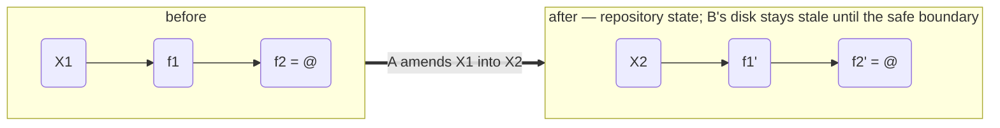
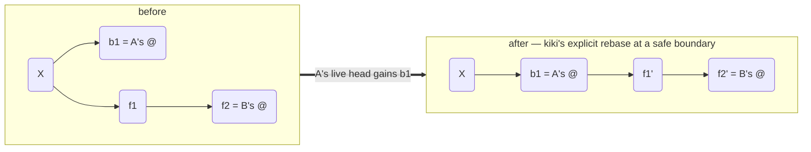
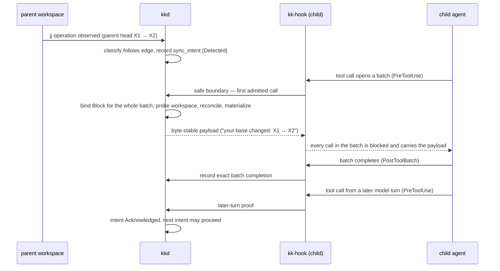

# Cascade

Cascade is the safety-critical feature of v1. Here is the problem it solves. A child thread follows a parent thread. When the parent's base changes, the child must catch up. (A thread's base is the parent commit its work sits on.) But the child's workspace has a managed coding agent working in it. That agent must never look up and see new files with no explanation. Cascade moves the child onto the new base and explains the change to the agent.

The design splits responsibility the way jj already does. jj — the jujutsu version control system — owns how revisions evolve in repository state. kiki owns the follows intent (which thread follows which), safe workspace reconciliation, recovery, and agent context.

Every cascade is a base transition: a move from the last synchronized parent commit to a new exact parent commit. There are two kinds:

- **`NativeRewrite`** — jj has already evolved the child's repository history, so the new parent base is an ancestor of the child's current repository commit. kiki must not rebase it again. Instead, kiki reconciles the on-disk workspace to jj's current view, at a safe boundary — a moment when the child's agent is not mid-edit.
- **`ParentAdvance`** — the new parent base is not already an ancestor of the child. jj cannot infer kiki's follows relationship from revision topology alone. So kiki explicitly rebases the child's owned stack onto that exact parent commit, at a safe boundary.

In pictures: parent thread A sits at a base commit, and child thread B follows it with owned commits f1 and f2. `NativeRewrite` first: jj has already evolved B's commits in repository state, and only B's on-disk files are stale.

`ParentAdvance`: nothing in revision topology says B should follow A's new commit, so kiki rebases B's owned stack explicitly.

The intent pins the base transition. It does not pin the child's working-copy commit. A child commit is a volatile outcome: agent edits and ordinary jj snapshots can change it without changing whether the follows base is synchronized.

## Invariant

kiki does not reconcile evolved state in a managed workspace while that workspace's managed agent is mid-edit. It does not perform an explicit follows rebase there mid-edit either. Think of the safe boundary as waiting for someone to finish their sentence before handing them a note.

Repository state may evolve earlier than that. When a rewrite of an ancestor happens in workspace A, jj can immediately evolve workspace B's working-copy commit in the shared repository. (The working-copy commit, written `@`, is the commit jj keeps in sync with the files on disk.) That leaves B's files stale. The invariant governs when kiki changes B's files and agent context. It does not govern when jj records successor commits.

A direct human `jj` command is an explicit escape hatch. It may reconcile a stale workspace before kiki's boundary. It may do so without creating a new repository operation. So kiki discovers actual workspace freshness at the next managed boundary. It does not pretend every materialization — every actual change to on-disk files — shows up in the op log, jj's record of repository operations.

## Classification

kiki's op-log watcher classifies repository transitions by comparing the repository view before and after each operation. It does not classify by command name. For each follows edge it compares:

- the edge's last synchronized parent commit;
- the parent workspace's exact `@` before and after the operation, with the result persisted as `thread_head_commit_id`;
- whether the new exact parent head is an ancestor of the child's repository commit after the operation;
- whether relevant bookmarks, changes, or operation heads are conflicted or divergent.

The result is one of:

- `NativeRewrite { from_base, to_base, trigger_op }` when the parent head changed and `to_base` is already an ancestor of the child;
- `ParentAdvance { from_base, to_base, trigger_op }` when the parent head changed and `to_base` is not yet an ancestor of the child;
- `AlreadyAligned` when no reconciliation remains;
- `TopologyDiverged { reason }` when the parent moved backward, when the follows anchors no longer describe the real topology, or when the relevant jj state is conflicted or ambiguous.

Change ids correlate rewritten parent revisions. Commit ids pin the exact base transition. Classification never consults the bookmark. kiki must not resolve "whatever the parent workspace or checkpoint points to later" as the destination of an older intent.

The same rule applies when a follows edge is first created. `thread_head_commit_id` is a cache, so creation does not trust it. Instead, creation pins a fresh jj operation view, reads the parent workspace's actual `@` from that view, updates the parent's cached head, and uses that exact commit as both the child's base and the edge's initial synchronized-parent anchor. All of that happens in one journaled step. kiki never bases a child on a possibly lagging watcher observation.

## Coalescing and multi-hop evolution

An intent in `Detected` may absorb later compatible parent transitions. Absorbing means three things: replace `to_base` with the newest exact base, reclassify the intent's kind against current ancestry, and record every contributing operation. Once reconciliation starts, absorption stops. Later transitions create a new intent instead of changing the in-flight target.

Repository evolution is not forced to proceed one follows edge at a time. Take a chain A→B→C. A single jj rewrite may logically evolve both B and C. kiki records one base-transition intent for each affected follows edge. Each workspace then reconciles independently, at its own safe boundary.

An explicit `ParentAdvance` on B may cause jj to evolve C. In that case, the initiating handler compares its starting and result operation views and records C's resulting `NativeRewrite` itself. The watcher does not classify that attributed operation a second time.

## Synchronization intent: the sole protocol authority

Each reconciliation is one durable row in `sync_intents`. The row holds:

- `intent_id`, `thread_id`, and a monotonic per-thread `seq`;
- `kind: NativeRewrite | ParentAdvance`;
- `from_base_commit` and the exact `to_base_commit`;
- `classification_op_id`, naming the exact repository view used for the latest classification, plus normalized trigger-operation rows;
- `state: Detected | Reconciling | Materialized | Delivered | Acknowledged | RecoveryRequired | TopologyDiverged | Superseded`;
- optional planned and result operation ids, plus the actual result workspace commit;
- embedded outbox fields: the byte-stable payload, a pinned transcript anchor, preparation/delivery/acknowledgement timestamps, a transcript row id, `delivery_mode: SoftBatch | RestartStartup`, that mode's exact proof fields, and the durable delivery-attempt history with its optional exhaustion timestamp;
- optional recovery metadata naming preserved files or divergent commits.

The intent row is the only authority for cascade progress and delivery. There are no mirrored pending/materialized/acknowledged counters. There is no separate context queue. There is no separate cascade-outbox table. The thread's three-valued UI status is derived from all unresolved intents, and blocking state takes precedence:

- any `RecoveryRequired | TopologyDiverged` intent, or any intent whose delivery attempts are exhausted → `conflicted`;
- otherwise, any `Detected | Reconciling | Materialized | Delivered` intent → `pending`;
- no unresolved intent → `in sync`.

Each **runtime agent incarnation** — one running agent process — carries only `delivered_intent_id`. That field identifies the intent most recently emitted to that process and not yet acknowledged. The incarnation row has its own kiki UUID. The harness conversation/session id is a separate field, because `--resume` may reuse it. The active intent embeds the durable delivery proof. A `SoftBatch` proof names the runtime incarnation, model turn, tool batch, binding time, and an optional exact batch-completion time. A `RestartStartup` proof names the replacement incarnation and a kiki-minted one-use `startup_delivery_id`. The harness must causally echo that id on the first model turn generated from that startup input.

In-memory batch admission is only an optimization. A durable `Block` can be reconstructed from the intent. A lost `PassThrough` admission is not guessed or reconstructed. Instead, the adapter restarts the incarnation before permitting any reconciliation decision that could mutate the workspace. Starting any replacement process retires the prior marker without acknowledging the intent. When a payload is pending, the replacement receives it through `RestartStartup` before any tool is allowed to run.

## Reconciliation lock and ordering

Each thread has an in-memory reconciliation lock owned by `CascadeOrchestrator`. Concretely, it is a `tokio::sync::Mutex` keyed by `thread_id`. Crash recovery comes from the durable intent state, not from the mutex.

Intents reconcile in sequence order. The lock serializes concurrent hook decisions and recovery for one thread. The op-log watcher may update only a `Detected` intent. After an intent enters `Reconciling`, newer work gets a later sequence number.

## Workspace probe

Before changing any files, kiki runs a workspace probe. The probe is read-only: it must not materialize anything. It checks the follows edge's last synchronized base, jj's recorded working-copy state, and the current filesystem. It returns a fingerprint plus one of:

- `FreshClean` — the workspace is already reconciled and has no unsnapshotted edits. This includes the case where a human updated it directly.
- `FreshDirty` — the base is already reconciled, but the filesystem has unsnapshotted edits (changes jj has not yet recorded in a snapshot).
- `StaleClean` — jj's repository view evolved, but the on-disk workspace has no unsnapshotted tracked changes relative to its last checked-out state.
- `StaleDirty` — the workspace is stale and also contains unsnapshotted changes.
- `Unknown` — the CLI backend cannot prove any of the preceding states without mutating the workspace.

The fingerprint covers the path inventory and the byte hashes used to classify edits. kiki rechecks the fingerprint immediately before mutation. If it drifted, kiki aborts to recovery. The `JjCli` proof of concept must demonstrate a lossless implementation. If it cannot distinguish a clean state from a dirty one without mutation, v1 must return `Unknown`. Optimistic materialization is not permitted.

## `NativeRewrite` reconciliation

At the child's safe boundary:

1. Claim the reconciliation lock. Load the oldest intent. Transition it `Detected → Reconciling`.
2. Revalidate the exact base transition against current repository ancestry. A compatible newer transition may supersede this intent. Ambiguity becomes `TopologyDiverged`.
3. Run the non-materializing workspace probe.
4. For `FreshClean | FreshDirty`: verify actual ancestry, then continue to result persistence without rewriting files. Once the base was already materialized, a `NativeRewrite` does not need to disturb later edits.
5. For `StaleClean`: run `jj workspace update-stale`, then verify the actual resulting workspace commit and ancestry.
6. For `StaleDirty | Unknown`: transition to `RecoveryRequired`, hard-pause the agent, and enter the recovery path below. Do not soft-materialize and resume.
7. Compose the byte-stable payload from the base transition and the actual result. Then, in one SQLite transaction: store the result commit, payload, anchor, and `state=Materialized`; update the thread's cached live head from the exact result operation view; and advance the follows edge's last synchronized base.

`jj workspace update-stale` has no exact-target argument. If an external operation lands concurrently, it may reconcile to a newer compatible repository view. The actual result is authoritative. If that result covers a coherent later base transition, kiki records or supersedes the covered intents accordingly. If it does not, kiki stops. It never claims the older target was materialized exactly.

## Unsnapshotted-edit recovery

A stale workspace with unsnapshotted edits is a normal race with an active agent. It is not an exceptional corruption case. `jj workspace update-stale` may preserve the edits in a divergent/conflicted successor while placing a clean evolved successor on disk. kiki must never resume the agent on that clean successor while its edits are hidden elsewhere.

Recovery is deliberately loud:

1. Hard-pause the agent before materialization.
2. Create a loss-safe recovery bundle through `WorkspaceRecovery` at `~/.config/kiki/repos/<repo_id>/recovery/<intent_id>/`, outside the source workspace. At minimum, the bundle contains: byte copies and hashes of every changed or untracked non-ignored path the probe identified; a path inventory; the working-copy change and commit ids; and the starting operation id. For `Unknown`, the bundle copies every non-ignored workspace path, because no narrower dirty set has been proved. The bundle must remain useful even if the next jj command changes repository state. Persist the bundle's path and fingerprint on the intent before invoking any mutating jj command. The CLI PoC must prove the concrete mechanism; if it cannot, automatic `NativeRewrite` is not accepted for v1.
3. Run jj's stale-workspace recovery. Enumerate every successor and divergent commit for the affected working-copy change id.
4. Verify that the pre-materialization edits are represented either in the materialized commit or in explicitly named recovery/divergent commits.
5. If exactly one recovery successor can be selected safely, make the conflict-bearing result visible in the workspace and resume with conflict framing. Otherwise, leave the thread in `RecoveryRequired`, preserve the recovery record, and require a human to choose.
6. Transition `RecoveryRequired → Reconciling → Materialized` only after the selected workspace state visibly contains the edits, or after the human explicitly chooses a recovery outcome. Record that choice and the recovery-bundle location on the intent.

The recovery payload names all preserved commit ids and recovery paths. "The work was preserved somewhere in the op log" is not enough if the agent resumes on files that omit it. Thread lifecycle operations never delete recovery bundles automatically — not close, not thread destroy. They surface the paths for manual disposition. The one exception is the deliberately repo-wide `kk repo unregister`; use `--keep-state` to retain the centralized directory and its recovery bundles.

## `ParentAdvance` reconciliation

At the child's safe boundary:

1. Claim the lock. Transition the oldest intent `Detected → Reconciling`.
2. Validate the owned chain. The exact revisions after `from_base_commit` up through the current thread head must form the v1 single-parent owned chain: no merge, no multiple roots, no foreign descendant. Otherwise, transition to `TopologyDiverged`. Never synthesize a dynamic descendants revset (a computed jj revision query).
3. Probe workspace freshness and edits. `FreshClean` may proceed. A preceding native stale state reconciles through the rules above. `FreshDirty | StaleDirty | Unknown` must create an edit-preserving recovery bundle and enter `RecoveryRequired` before the explicit rebase starts.
4. Persist the planned source revset, the starting operation, and the exact `to_base_commit` on the intent.
5. Explicitly rebase the exact validated chain through `JjBackend`.
6. Compare the starting and result operation views. Record `NativeRewrite` intents for any other descendant workspaces jj evolved.
7. Reconcile the current child's workspace, inspect conflicts, and determine the actual result commit.
8. Compose the payload. Atomically persist the result, anchor, embedded outbox, and `state=Materialized`. Update `thread_head_commit_id` to the actual rebased workspace `@` from the exact result operation view. Then advance the follows edge's last synchronized base.

The CLI PoC must evaluate jj's `--no-integrate-operation` plus `jj op integrate` as the preferred way to inspect a planned result before integrating it. Recovery must use exact operation ids. It must not rerun an ambiguous "rebase onto current parent" command.

## Delivery protocol

Here is the happy path, end to end: a parent change reaches a child agent without that agent ever seeing unexplained files.

Everything below exists to keep that sequence honest when batches are concurrent, hooks crash, harnesses differ, or the workspace holds unsnapshotted edits.

A harness may dispatch several tool calls from one assistant response and invoke their `PreToolUse` hooks concurrently. Claude Code does. A second hook invocation from that batch is not evidence that the model consumed the first hook's synthetic result. So kiki treats the complete tool batch as the delivery boundary, not an individual hook process. Blocking a batch means holding the whole elevator, not one passenger.

The adapter supplies stable `model_turn_id` and `tool_batch_id` values to `kk-hook`. A matching `PostToolBatch` event marks that batch complete. How an adapter derives these values is adapter-specific and must pass the integration gate in [Build Sequencing](15-build-sequencing.md). Claude Code derives them from its parallel batch and its batch-completion signal. Codex, whose pinned versions must prove serial dispatch, degenerates cleanly. Each Codex batch is one tool call, identified by its `tool_use_id`. Model-turn identity is the proven-serial step order — Codex's `turn_id` spans many model steps and cannot serve. A blocked batch's completion is reported by the next turn-scoped hook event. A denied call never runs, so it fires no post-tool event; the crash-surviving completion report is the harness's own next arrival, and under the serial proof that arrival cannot happen before the blocked call resolved. The protocol below is unchanged; its concurrent-sibling steps are vacuously satisfied. If the installed harness version cannot provide or support an unambiguous batch-completion boundary, soft delivery is disabled and kiki uses the hard-restart fallback below.

The first `PreToolUse` admitted for a batch fixes that batch's decision under the reconciliation lock. If no intent is ready, the adapter caches `PassThrough` for the batch. Intents detected afterward wait for the next batch; a later sibling hook may not begin reconciliation. If work is ready, kiki writes the complete `SoftBatch` proof and durably fixes `Block(intent_id)` before reconciliation may perform any workspace mutation. kiki retains the reconciliation lock through that decision and mutation. All sibling calls reuse the fixed decision. This avoids an impossible promise: retracting a tool call that was already admitted before a later hook arrived.

`PassThrough` needs no cascade row. But losing that cache means kiki cannot prove whether another call in the batch was already admitted. So the launcher blocks the unknown call, hard-pauses the incarnation without changing the workspace, and starts a replacement incarnation. Pending work is reconciled only after the old batch can no longer be running. If reconciliation produces a payload, delivery uses `RestartStartup`. Cache loss may cause a disruptive restart. It never causes a mid-batch mutation, and never an indefinite wait for a completion event that may never arrive. An already durable `Block` is different: it remains fail-closed and follows its intent, not this cache-loss path.

On every `PreToolUse` call:

1. Claim the per-thread reconciliation lock. Load the active intent proof, the incarnation marker, the batch admission, and the oldest unresolved intent. Handle `RestartStartup` through step 2 before consulting batch admission. Otherwise, a cached `PassThrough` returns immediately, and newly detected work waits for a later batch. A missing admission cache for an unknown in-flight batch takes the cache-loss restart path above.
2. If the active intent uses `RestartStartup`, acknowledge only when this call names its replacement incarnation and the exact `startup_delivery_id`. A match proves this model turn consumed the startup payload. Clear that delivery proof and marker atomically, then select the next intent. A missing or mismatched id blocks and fails closed.
3. If an active `SoftBatch` `Block` names this `tool_batch_id`, block the requested tool, and never acknowledge from it. If the payload is prepared, emit it byte-identically. If the intent is still `Reconciling`, the sibling waits behind the owning reconciliation within the hook budget. If the owner crashes or times out, the call stays blocked and kiki enters recovery or hard restart. It never emits a nonexistent payload, and never passes through.
4. If an active `SoftBatch` names another batch that has not been durably marked complete, fail closed: block the tool and initiate hard-restart recovery. An absent, crashed, or reordered `PostToolBatch` must never turn into acknowledgement by inference.
5. If the `SoftBatch` is complete, the intent is `Delivered`, and this call's `model_turn_id` is later than the delivered turn: atomically mark the intent `Acknowledged`, clear the incarnation marker and delivery-proof fields, then select the next intent. The exact recovered `Materialized` case is defined below. `Reconciling` and `RecoveryRequired` can never be acknowledged. A different batch id alone is not enough; the adapter must prove a later model turn.
6. Find the oldest unacknowledged prepared intent, or the oldest `Detected` intent. Before reconciliation or any possible workspace mutation: atomically fix `Block(intent_id)`, set `delivery_mode=SoftBatch`, and bind the current incarnation, model turn, and tool batch. Only then may a `Detected` intent enter `Reconciling`. A crash can therefore leave an incomplete payload, but never changed files without a durable fail-closed batch decision.
7. Once reconciliation has prepared the payload, block this tool call and emit the payload. Every other call in the same batch follows step 3 and is also blocked. If recovery finds a bound barrier whose payload is not yet prepared, it blocks with generic recovery framing until the exact saved payload exists or hard restart takes over. If no intent or active delivery proof exists, pass through.

`PostToolBatch` never acknowledges an intent. For `PassThrough`, it expires the launcher cache entry. For a `SoftBatch` `Block`, it verifies the active incarnation, turn, and batch tuple, then durably sets that proof's `batch_completed_at`. `RestartStartup` does not accept a batch-completion report. Acknowledgement happens on a later `PreToolUse` that carries the proof its delivery mode requires. Duplicate `PostToolBatch` events are idempotent. Stale or mismatched events are logged and ignored.

After writing the payload to stdout, `kk-hook` calls `MarkDelivered(intent_id, incarnation_id, model_turn_id, tool_batch_id)`. One SQLite transaction marks the intent `Delivered`, preserves the already-bound barrier, and sets the current runtime incarnation's `delivered_intent_id`. A partial unique index permits only one live incarnation to claim an intent. When v1.x transcript capture is enabled, a separate idempotent projection records at most one visible row through `dedup_key=cascade:<intent_id>`. Its failure cannot roll back or block cascade delivery.

An exact completed `SoftBatch`, plus a `PreToolUse` carrying a provably later `model_turn_id`, is stronger delivery evidence than the best-effort post-stdout RPC. So a lost `MarkDelivered` can be recovered. If `MarkDelivered` was lost and the intent is still `Materialized`, the acknowledgement transaction first records recovered delivery using `batch_completed_at`, then performs `Materialized → Acknowledged`, clears the barrier, and schedules the same idempotent transcript projection. Without both the exact completion tuple and the later-turn proof, `Materialized` cannot skip delivery. It is redelivered or hard-restarted instead.

An adapter whose blocked batch has a single call must additionally prove consumption before recovered delivery. A later arrival alone cannot show whether the model consumed the payload or a substituted result. And `MarkDelivered` proves only that the hook wrote stdout, not that the harness applied it. The Codex adapter therefore reads the delivery receipt from the harness's own session record. A byte-identical deny result for the blocked `tool_use_id` acknowledges. A contrary result redelivers byte-identically on the arriving batch, at most once per intent; the rebinding transaction durably counts the attempt on the intent, so the bound survives daemon restart, and a second contrary receipt abandons the deny channel and fails over to `RestartStartup`. An unreadable receipt defers acknowledgement when no delivery is pending, and fails closed into `RestartStartup` when one is.

The barrier is fail-closed because workspace files may already have changed. If `PostToolBatch` is unavailable, never arrives, or its identity cannot be proved after a hook or daemon crash, kiki hard-pauses and switches the intent to `delivery_mode=RestartStartup`. In one transaction, kiki creates a replacement incarnation and a one-use `startup_delivery_id`. It then starts or resumes the harness with the saved payload as its mandatory first input, carrying that id. The launcher cannot release the process without that input. A ready handshake proving the harness accepted the tagged startup input marks the intent `Delivered` and sets the replacement incarnation's `delivered_intent_id`. A crash before the handshake retires that attempt without acknowledgement, and kiki retries with a new incarnation and a new id. Those retries are bounded, and the bound is durable: every replacement attempt is already a persisted incarnation row bound to the intent, the bound is evaluated against that durable history rather than an in-memory counter, and exhaustion is recorded on the intent in the same transaction that abandons the final attempt. When attempts for one intent keep failing their handshake or echo, kiki stops retrying. It leaves the intent unacknowledged with its saved payload intact, keeps the agent hard-paused, and raises a loud attention event. Resumption is an explicit human action, never another silent loop. A daemon restart resumes that recorded state and re-surfaces the blocked thread. It does not mint a fresh attempt against an exhausted intent.

The human path out is `kk repair`. It diagnoses an exhausted intent to exactly two named plans. Retry re-arms delivery in one journaled transaction — clearing the exhaustion mark, incrementing the intent's delivery epoch, and resetting the soft-redelivery count — after which one fresh bounded `RestartStartup` cycle is permitted. Every attempt is stamped with the epoch it was created under. Bounds count only current-epoch attempts, by exact id match, never by timestamp comparison. So clock skew cannot smuggle a stale attempt into the fresh cycle, or a fresh one out of it. A re-armed intent that exhausts again returns here. Discard acknowledges the intent without delivery proof, under a one-shot approval bound to the plan. It records that human resolution on the intent and frees the queue behind it. The payload is never delivered, and the plan states that consequence before approval. These two exits are the only writes permitted against an exhausted intent.

The first `PreToolUse` generated by the replacement process may acknowledge only when it names the replacement incarnation and causally echoes the exact `startup_delivery_id`. That evidence proves the model turn was generated after consuming the startup payload. The acknowledgement transaction then clears the `RestartStartup` proof and incarnation marker before selecting the next intent. It does not require or fabricate a tool-batch id for the startup input. No tool from the interrupted batch is replayed automatically. A mismatched or absent startup id fails closed.

Crashes stay safe at every point. If the daemon crashes after binding the barrier and changing files, but before persisting `Materialized`, every sibling hook still fails closed. Restart finds `Reconciling`, probes actual workspace state, and resumes recovery. If the daemon crashes after the atomic `Materialized` transaction, the embedded payload is available for retry. Restart reconstructs the intent's `SoftBatch` or `RestartStartup` proof and validates only that mode's exact evidence. No mutation begins without a durable block decision. No state claims materialization without its explanatory payload. No unrelated hook arrival claims consumption.

## Worked scenarios

### Scenario 1: clean ancestor rewrite

Thread A evolves from base X1 to X2. jj already rebases B's repository history, so X2 is an ancestor of B, while B's disk stays clean but stale. kiki records `NativeRewrite { from_base: X1, to_base: X2 }`. At B's boundary the probe returns `StaleClean`. kiki runs `jj workspace update-stale`, stores the actual result and the embedded payload, and informs the agent.

### Scenario 2: ancestor rewrite after an agent edit

The agent edits B's files. Then A evolves X1→X2 before B's next jj snapshot. At B's boundary the probe returns `StaleDirty` or `Unknown`. kiki hard-pauses, records recovery state, runs stale recovery, and surfaces every divergent successor. It does not resume the agent on a clean X2-based tree that omits the edit.

### Scenario 3: parent adds a revision

Parent `bar` advances from X to X+b1 while child `foo` stays at X+f1. kiki records `ParentAdvance { from_base: X, to_base: X+b1 }`. At `foo`'s safe boundary, kiki snapshots and reconciles the workspace as required, explicitly rebases the owned stack, stores the result and payload, and informs the agent. Any evolved grandchild receives its own `NativeRewrite` intent.

### Scenario 4: direct human reconciliation

The human runs `jj workspace update-stale` before the managed agent's boundary. This may change files without creating an op-log entry. The original base-transition intent stays pending. At the next boundary the workspace probe returns `FreshClean` or `FreshDirty`. kiki verifies ancestry, stores the observed result, and delivers context without rewriting files again.

### Scenario 5: agent crash after delivery

An agent receives intent N and crashes before acknowledgement. N stays `Delivered`. Restart retires the old runtime incarnation and its incomplete `SoftBatch` proof, without acknowledging N. It then binds a new `RestartStartup` attempt. The replacement process receives N's embedded payload byte-for-byte, with a one-use `startup_delivery_id` — even when the harness conversation id is reused. No replacement-process tool runs first. The replacement's first causally tagged model turn acknowledges N. The agent may see the payload twice across processes; the transcript projection records it once, through `dedup_key=cascade:<intent_id>`.

### Scenario 6: parallel tool batch

One assistant response requests tools T1, T2, and T3 concurrently. T1's hook finds an intent, binds `SoftBatch` to that model turn and batch, and only then materializes the workspace. T1 is blocked and receives the payload. T2 and T3 may already be waiting or may arrive afterward. Both observe the same proof, are blocked, and receive the same payload. `PostToolBatch` marks only batch completion. The first `PreToolUse` from a later assistant response acknowledges the intent; neither T2 nor T3 can. Under Codex's proven-serial dispatch this scenario cannot arise. The batch is T1 alone. The next turn-scoped hook event completes it — a denied T1 never runs and fires no post-tool event, so the harness's own next arrival is the completion report. That serially later `PreToolUse` acknowledges once the session record's delivery receipt proves the payload, not a substituted result, was what the model consumed.

## Conflicts and escalation

In jj, conflicts and divergent changes are first-class states, not necessarily failed commands. kiki inspects result revisions and every successor of the affected working-copy change id. It does not rely only on process exit status, or on whichever divergent commit jj happens to place on disk.

Hard escalation is required when:

- a required workspace mutation sees `FreshDirty | StaleDirty | Unknown`;
- reconciliation exposes textual conflicts or divergent successors;
- topology or exact base state cannot be reconciled automatically;
- an active delivery barrier has no provable batch-completion or later-model-turn boundary;
- bounded delivery attempts are exhausted because receipts or startup handshakes keep proving the payload is not reaching the model; or
- the human invokes `kk thread interrupt`.

## Parent merged

Once the v1.x GitHub polling integration ships, a parent merge records a `ParentAdvance`-shaped transition. Its exact `to_base_commit` is the resolved default-branch commit. The child rebases and reconciles at its safe boundary. The approved remote-operation journal then updates the child branch and PR base. It drops the follows link only after local and remote state are observed coherent.

## Parent abandoned

Deleting or moving only the parent's checkpoint bookmark creates `ProjectionDiverged`. It does not change the pinned follows relationship. If an external jj operation abandons the parent live head or owned revisions, or otherwise makes ancestry ambiguous, kiki records `TopologyDiverged` and requires human attention. It does not silently choose a new parent. It does not reinterpret a bookmark as the head.

## Detach and graph surgery

`kk thread detach` removes the follows edge and leaves the child's current ancestry unchanged. It first runs `RefreshToFrontier`: it refreshes the parent and child workspace heads from the pinned operation view, and creates any transition a lagging watcher had not yet recorded. The user must reconcile that exact transition, or explicitly discard it with one-shot approval. Only then does kiki checkpoint the child's exact live head and delete the edge. It preserves the thread-owned base anchor, so the now-independent thread stays publishable, reopenable, and safe to validate later. Broader graph surgery stays deferred beyond v1.
