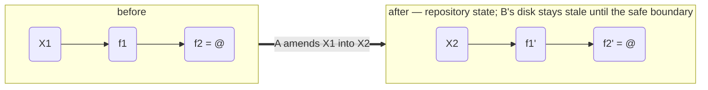
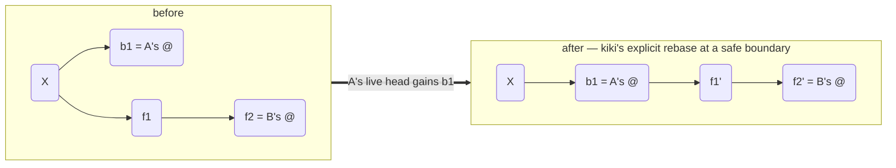
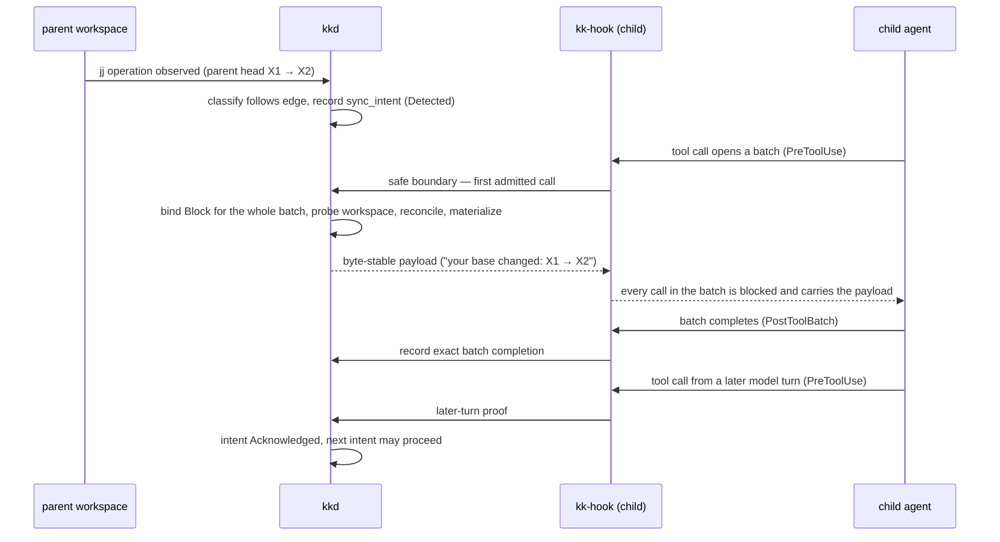

# Cascade

Cascade is the safety-critical feature of v1. Here is the problem it solves.

A child [thread](appendix-a-glossary.md#thread) [follows](appendix-a-glossary.md#follows) a parent thread. (A thread is kiki's unit of work: a themed sequence of revisions in [jj](https://docs.jj-vcs.dev/latest/), the Jujutsu version control system.) When the parent's base changes, the child must catch up. A thread's base is the parent commit its work sits on.

But the child's [workspace](appendix-a-glossary.md#workspace) has a managed coding agent working in it. A workspace is a folder of files with its own working copy. That agent must never look up and see new files with no explanation. Cascade moves the child onto the new base and explains the change to the agent.

The design splits responsibility the way jj already does:

- jj owns how revisions evolve in repository state.
- kiki owns the follows intent (which thread follows which), safe workspace reconciliation, recovery, and agent context. Reconciliation means making the child's workspace match the state it should have.

Every cascade is a [base transition](appendix-a-glossary.md#base-transition): a move from the last synchronized parent commit to a new exact parent commit. There are two kinds:

- **[`NativeRewrite`](appendix-a-glossary.md#nativerewrite)**: jj has already evolved the child's repository history, so the new parent base is an ancestor of the child's current repository commit. kiki must not [rebase](https://git-scm.com/docs/git-rebase) it again. (To rebase is to move commits so they sit on a different parent.) Instead, kiki reconciles the on-disk workspace to jj's current view, at a [safe boundary](appendix-a-glossary.md#safe-boundary): a moment when the child's agent is not mid-edit.
- **[`ParentAdvance`](appendix-a-glossary.md#parentadvance)**: the new parent base is not already an ancestor of the child. jj cannot infer kiki's follows relationship from revision topology alone. (Topology is the shape of the commit graph: which commit sits on which.) So kiki explicitly rebases the child's [owned stack](appendix-a-glossary.md#owned-stack) onto that exact parent commit, at a safe boundary.

In pictures: parent thread A sits at a base commit, and child thread B follows it with owned commits f1 and f2. `NativeRewrite` first: jj has already evolved B's commits in repository state, and only B's on-disk files are stale.

`ParentAdvance`: nothing in revision topology says B should follow A's new commit, so kiki rebases B's owned stack explicitly.

kiki records each base transition as an intent: a saved note that says "this child needs to move from this base to that base". The intent pins the base transition. It does not pin the child's [working-copy commit](https://docs.jj-vcs.dev/latest/glossary/). A child commit is a volatile outcome. Agent edits and ordinary jj [snapshots](https://docs.jj-vcs.dev/latest/working-copy/) can change it without changing whether the follows base is synchronized.

## Invariant

This section states the one promise the rest of the chapter keeps: kiki changes a child's files only at a safe moment. It also says exactly what counts as a safe moment and what does not.

The promise has two parts:

- kiki does not reconcile evolved state in a managed [workspace](appendix-a-glossary.md#workspace) while that workspace's managed agent is mid-edit.
- kiki does not perform an explicit [follows](appendix-a-glossary.md#follows) rebase there mid-edit either.

Think of the [safe boundary](appendix-a-glossary.md#safe-boundary) as waiting for someone to finish their sentence before handing them a note.

### What the promise does not cover: repository state

Repository state may evolve earlier than that. When a rewrite of an ancestor happens in workspace A, [jj](https://docs.jj-vcs.dev/latest/) can immediately evolve workspace B's working-copy commit in the shared repository. (The [working-copy commit](https://docs.jj-vcs.dev/latest/glossary/), written `@`, is the commit jj keeps in sync with the files on disk.) That leaves B's files [stale](https://docs.jj-vcs.dev/latest/working-copy/): they no longer match B's `@`.

The invariant governs when kiki changes B's files and agent context. It does not govern when jj records successor commits.

### The human escape hatch

A direct human `jj` command is an explicit escape hatch. It may reconcile a stale workspace before kiki's boundary. That update may or may not create a repository [operation](https://docs.jj-vcs.dev/latest/operation-log/):

- Updating a clean stale workspace in a non-colocated repository creates none.
- The same update in a [colocated repository](https://docs.jj-vcs.dev/latest/git-compatibility/) (jj 0.46's default) records one. A [colocated repository](appendix-a-glossary.md#ext-colocated-repository) is one where jj and Git share the same folder.
- A dirty update records several.

An operation, or its absence, is not freshness evidence. Kiki checks workspace freshness at the next managed boundary. A [materialization](appendix-a-glossary.md#materialization) changes files on disk but does not always appear in the op log, jj's record of repository operations.

### What counts as a safe boundary

The safe boundary is a [harness](appendix-a-glossary.md#harness) fact. (A harness is the agent program kiki runs, such as Claude Code or Codex.) It is established only by one of these three things:

- the managed harness's pre-tool hook, which is the hook that fires before an agent's tool call runs;
- **[agent quiescence](appendix-a-glossary.md#agent-quiescence)**: the harness adapter's `AgentStatus::Quiescent`, proven by that adapter. Quiescence means the agent is idle; or
- **no live agent**: the thread has no live [incarnation](appendix-a-glossary.md#incarnation), and the remnant check has passed. The remnant check is the inventory rooted at the `agent` launcher that shows no process left over from the retired harness. With no harness and no leftover tool process, nothing can be mid-edit.

Agent quiescence is a different thing from the **[process quiescence proof](appendix-a-glossary.md#process-quiescence-proof)**. That proof is the [`ProcessSupervisor`](appendix-a-glossary.md#processsupervisor) freeze fixed point defined in [Terminal runtime](13-architecture/terminal-runtime.md#process-supervision). Only close, destroy, and repair use the process quiescence proof. Cascade never uses a process freeze as its boundary.

Terminal observations satisfy neither. None of the following is a boundary, agent quiescence, delivery, or acknowledgement:

- an idle-looking screen;
- the detected agent state reported by [Herdr](appendix-a-glossary.md#herdr), the terminal program kiki uses;
- a returned `agent.wait`;
- text accepted into a pane's input queue.

## Classification

Before kiki can react to a parent change, it has to decide what kind of change happened. This section says how kiki reads jj's history to decide, and lists the four possible answers.

### How kiki reads the repository

kiki's [op-log watcher](13-architecture/op-log-watcher.md) watches jj's [operation log](https://docs.jj-vcs.dev/latest/operation-log/). It classifies repository transitions by comparing the repository view before and after each operation. It does not classify by command name.

Every view is read at an exact operation id with the working copy ignored (`--at-op=<op_id> --ignore-working-copy`). This is a [pinned read](appendix-a-glossary.md#pinned-read). kiki never reads a managed repository through an unpinned jj command. Such a command can, as a side effect:

- snapshot a working copy; or
- merge [divergent operation heads](https://docs.jj-vcs.dev/latest/technical/concurrency/) (two operations that happened at the same time and were not yet combined).

See [Op-log watcher](13-architecture/op-log-watcher.md#pinned-reads-and-pinned-mutations).

### What kiki compares

For each [follows edge](appendix-a-glossary.md#follows-edge) (one parent-child link) kiki compares:

- the edge's last synchronized parent commit;
- the parent workspace's exact `@` before and after the operation, with the result persisted as `thread_head_commit_id`;
- whether the new exact parent head is an ancestor of the child's repository commit after the operation;
- whether relevant [bookmarks](https://docs.jj-vcs.dev/latest/bookmarks/), changes, or operation heads are [conflicted](https://docs.jj-vcs.dev/latest/conflicts/) or [divergent](https://docs.jj-vcs.dev/latest/glossary/).

### The four results

The result is one of:

- `NativeRewrite { from_base, to_base, trigger_op }` when the parent head changed and `to_base` is already an ancestor of the child;
- `ParentAdvance { from_base, to_base, trigger_op }` when the parent head changed and `to_base` is not yet an ancestor of the child;
- `AlreadyAligned` when no reconciliation remains;
- [`TopologyDiverged { reason }`](appendix-a-glossary.md#topologydiverged) when any of these is true:
  - the parent moved backward;
  - the follows anchors no longer describe the real topology;
  - the relevant jj state is conflicted or ambiguous.

### Which ids kiki trusts

- [Change ids](https://docs.jj-vcs.dev/latest/glossary/) correlate rewritten parent revisions. A change id stays the same when a commit is rewritten.
- Commit ids pin the exact [base transition](appendix-a-glossary.md#base-transition). A commit id names one exact version of a commit.
- Classification never consults the [bookmark](appendix-a-glossary.md#bookmark), a named pointer to a revision. A bookmark's own movement is judged separately by [checkpoint tracking](13-architecture/op-log-watcher.md#checkpoint-tracking).

kiki must not resolve "whatever the parent workspace or checkpoint points to later" as the destination of an older intent.

### Creating a follows edge

The same rule applies when a follows edge is first created. `thread_head_commit_id` is a cache, so creation does not trust it. Instead, creation does all of the following in one journaled step:

1. It pins a fresh jj operation view.
2. It reads the parent workspace's actual `@` from that view.
3. It updates the parent's cached head.
4. It uses that exact commit as both the child's base and the edge's initial synchronized-parent anchor.

kiki never bases a child on a possibly lagging watcher observation.

One request is refused before any of this runs. If the child's harness failed its [`RestartStartup` proof](appendix-a-glossary.md#restartstartup-delivery-proof), that harness runs managed sessions without cascade delivery, and its threads cannot follow other threads. A request to make such a thread follow another (`kk new --follows`, or the contextual default of `kk new`) is refused with that reason. See [Commands](09-commands.md#kk-new).

## Coalescing and multi-hop evolution

Several parent changes can pile up before the child reaches a safe boundary. One jj rewrite can also affect a whole chain of threads. This section says how kiki folds waiting changes together (coalescing) and how it handles chains (multi-hop evolution).

### Coalescing

An intent in `Detected` may absorb later compatible parent transitions. Absorbing means three things:

- replace `to_base` with the newest exact base;
- reclassify the intent's kind against current ancestry; and
- record every contributing operation.

Once reconciliation starts, absorption stops. Later transitions create a new intent instead of changing the in-flight target.

### Chains of threads

Repository evolution is not forced to proceed one [follows edge](appendix-a-glossary.md#follows-edge) at a time. Take a chain A→B→C. A single jj rewrite may logically evolve both B and C. kiki records one base-transition intent for each affected follows edge. Each workspace then reconciles independently, at its own safe boundary.

An explicit `ParentAdvance` on B may cause jj to evolve C. In that case:

- The initiating handler compares its starting and result operation views. It records C's resulting `NativeRewrite` itself.
- The watcher opens no second intent for that attributed operation.
- The watcher still classifies the operation for workspace heads and checkpoint tracking, as it does every operation.

## Synchronization intent: the sole protocol authority

kiki needs one place that records how far each cascade has progressed. If there were two places, a crash could leave them disagreeing. That one place is the [synchronization intent](appendix-a-glossary.md#intent) ([`sync_intent`](appendix-a-glossary.md#sync-intent)): one saved database row for each reconciliation.

### What the row holds

Each reconciliation is one durable row in `sync_intents`. Durable means it is saved to disk and survives a crash. The row holds:

- `intent_id`, `thread_id`, and a monotonic per-thread `seq` (a counter that only goes up);
- `kind: NativeRewrite | ParentAdvance`;
- `from_base_commit_id` and the exact `to_base_commit_id`;
- `classification_op_id`, naming the exact repository view used for the latest classification, plus normalized trigger-operation rows;
- `state: Detected | Reconciling | Materialized | Delivered | Acknowledged | RecoveryRequired | TopologyDiverged | Superseded`;
- optional planned and result operation ids, plus the actual result workspace commit;
- embedded outbox fields (see the [embedded cascade outbox](appendix-a-glossary.md#embedded-cascade-outbox)). These are the saved message for the agent and the facts about its delivery:
  - the [byte-stable payload](appendix-a-glossary.md#byte-stable-payload): the message text, saved once so every retry sends exactly the same bytes;
  - a pinned transcript anchor;
  - preparation, delivery, and acknowledgement timestamps;
  - a transcript row id;
  - `delivery_mode: SoftBatch | RestartStartup`;
  - that mode's exact proof fields;
  - the durable delivery-attempt history with its optional exhaustion timestamp;
- optional recovery metadata naming preserved files or divergent commits;
- `result_has_conflicts`, a flag set when the reconciliation result contains jj [conflicts](https://docs.jj-vcs.dev/latest/conflicts/), and the operation that later cleared it.

### One authority, and the status derived from it

The intent row is the only authority for cascade progress and delivery.

- There are no mirrored pending/materialized/acknowledged counters.
- There is no separate context queue.
- There is no separate cascade-outbox table.

The thread's three-valued UI status is derived from all unresolved intents, plus any intent whose result still has uncleared conflicts. Blocking state takes precedence:

- any `RecoveryRequired | TopologyDiverged` intent, any intent whose [delivery attempts are exhausted](appendix-a-glossary.md#exhausted-intent), or any intent with `result_has_conflicts` set and not yet cleared → `conflicted`;
- otherwise, any `Detected | Reconciling | Materialized | Delivered` intent → `pending`;
- no unresolved intent → `in sync`.

### The agent process and its delivery proof

Each **[runtime agent incarnation](appendix-a-glossary.md#runtime-agent-incarnation)**, one running agent process, carries only `delivered_intent_id`. That field identifies the intent most recently emitted to that process and not yet acknowledged.

- The incarnation row has its own kiki [UUID](https://en.wikipedia.org/wiki/Universally_unique_identifier), a unique id.
- The harness conversation/session id is a separate field, because `--resume` may reuse it.

The active intent embeds the durable delivery proof. There are two kinds:

- A [`SoftBatch` proof](appendix-a-glossary.md#softbatch-delivery-proof) names the runtime incarnation, [model turn](appendix-a-glossary.md#model-turn), [tool batch](appendix-a-glossary.md#tool-batch), binding time, and an optional exact batch-completion time. A tool batch is the set of tool calls the harness sends out together.
- A [`RestartStartup` proof](appendix-a-glossary.md#restartstartup-delivery-proof) names the replacement incarnation and a kiki-minted one-use `startup_delivery_id`. The launch specification carries that id in the launcher environment. The session-start hook reports it with `ReportHarnessReady`. `kkd` then matches the first pre-tool hook call of a model turn in that incarnation by its incarnation id, and that call is the acknowledgement. The model does not have to repeat the id.

### Batch admission is only a cache

[Batch admission](appendix-a-glossary.md#batch-admission) is kiki's decision, for one tool batch, to either block it (`Block`) or let it run (`PassThrough`). In-memory batch admission is only an optimization.

- [`kkd`](appendix-a-glossary.md#kkd) owns the admission cache. It lives in `kkd`'s memory, keyed by incarnation and batch. [`kk-hook`](appendix-a-glossary.md#kk-hook) keeps no state. It is a client that makes one call and exits.
- A durable `Block` can be reconstructed from the intent.
- A lost `PassThrough` admission is not guessed or reconstructed. Instead, `kkd` restarts the incarnation before permitting any reconciliation decision that could mutate the workspace.
- Starting any replacement process retires the prior marker without acknowledging the intent.
- When a payload is pending, the replacement receives it through `RestartStartup` before any tool is allowed to run.

## Reconciliation lock and ordering

Two hooks, or a hook and a recovery job, could try to reconcile the same thread at the same time. A per-thread [lock](<https://en.wikipedia.org/wiki/Lock_(computer_science)>) makes them take turns, and a sequence number fixes the order of the work.

- Each thread has an in-memory [reconciliation lock](appendix-a-glossary.md#reconciliation-lock) owned by `CascadeOrchestrator`. Concretely, it is a `tokio::sync::Mutex` keyed by `thread_id`.
- Crash recovery comes from the durable intent state, not from the mutex.
- Intents reconcile in sequence order.
- The lock serializes concurrent hook decisions and recovery for one thread. To serialize is to make them run one at a time.
- The [op-log watcher](appendix-a-glossary.md#op-log-watcher) may update only a `Detected` intent.
- After an intent enters `Reconciling`, newer work gets a later sequence number.

The same lock, held for the whole length of a lifecycle operation, is called the [lifecycle lock](appendix-a-glossary.md#lifecycle-lock). A second, per-repo lock, the [repo jj lock](appendix-a-glossary.md#repo-jj-lock), wraps each unpinned working-copy command and each integration of operation heads. [Invariants](02-invariants.md#locks-and-their-order) defines both and fixes their order: parent thread lock, then child thread lock, then the repo jj lock.

## Workspace probe

Before kiki changes any files, it needs to know whether the workspace is up to date and whether the agent has edits jj has not recorded. The workspace probe ([`WorkspaceProbe`](appendix-a-glossary.md#workspaceprobe)) answers that question without changing anything.

The probe is read-only: it must not materialize anything. It checks three things:

- the [follows edge](appendix-a-glossary.md#follows-edge)'s [last synchronized base](appendix-a-glossary.md#synchronized-base);
- jj's recorded working-copy state; and
- the current filesystem.

It returns a [fingerprint](https://en.wikipedia.org/wiki/Cryptographic_hash_function) plus one of these results. In the names, "fresh" means the workspace is already reconciled to jj's current view of its base, and "stale" means jj's repository view evolved and the workspace has not been updated to it. "Clean" means no unsnapshotted edits, and "dirty" means there are some.

- `FreshClean`: the workspace is already reconciled and has no unsnapshotted edits. This includes the case where a human updated it directly.
- `FreshDirty`: the base is already reconciled, but the filesystem has unsnapshotted edits (changes jj has not yet recorded in a [snapshot](https://docs.jj-vcs.dev/latest/working-copy/)).
- `StaleClean`: jj's repository view evolved, but the on-disk workspace has no unsnapshotted tracked changes relative to its last checked-out state.
- `StaleDirty`: the workspace is stale and also contains unsnapshotted changes.
- `Unknown`: the CLI backend cannot prove any of the preceding states without mutating the workspace.

The fingerprint covers the path inventory and the byte hashes used to classify edits. kiki rechecks the fingerprint immediately before mutation. If it drifted, kiki aborts to recovery.

The `JjCli` proof of concept (an early trial of the backend that drives jj through its command line) must demonstrate a lossless implementation. If it cannot distinguish a clean state from a dirty one without mutation, v1 must return `Unknown`. Optimistic materialization is not permitted.

## Boundary snapshot

Sometimes kiki needs the agent's unrecorded edits to be recorded in jj before it goes on. The [boundary snapshot](appendix-a-glossary.md#boundary-snapshot) is the one command kiki runs on purpose to do that, and only under the conditions listed below.

The probe never snapshots. One kiki-run command does: the **boundary snapshot**. It is a jj [snapshot](https://docs.jj-vcs.dev/latest/working-copy/) of one managed workspace that [`kkd`](appendix-a-glossary.md#kkd) (the kiki daemon) takes on purpose, and only under all of these conditions:

- one of these holds:
  - the agent is at [agent quiescence](appendix-a-glossary.md#agent-quiescence); or
  - its tool batch is held at a harness boundary; or
  - in a lifecycle preflight for a harness that cannot prove quiescence, the human has been warned that the agent may be working. This warned rule also covers an idle child's snapshot during a parent's close;
- the thread's [reconciliation lock](appendix-a-glossary.md#reconciliation-lock) is held;
- the [repo jj lock](appendix-a-glossary.md#repo-jj-lock) is held, from the frontier sample until the fresh sample afterward;
- a frontier sample shows exactly one operation head (the [operation frontier](appendix-a-glossary.md#operation-frontier) is the set of newest operations); and
- the resulting operation is attributed.

Kiki samples the frontier again afterward and reads the result from the exact resulting operation. The boundary snapshot is one of the working-copy commands listed in [Invariants](02-invariants.md). Outside the warned lifecycle preflight above, it is never taken while a tool may be writing.

A boundary snapshot records the workspace's tracked edits in its working-copy commit. It rewrites that commit, so a checkpoint bookmark on it follows under [checkpoint tracking](13-architecture/op-log-watcher.md#checkpoint-tracking). It is used in two places:

- **Lifecycle preflight.** Close, detach, and publish take it in preflight, so the head they pin already contains every tracked edit.
- **`ParentAdvance` with fresh edits.** An explicit rebase must not run over unsnapshotted edits. When the probe returns `FreshDirty` at a held boundary, kiki takes the boundary snapshot, probes again, and proceeds only on `FreshClean`.

It is not used for `NativeRewrite`, for two reasons:

- a `FreshDirty` workspace needs no update there; and
- a stale workspace cannot be snapshotted in place.

`StaleDirty` and `Unknown` always go to recovery.

## `NativeRewrite` reconciliation

In a [`NativeRewrite`](appendix-a-glossary.md#nativerewrite), jj has already moved the child's commits, and only the files on disk may lag. This procedure brings the files up to date at the child's [safe boundary](appendix-a-glossary.md#safe-boundary) and records the result.

At the child's safe boundary:

1. Claim the [reconciliation lock](appendix-a-glossary.md#reconciliation-lock). Load the oldest intent. Transition it `Detected → Reconciling`.
2. Revalidate the exact [base transition](appendix-a-glossary.md#base-transition) against current repository ancestry.
   - A compatible newer transition may supersede this intent.
   - Ambiguity becomes [`TopologyDiverged`](appendix-a-glossary.md#topologydiverged).
3. Run the non-materializing workspace probe.
4. For `FreshClean | FreshDirty`: verify actual ancestry, then continue to result persistence without rewriting files. Once the base was already materialized, a `NativeRewrite` does not need to disturb later edits.
5. For `StaleClean`: run `jj workspace update-stale` under the [repo jj lock](appendix-a-glossary.md#repo-jj-lock). Then verify the actual resulting workspace commit and ancestry from the exact resulting operation. The command's exit status is not that verification.
6. For `StaleDirty | Unknown`: [hard-pause](appendix-a-glossary.md#hard-pause) the agent and enter the recovery path below.
   - That path creates the [recovery bundle](appendix-a-glossary.md#recovery-bundle) first.
   - It then records `RecoveryRequired` in the same transaction as that bundle.
   - Do not soft-materialize and resume.
7. Compose the [byte-stable payload](appendix-a-glossary.md#byte-stable-payload) from the base transition and the actual result. Then, in one [SQLite](https://www.sqlite.org/) [transaction](https://en.wikipedia.org/wiki/Database_transaction) (an all-or-nothing database write):
   - store the result commit, payload, anchor, and `state=Materialized`;
   - update the thread's cached live head from the exact result operation view; and
   - advance the [follows edge](appendix-a-glossary.md#follows-edge)'s [last synchronized base](appendix-a-glossary.md#synchronized-base).

### When the update lands on a newer view

`jj workspace update-stale` has no exact-target argument. If an external operation lands concurrently, it may reconcile to a newer compatible repository view.

- The actual result is authoritative.
- If that result covers a coherent later base transition, kiki records or supersedes the covered intents accordingly.
- If it does not, kiki stops. It never claims the older target was materialized exactly.

## Unsnapshotted-edit recovery

An agent may edit files just before its workspace goes stale, so jj has not recorded those edits yet. This section says how kiki updates such a workspace without letting those edits vanish from the agent's view.

### Why this needs care

A stale workspace with unsnapshotted edits is a normal race with an active agent. It is not an exceptional corruption case.

`jj workspace update-stale` may preserve the edits in a divergent/conflicted successor while placing a clean evolved successor on disk. (A successor is the newer version of a rewritten commit. [Divergent](https://docs.jj-vcs.dev/latest/glossary/) means more than one visible version of the same change exists.) The command exits successfully when it does this:

- the edited files are gone from the working tree; and
- they exist only in the other successor.

Success is therefore not an edit-preservation proof. A [bookmark](appendix-a-glossary.md#bookmark) on the affected working-copy commit becomes conflicted across both successors, which kiki records as [`BookmarkConflicted`](appendix-a-glossary.md#bookmarkconflicted). kiki must never resume the agent on that clean successor while its edits are hidden elsewhere.

### Recovery steps

Recovery pauses the agent and preserves the files at risk:

1. [Hard-pause](appendix-a-glossary.md#hard-pause) the agent before materialization.
2. Create a loss-safe [recovery bundle](appendix-a-glossary.md#recovery-bundle) through [`WorkspaceRecovery`](appendix-a-glossary.md#workspacerecovery) at `~/.config/kiki/repos/<repo_id>/recovery/<intent_id>/`, outside the source workspace. A recovery bundle is a saved copy of the files at risk.
   - At minimum, the bundle contains:
     - byte copies and hashes of every changed or untracked non-ignored path the probe identified;
     - a path inventory;
     - the working-copy change and commit ids; and
     - the starting operation id.
   - For `Unknown`, the bundle copies every non-ignored workspace path, because no narrower dirty set has been proved.
   - The bundle must remain useful even if the next jj command changes repository state.
   - Persist the bundle's path and fingerprint on the intent before invoking any mutating jj command.
   - The CLI PoC (proof of concept) must prove the concrete mechanism. If it cannot, automatic `NativeRewrite` is not accepted for v1.
3. Run jj's stale-workspace recovery. Then, from the exact resulting operation, enumerate every visible successor and divergent commit for the affected working-copy change id. For each one, include the operation predecessor record that links it to the pre-recovery commit.
4. Verify that the pre-materialization edits are represented either in the materialized commit or in explicitly named recovery/divergent commits.
5. If exactly one recovery successor can be selected safely, make the conflict-bearing result visible in the workspace and resume with conflict framing. Otherwise, leave the thread in `RecoveryRequired`, preserve the recovery record, and require an explicit choice. kiki never makes that choice itself.
6. Transition `RecoveryRequired → Reconciling → Materialized` only after the selected workspace state visibly contains the edits, or after a caller explicitly chooses a recovery outcome. Record that choice and the recovery-bundle location on the intent.

### What the payload says, and who may delete a bundle

The recovery payload names all preserved commit ids and recovery paths. "The work was preserved somewhere in the op log" is not enough if the agent resumes on files that omit it.

Thread lifecycle operations never delete recovery bundles automatically. Close does not, and thread destroy does not. They surface the paths for manual disposition. The one exception is the deliberately repo-wide `kk repo unregister`; use `--keep-state` to retain the centralized directory and its recovery bundles.

## `ParentAdvance` reconciliation

In a [`ParentAdvance`](appendix-a-glossary.md#parentadvance), the parent's new base is not yet an ancestor of the child. This procedure moves the child's own commits onto that exact commit at the child's [safe boundary](appendix-a-glossary.md#safe-boundary), then updates the files and records the result.

At the child's safe boundary:

1. Claim the lock. Transition the oldest intent `Detected → Reconciling`.
2. Validate the owned chain.
   - The exact revisions after `from_base_commit_id` up through the current thread head must form the v1 single-parent [owned chain](appendix-a-glossary.md#owned-stack): no merge, no multiple roots, no foreign descendant.
   - Otherwise, transition to [`TopologyDiverged`](appendix-a-glossary.md#topologydiverged).
   - Never synthesize a dynamic descendants [revset](https://docs.jj-vcs.dev/latest/revsets/) (a computed jj revision query).
3. Probe workspace freshness and edits.
   - `FreshClean` may proceed.
   - `FreshDirty` takes the [boundary snapshot](#boundary-snapshot) and probes again. It proceeds only if the second probe returns `FreshClean`. The snapshot's result becomes the thread head the chain is validated against.
   - A preceding native stale state reconciles through the rules above.
   - `StaleDirty | Unknown`, and a `FreshDirty` that the boundary snapshot did not clear, must create an edit-preserving [recovery bundle](appendix-a-glossary.md#recovery-bundle) and enter `RecoveryRequired` before the explicit rebase starts.
4. Persist the planned source revset, the starting operation, and the exact `to_base_commit_id` on the intent.
5. Explicitly rebase the exact validated chain through `JjBackend`, pinned to the exact operation head the plan was validated against.
6. Compare the starting and result operation views. Record `NativeRewrite` intents for any other descendant workspaces jj evolved.
7. Reconcile the current child's workspace, inspect the result for jj [conflicts](https://docs.jj-vcs.dev/latest/conflicts/), and determine the actual result commit. A result that contains conflicts sets `result_has_conflicts`; see [Conflicts and escalation](#conflicts-and-escalation).
8. Compose the payload. Atomically persist the result, anchor, embedded outbox, and `state=Materialized`. Update `thread_head_commit_id` to the actual rebased workspace `@` from the exact result operation view. Then advance the [follows edge](appendix-a-glossary.md#follows-edge)'s [last synchronized base](appendix-a-glossary.md#synchronized-base).

### Inspecting a planned result, and recovery

The CLI PoC (proof of concept) must evaluate jj's `--no-integrate-operation` plus `jj op integrate` as the preferred way to inspect a planned result before integrating it. `jj op integrate` is a deliberate operation-head integration:

- it is the integration entry in the closed list of unpinned commands;
- it runs under the [reconciliation lock](appendix-a-glossary.md#reconciliation-lock) and the [repo jj lock](appendix-a-glossary.md#repo-jj-lock); and
- its result is attributed and classified like any other integration.

Recovery must use exact operation ids. It must not rerun an ambiguous "rebase onto current parent" command.

## Delivery protocol

After kiki changes a child's files, the agent needs to be told what changed, and kiki needs to know the agent really read that message. The delivery protocol blocks the agent's tool calls, hands over the saved message (the payload), and accepts proof of reading only from a later [model turn](appendix-a-glossary.md#model-turn).

Here is the happy path, end to end: a parent change reaches a child agent without that agent ever seeing unexplained files.

The rules below preserve that sequence when batches run concurrently, hooks crash, harnesses differ, or the workspace holds unsnapshotted edits.

A few words used throughout this section:

- A **hook** is a small program the [harness](appendix-a-glossary.md#harness) runs at set moments. `PreToolUse` runs before a tool call. `PostToolBatch` runs when a batch of tool calls has finished. See [PreToolUse / PostToolBatch hooks](appendix-a-glossary.md#pretooluse-posttoolbatch-hooks).
- [`kk-hook`](appendix-a-glossary.md#kk-hook) is kiki's hook program. [`kkd`](appendix-a-glossary.md#kkd) is the kiki [daemon](<https://en.wikipedia.org/wiki/Daemon_(computing)>), the background process that holds kiki's state.
- A **model turn** is one response from the model. A **[tool batch](appendix-a-glossary.md#tool-batch)** is the set of tool calls from one response that the harness sends out together.
- **Fail closed** means: when kiki cannot prove an action is safe, it blocks the action.
- The **barrier** is the durable `Block` decision bound to one batch.

### The whole batch is the delivery boundary

A harness may dispatch several tool calls from one assistant response and invoke their `PreToolUse` hooks concurrently. [Claude Code](https://docs.claude.com/en/docs/claude-code/overview) does. A second hook invocation from that batch is not evidence that the model consumed the first hook's synthetic result.

So kiki treats the complete tool batch as the delivery boundary, not an individual hook process. Blocking a batch means holding the whole elevator, not one passenger.

### How a batch is identified

The adapter supplies stable `model_turn_id` and `tool_batch_id` values to `kk-hook`. A matching `PostToolBatch` event marks that batch complete. How an adapter derives these values is adapter-specific and must pass the integration gate in [Build Sequencing](15-build-sequencing.md).

- **Claude Code** derives them from its parallel batch and its batch-completion signal.
- **[Codex](https://github.com/openai/codex)**, whose pinned versions must prove serial dispatch (one tool call at a time), degenerates cleanly: it becomes the simplest case of the same protocol.
  - Each Codex batch is one tool call, identified by its `tool_use_id`.
  - Model-turn identity is the proven-serial step order. Codex's `turn_id` spans many model steps and cannot serve.
  - A blocked batch's completion is reported by the next turn-scoped hook event.
  - A denied call never runs, so it fires no post-tool event. The crash-surviving completion report is the harness's own next arrival. Under the serial proof, that arrival cannot happen before the blocked call resolved.
  - The protocol below is unchanged. Its concurrent-sibling steps are vacuously satisfied: there are no sibling calls, so those steps have nothing to check.

If the installed harness version cannot provide or support an unambiguous batch-completion boundary, soft delivery is disabled and kiki uses the hard-restart fallback below.

### The first call fixes the batch decision

The first `PreToolUse` admitted for a batch fixes that batch's decision under the [reconciliation lock](appendix-a-glossary.md#reconciliation-lock).

- **If no intent is ready,** `kkd` caches [`PassThrough`](appendix-a-glossary.md#batch-admission) for the batch, in memory, keyed by incarnation and batch. Intents detected afterward wait for the next batch. A later sibling hook may not begin reconciliation.
- **If work is ready,** kiki writes the complete `SoftBatch` proof and durably fixes `Block(intent_id)` before reconciliation may perform any workspace mutation. kiki retains the reconciliation lock through that decision and mutation.

All sibling calls reuse the fixed decision. This avoids an impossible promise: retracting a tool call that was already admitted before a later hook arrived.

### When the `PassThrough` cache is lost

`PassThrough` needs no cascade row. The cache lives only in `kkd`'s memory, so a `kkd` restart loses it. Losing it means kiki cannot prove whether another call in the batch was already admitted.

The rule for telling is this. Take the first pre-tool call that arrives from an incarnation that was already running before this `kkd` start. That call belongs to an **unknown in-flight batch**, unless the hook payload proves it is the first call of a new model turn.

For an unknown in-flight batch, `kkd` does three things. The hook does none of them; it only relays `kkd`'s answer.

- it blocks the unknown call;
- it [hard-pauses](appendix-a-glossary.md#hard-pause) the incarnation without changing the workspace; and
- it starts a replacement incarnation.

A hard-pause retires the incarnation by terminating the harness's whole process tree through [`ProcessSupervisor`](appendix-a-glossary.md#processsupervisor), by recorded identity. It leaves the `agent` [pane launcher](appendix-a-glossary.md#pane-launcher) alive. (The process tree is the harness process and everything it started. The pane launcher is the kiki process that starts the harness inside its terminal pane.)

The same rule covers a process freeze. Suppose a tool batch was in flight when a close, destroy, or repair freeze began, and that operation then takes [verified resume](appendix-a-glossary.md#verified-resume). The incarnation's batch state is unknown afterward, and this unknown-batch rule applies: a hard restart to a clean boundary, with files untouched.

After the restart:

- Pending work is reconciled only after the old batch can no longer be running.
- If reconciliation produces a payload, delivery uses `RestartStartup`.

Cache loss may cause a disruptive restart. It never causes a mid-batch mutation, and never an indefinite wait for a completion event that may never arrive.

An already durable `Block` is different. It remains [fail-closed](appendix-a-glossary.md#fail-closed) and follows its intent, not this cache-loss path.

### The barrier marker

A bound `Block` must hold even while `kkd` is down. `kk-hook` keeps no state and cannot read the database, so `kkd` leaves it a file to check: the [barrier marker](appendix-a-glossary.md#barrier-marker).

- When `kkd` binds a `Block` for a thread, it first writes the marker file durably at `~/.config/kiki/repos/<repo_id>/barriers/<thread_id>`. It does this before it changes any workspace file.
- `kkd` removes the marker when the barrier lifts. That happens at exactly two moments: when the delivery is acknowledged by a later model turn, or when the blocked incarnation has been retired and its replacement's gate is recorded.
- After a crash, recovery removes the marker only after the reconciliation it guards is resolved.
- The hook only checks whether the file exists. It never writes or removes it.

So a tool call can never run against changed files just because `kkd` was down when the hook asked.

### The hook's time budget

`kk-hook` works within two time limits. Both are `[timeouts]` keys in [Configuration](11-configuration.md).

- **`hook_connect` (default `1s`)** covers only connecting to `kkd` and being admitted. If it expires, the hook checks the thread's [barrier marker](appendix-a-glossary.md#barrier-marker).
  - **Marker present.** A `Block` is bound for this thread. The hook answers with the generic blocking deny.
  - **Marker absent.** The hook returns the harness's non-blocking decision, and the tool call runs.
- **`slow_path` (default `30s`)** is the [slow-path bound](appendix-a-glossary.md#slow-path-bound). It applies once `kkd` has admitted a call into a reconciliation. The hook then waits up to this long for the answer.

If `slow_path` expires, or the owner of the reconciliation crashes, the answer is a generic blocking deny: "kiki is reconciling; try again". It is never "continue". A call that was admitted into a reconciliation may be facing changed files, so it must not run unexplained.

Each harness adapter pins the harness's own hook timeout above `slow_path` plus a margin. Otherwise the harness would give up on the hook first and let the call through.

A `kk-hook` process can also die before it answers. The marker cannot help then, because no hook is left to check it. This case is covered by a proof for each pinned harness version: when the hook process dies without an answer, the harness must not run the tool as if the hook had allowed it. If that proof fails, that harness version is unsupported for cascade delivery.

### Steps on every pre-tool call

On every `PreToolUse` call:

1. Claim the per-thread reconciliation lock. Load the active intent proof, the incarnation marker, the batch admission, and the oldest unresolved intent.
   - Handle `RestartStartup` through step 2 before consulting batch admission.
   - Otherwise, a cached `PassThrough` returns immediately, and newly detected work waits for a later batch.
   - A missing admission cache for an unknown in-flight batch takes the cache-loss restart path above.
2. If the active intent uses `RestartStartup`, acknowledge only when both of these hold: the session-start hook already reported the exact `startup_delivery_id` with `ReportHarnessReady`, and this call is the first pre-tool hook call of a model turn in the replacement incarnation. `kkd` matches the call by its incarnation id.
   - A match proves this model turn came after the startup payload. Clear that delivery proof and marker atomically, then select the next intent.
   - A call from any other incarnation, or a handshake with a missing or different startup id, blocks and fails closed.
3. If an active `SoftBatch` `Block` names this `tool_batch_id`, block the requested tool, and never acknowledge from it.
   - If the payload is prepared, emit it byte-identically.
   - If the intent is still `Reconciling`, the sibling waits behind the owning reconciliation, up to `[timeouts] slow_path`.
   - If that bound expires or the owner crashes, the call gets the generic blocking deny ("kiki is reconciling; try again"), and kiki enters recovery or hard restart.
   - It never emits a nonexistent payload, and never passes through.
4. If an active `SoftBatch` names another batch that has not been durably marked complete, fail closed: block the tool and initiate hard-restart recovery. An absent, crashed, or reordered `PostToolBatch` must never turn into acknowledgement by inference.
5. If the `SoftBatch` is complete, the intent is `Delivered`, and this call's `model_turn_id` is later than the delivered turn: atomically mark the intent `Acknowledged`, clear the incarnation marker and delivery-proof fields, then select the next intent.
   - The exact recovered `Materialized` case is defined below.
   - `Reconciling` and `RecoveryRequired` can never be acknowledged.
   - A different batch id alone is not enough; the adapter must prove a later model turn.
6. Find the oldest unacknowledged prepared intent, or the oldest `Detected` intent. Before reconciliation or any possible workspace mutation, first write the thread's [barrier marker](appendix-a-glossary.md#barrier-marker) durably. Then do all of this atomically:
   - fix `Block(intent_id)`;
   - set `delivery_mode=SoftBatch`; and
   - bind the current incarnation, model turn, and tool batch.

   Only then may a `Detected` intent enter `Reconciling`. A crash can therefore leave an incomplete payload, but never changed files without a durable fail-closed batch decision.

7. Once reconciliation has prepared the payload, block this tool call and emit the payload.
   - Every other call in the same batch follows step 3 and is also blocked.
   - If recovery finds a bound barrier whose payload is not yet prepared, it blocks with generic recovery framing until the exact saved payload exists or hard restart takes over.
   - If no intent or active delivery proof exists, pass through.

### What batch completion does

`PostToolBatch` never acknowledges an intent.

- For `PassThrough`, it expires `kkd`'s cache entry for that batch.
- For a `SoftBatch` `Block`, it verifies the active incarnation, turn, and batch tuple. Then it durably sets that proof's `batch_completed_at`.
- `RestartStartup` does not accept a batch-completion report.

Acknowledgement happens on a later `PreToolUse` that carries the proof its delivery mode requires. Duplicate `PostToolBatch` events are [idempotent](https://en.wikipedia.org/wiki/Idempotence): a repeat has no extra effect. Stale or mismatched events are logged and ignored.

### Marking delivery

After writing the payload to stdout (its [standard output](https://en.wikipedia.org/wiki/Standard_streams)), `kk-hook` calls `MarkDelivered(intent_id, incarnation_id, model_turn_id, tool_batch_id)`. One SQLite transaction does three things:

- it marks the intent `Delivered`;
- it preserves the already-bound barrier; and
- it sets the current runtime incarnation's `delivered_intent_id`.

A partial unique index permits only one live incarnation to claim an intent. (That is a database rule that rejects a second claim.)

When v1.x transcript capture is enabled, a separate idempotent projection records at most one visible row through `dedup_key=cascade:<intent_id>`. Its failure cannot roll back or block cascade delivery. See [Transcript](06-transcript.md#recovery-and-idempotency).

### Recovering a lost delivery mark

An exact completed `SoftBatch`, plus a `PreToolUse` carrying a provably later `model_turn_id`, is stronger delivery evidence than the best-effort post-stdout RPC (the `MarkDelivered` call). So a lost `MarkDelivered` can be recovered.

If `MarkDelivered` was lost and the intent is still `Materialized`, the acknowledgement transaction does this, in order:

1. It records recovered delivery using `batch_completed_at`.
2. It performs `Materialized → Acknowledged`.
3. It clears the barrier.
4. It schedules the same idempotent transcript projection.

Without both the exact completion tuple and the later-turn proof, `Materialized` cannot skip delivery. It is redelivered or hard-restarted instead.

### Single-call batches need a delivery receipt

An adapter whose blocked batch has a single call must also prove consumption before recovered delivery. There are two reasons:

- A later arrival alone cannot show whether the model consumed the payload or a substituted result.
- `MarkDelivered` proves only that the hook wrote stdout, not that the harness applied it.

The Codex adapter therefore reads the [delivery receipt](appendix-a-glossary.md#delivery-receipt) from the harness's own session record. The receipt is the result the harness saved for the blocked call.

- **Matching receipt.** A byte-identical deny result for the blocked `tool_use_id` acknowledges.
- **Contrary receipt.** A contrary result redelivers byte-identically on the arriving batch, at most once per intent.
  - The rebinding transaction durably counts the attempt on the intent, so the bound survives daemon restart.
  - A second contrary receipt abandons the deny channel and fails over to `RestartStartup`.
- **Unreadable receipt.** An unreadable receipt defers acknowledgement when no delivery is pending. It fails closed into `RestartStartup` when one is.

### Hard-restart fallback

The barrier is fail-closed because workspace files may already have changed. kiki [hard-pauses](appendix-a-glossary.md#hard-pause) and switches the intent to `delivery_mode=RestartStartup` if `PostToolBatch`:

- is unavailable;
- never arrives; or
- has an identity that cannot be proved after a hook or daemon crash.

In one transaction, kiki creates a replacement incarnation and a one-use `startup_delivery_id`. It then starts or resumes the harness with the saved payload as its mandatory first input, carrying that id.

**Where the replacement starts.** The replacement incarnation starts on the same live `agent` [pane launcher](appendix-a-glossary.md#pane-launcher), through a fresh one-use [launch gate](appendix-a-glossary.md#launch-gate). It needs no terminal provisioning. The pane launcher cannot start the harness without that input.

**No leftover processes.** Before that gate is activated, an inventory rooted at the launcher must show no process other than the launcher itself. No tool child of the retired harness may survive in the launcher's descendant, session, or [process-group](https://en.wikipedia.org/wiki/Process_group) set. A survivor raises [`OrphanedProcess`](appendix-a-glossary.md#orphanedprocess) with harness-remnant evidence (see [orphan](appendix-a-glossary.md#orphan)). It blocks replacement, materialization, and deletion until the approved [`terminate-orphans`](appendix-a-glossary.md#terminate-orphans) plan resolves it.

**Approval.** These restarts, the cascade hard restart and the `RestartStartup` replacement, are daemon-initiated steps of the delivery protocol and need no one-shot approval. A requested interruption or close does need one, from a human or from an activated [automation policy](appendix-a-glossary.md#automation-policy) rule.

**If the pane launcher is gone.** Then there is nothing to open a gate for:

- the thread has [`TerminalMissing`](appendix-a-glossary.md#terminalmissing);
- the intent waits unacknowledged behind that repair; and
- the incarnation that the approved [`restart-terminal`](appendix-a-glossary.md#restart-terminal) plan starts receives the saved payload through this same `RestartStartup` path.

**If the harness crashed outside a delivery.** A harness that crashed under a live launcher outside a delivery is restarted by the `kk repair` plan [`restart-agent`](appendix-a-glossary.md#restart-agent). That plan:

- starts a replacement incarnation on the live launcher under the same precondition and a fresh gate;
- uses `RestartStartup` when an intent is pending; and
- being a same-thread action, needs no approval in thread context.

**The handshake.** A [ready handshake](appendix-a-glossary.md#ready-handshake) proving the harness accepted the tagged startup input marks the intent `Delivered` and sets the replacement incarnation's `delivered_intent_id`. A crash before the handshake retires that attempt without acknowledgement, and kiki retries with a new incarnation and a new id.

**Retries are bounded.** Those retries are bounded by `[cascade] delivery_attempts` (default `3`), and the bound is durable:

- every replacement attempt is already a persisted incarnation row bound to the intent;
- the bound is evaluated against that durable history, not an in-memory counter; and
- exhaustion is recorded on the intent in the same transaction that abandons the final attempt.

When attempts for one intent keep failing their handshake, kiki stops retrying. It then:

- leaves the intent unacknowledged with its saved payload intact;
- keeps the agent hard-paused; and
- raises a loud [attention event](appendix-a-glossary.md#attention-event).

Resumption is an explicit human action, never another silent loop. A daemon restart resumes that recorded state and re-surfaces the blocked thread. It does not mint a fresh attempt against an [exhausted intent](appendix-a-glossary.md#exhausted-intent).

### Repairing an exhausted intent

The human path out is `kk repair`. It diagnoses an exhausted intent to exactly two named plans, [`retry-delivery`](appendix-a-glossary.md#retry-delivery) and [`discard-delivery`](appendix-a-glossary.md#discard-delivery). (A [repair plan](appendix-a-glossary.md#repair-plan) is a named fix that `kk repair` offers.)

**`retry-delivery`** re-arms delivery in one journaled transaction. That transaction:

- clears the exhaustion mark;
- increments the intent's [delivery epoch](appendix-a-glossary.md#delivery-epoch) (a counter that marks each fresh round of attempts); and
- resets the soft-redelivery count.

After that, one fresh bounded `RestartStartup` cycle is permitted. Every attempt is stamped with the epoch it was created under. Bounds count only current-epoch attempts, by exact id match, never by timestamp comparison. Clock skew therefore cannot change which cycle an attempt belongs to. A re-armed intent that exhausts again returns here.

**`discard-delivery`** acknowledges the intent without delivery proof, under a one-shot [approval](appendix-a-glossary.md#human-approval) bound to the plan.

- It records that resolution on the intent, with the approval that allowed it, and frees the queue behind it.
- The payload is never delivered, and the plan states that consequence before approval.

These two exits are the only writes permitted against an exhausted intent.

### Acknowledging a restart delivery

A restart delivery is acknowledged by one mechanism:

1. The launch specification carries the `startup_delivery_id` in the launcher environment.
2. The session-start hook reports that id with `ReportHarnessReady`.
3. `kkd` matches the first pre-tool hook call of a model turn in that incarnation by its incarnation id. That call is the acknowledgement.

That evidence proves the model turn was generated after the replacement process took in the startup payload.

- The acknowledgement transaction then clears the `RestartStartup` proof and incarnation marker before selecting the next intent.
- It does not require or fabricate a tool-batch id for the startup input.
- No tool from the interrupted batch is replayed automatically.
- A handshake with a mismatched or absent startup id fails closed. So does a call from any other incarnation.

### Crash safety

Crashes stay safe at every point.

- **Crash after binding the barrier and changing files, but before persisting `Materialized`.** Every sibling hook that was admitted still fails closed: it gets the generic blocking deny. Restart finds `Reconciling`, probes actual workspace state, and resumes recovery.
- **Crash after the atomic `Materialized` transaction.** The embedded payload is available for retry. Restart reconstructs the intent's `SoftBatch` or `RestartStartup` proof and validates only that mode's exact evidence.

Three things are always true:

- No mutation begins without a durable block decision.
- No state claims materialization without its explanatory payload.
- No unrelated hook arrival claims consumption.

## Worked scenarios

These six examples walk through the rules above. They add no new rules.

### Scenario 1: clean ancestor rewrite

1. Thread A evolves from base X1 to X2.
2. jj already rebases B's repository history, so X2 is an ancestor of B. B's disk stays clean but stale.
3. kiki records `NativeRewrite { from_base: X1, to_base: X2 }`.
4. At B's boundary the probe returns `StaleClean`.
5. kiki runs `jj workspace update-stale`, stores the actual result and the embedded payload, and informs the agent.

### Scenario 2: ancestor rewrite after an agent edit

1. The agent edits B's files.
2. Then A evolves X1→X2 before B's next jj snapshot.
3. At B's boundary the probe returns `StaleDirty` or `Unknown`.
4. kiki hard-pauses, records recovery state, runs stale recovery, and surfaces every divergent successor.

kiki does not resume the agent on a clean X2-based tree that omits the edit.

### Scenario 3: parent adds a revision

1. Parent `bar` advances from X to X+b1 while child `foo` stays at X+f1.
2. kiki records `ParentAdvance { from_base: X, to_base: X+b1 }`.
3. At `foo`'s safe boundary, kiki does the following in order:
   - it probes the workspace;
   - it takes the boundary snapshot if the probe found fresh unsnapshotted edits;
   - it explicitly rebases the owned stack;
   - it reconciles the workspace;
   - it stores the result and payload; and
   - it informs the agent.
4. Any evolved grandchild receives its own `NativeRewrite` intent.

### Scenario 4: direct human reconciliation

1. The human runs `jj workspace update-stale` before the managed agent's boundary. This changes files. Depending on the repository, it may or may not create an op-log entry.
2. The original base-transition intent stays pending.
3. At the next boundary the workspace probe returns `FreshClean` or `FreshDirty`.
4. kiki verifies ancestry, stores the observed result, and delivers context without rewriting files again.

### Scenario 5: agent crash after delivery

1. An agent receives intent N and crashes before acknowledgement. N stays `Delivered`.
2. Restart retires the old runtime incarnation and its incomplete `SoftBatch` proof, without acknowledging N.
3. Restart then binds a new `RestartStartup` attempt.
4. The replacement process receives N's embedded payload byte-for-byte, with a one-use `startup_delivery_id`. This holds even when the harness conversation id is reused.
5. No replacement-process tool runs first.
6. The session-start hook reports the startup id. The first pre-tool hook call of a [model turn](appendix-a-glossary.md#model-turn) in the replacement incarnation then acknowledges N.

The agent may see the payload twice across processes. The transcript projection records it once, through `dedup_key=cascade:<intent_id>`.

### Scenario 6: parallel tool batch

1. One assistant response requests tools T1, T2, and T3 concurrently.
2. T1's hook finds an intent. It binds `SoftBatch` to that model turn and batch, and only then materializes the workspace.
3. T1 is blocked and receives the payload.
4. T2 and T3 may already be waiting or may arrive afterward. Both observe the same proof, are blocked, and receive the same payload.
5. `PostToolBatch` marks only batch completion.
6. The first `PreToolUse` from a later assistant response acknowledges the intent. Neither T2 nor T3 can.

Under Codex's proven-serial dispatch this scenario cannot arise:

- The batch is T1 alone.
- The next turn-scoped hook event completes it. A denied T1 never runs and fires no post-tool event, so the harness's own next arrival is the completion report.
- That serially later `PreToolUse` acknowledges once the session record's delivery receipt proves the payload, not a substituted result, was what the model consumed.

## Conflicts and escalation

A jj command can succeed and still leave a problem behind, such as a file with conflict markers or two competing versions of a commit. This section says which of those results the agent may handle itself and which require kiki to stop the agent and wait for an explicit decision.

In [jj](https://docs.jj-vcs.dev/latest/), [conflicts](https://docs.jj-vcs.dev/latest/conflicts/) and [divergent changes](https://docs.jj-vcs.dev/latest/glossary/) are first-class states, not necessarily failed commands. kiki inspects result revisions and every successor of the affected working-copy change id. It does not rely only on process exit status, or on whichever divergent commit jj happens to place on disk.

### Textual conflicts in a result

A rebase or a native rewrite can succeed and still leave jj conflicts in the thread's commits. That is a result, not a failure, and it is not a new intent state.

- **Recording.** When the reconciliation result contains conflicts anywhere on the thread's chain from its base to its head, kiki sets `result_has_conflicts` on the intent in the transaction that stores the result. The intent still moves `Reconciling → Materialized → Delivered → Acknowledged` by the ordinary rules.
- **Status.** The thread's derived cascade status is `conflicted` for as long as an intent of that thread has `result_has_conflicts` set and not cleared. Acknowledgement does not clear it: the agent knowing about a conflict is not the conflict being resolved.
- **Payload.** The delivered payload states:
  - the [base transition](appendix-a-glossary.md#base-transition);
  - the actual result commit;
  - that the result contains conflicts;
  - each conflicted commit and each conflicted path;
  - that the listed files now contain jj conflict markers; and
  - that the conflicts must be resolved before other work continues.

  The payload is byte-stable like every other payload, so the list is fixed when the payload is composed.

- **Exit.** The flag is cleared when a later operation's exact view shows every commit on the thread's chain conflict-free.
  - The watcher records that operation as `conflicts_cleared_op_id`. The status then leaves `conflicted` unless another reason holds it there.
  - Nothing else clears the flag: not acknowledgement, not a later intent, and not elapsed time.
  - A later reconciliation whose result is itself conflicted sets the flag on its own intent.

A textual conflict alone does not hard-pause the agent; the agent is the party that resolves it. Divergent successors are different, and stay an escalation.

Hard escalation (see [hard escalation](appendix-a-glossary.md#hard-escalation)) is required when:

- a required workspace mutation sees `StaleDirty | Unknown`, or a `FreshDirty` that the boundary snapshot did not clear;
- reconciliation exposes divergent successors;
- topology or exact base state cannot be reconciled automatically;
- an active [delivery barrier](appendix-a-glossary.md#delivery-barrier) has no provable batch-completion or later-model-turn boundary;
- bounded [delivery attempts are exhausted](appendix-a-glossary.md#exhausted-intent) because receipts or startup handshakes keep proving the payload is not reaching the model; or
- the human invokes `kk thread interrupt`.

## Parent merged

When a parent's [pull request](https://docs.github.com/en/pull-requests) is merged, the child should stop following the parent and sit on the default branch instead. This section says how that will work once kiki can see merges.

Once the v1.x GitHub polling integration ships ([v1.x](appendix-a-glossary.md#v1-x-polish) is work planned after the first accepted release), a parent merge records a `ParentAdvance`-shaped transition.

- Its exact `to_base_commit_id` is the resolved default-branch commit.
- The child rebases and reconciles at its safe boundary.
- The approved remote-operation journal then updates the child branch and PR base.
- The follows link is dropped only after local and remote state are observed coherent.

## Parent abandoned

A parent thread's bookmark or commits can be changed or thrown away from outside kiki. This section says which of those changes kiki reports, and that it then waits for an explicit decision instead of picking a new parent by itself.

A change to the parent's checkpoint [bookmark](appendix-a-glossary.md#bookmark) never changes the pinned follows relationship.

- jj carrying the bookmark to a proven rewrite successor is ordinary and raises nothing.
- Deleting the bookmark, moving it elsewhere, or leaving it conflicted creates [`BookmarkMissing`](appendix-a-glossary.md#bookmarkmissing), [`BookmarkMoved`](appendix-a-glossary.md#bookmarkmoved), or [`BookmarkConflicted`](appendix-a-glossary.md#bookmarkconflicted). Abandoning the bookmarked commit creates [`CheckpointAbandoned`](appendix-a-glossary.md#checkpointabandoned). In each case an active parent enters `ProjectionDiverged` (see [projection divergence](appendix-a-glossary.md#projection-divergence)).
- If an external jj operation abandons the parent live head or owned revisions, or otherwise makes ancestry ambiguous, kiki records [`TopologyDiverged`](appendix-a-glossary.md#topologydiverged) and waits for an explicit decision. It raises an attention event, which also shows in `kk events`.

`jj abandon` hides the commit and also deletes a bookmark on it by default. So one abandon can produce both a bookmark issue and `TopologyDiverged`. Each is classified on its own and neither replaces the other.

kiki does not silently choose a new parent. It does not reinterpret a bookmark as the head.

## Detach and graph surgery

Detaching makes a child thread independent of its parent. This section gives the order of steps, so that no pending parent change is lost on the way.

`kk thread detach [<thread>]` removes the [follows edge](appendix-a-glossary.md#follows-edge) and leaves the child's current ancestry unchanged. With no argument it acts on the contextual thread. The steps are:

1. It first runs `RefreshToFrontier`. This step refreshes the parent and child workspace heads from the pinned operation view. It also creates any transition a lagging watcher had not yet recorded.
2. The user must reconcile that exact transition. Pending parent work is discarded only with `--discard-pending`, which needs a one-shot [approval](appendix-a-glossary.md#human-approval).
3. Only then does kiki checkpoint the child at its [checkpoint target](appendix-a-glossary.md#checkpoint-target) and delete the edge.

kiki preserves the thread-owned base anchor, so the now-independent thread stays publishable, reopenable, and safe to validate later. Broader graph surgery stays deferred beyond v1.
