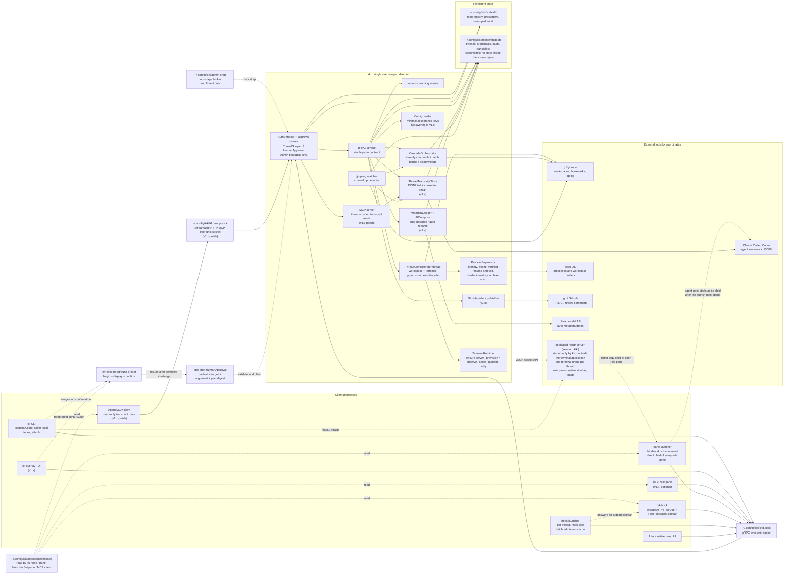

# Architecture

This chapter explains the shape of the implementation: which programs exist, what each one owns, and how they talk to each other.

Behavioral truth lives in the earlier chapters. Architecture exists to make that behavior implementable without smuggling privileged paths through the side door. In plain words: no part of the system gets a hidden shortcut around the rules.

Read in this order:

1. [Crate layout](crates.md)
2. [Daemon](daemon.md)
3. [Terminal runtime](terminal-runtime.md)
4. [gRPC service](grpc.md)
5. [State schema](schema.md)
6. [Op-log watcher](op-log-watcher.md)
7. [Harness adapter](harness-adapter.md)

The architectural rule is simple: [`kkd`](../appendix-a-glossary.md#kkd) owns behavior; clients observe and request. `kkd` is the kiki [daemon](../appendix-a-glossary.md#ext-daemon), a program that runs in the background. A client is any program that asks `kkd` to do something.

All of these clients use the same service contract:

- [`kk`](../appendix-a-glossary.md#kk), the command-line program;
- the [pane launcher](../appendix-a-glossary.md#pane-launcher);
- [`kk-hook`](../appendix-a-glossary.md#kk-hook);
- the [overlay](../appendix-a-glossary.md#overlay-tui);
- the optional [`ui` pane](../appendix-a-glossary.md#ui-role-pane);
- future UIs.

Terminals work like this:

- Terminals are hosted by a [dedicated Herdr server](../appendix-a-glossary.md#dedicated-herdr-server). [Herdr](../appendix-a-glossary.md#herdr) is the [terminal multiplexer](../appendix-a-glossary.md#ext-terminal-multiplexer) kiki uses.
- `kkd` drives that server through [`TerminalRuntime`](../appendix-a-glossary.md#terminalruntime).
- Which terminal a human is looking at belongs to each [Herdr client](../appendix-a-glossary.md#herdr-client). `kk` requests it through [`TerminalClient`](../appendix-a-glossary.md#terminalclient).

## System shape

The diagram below shows the whole system. Read it left to right:

- **Client processes** are the programs that people and agents run.
- The clients reach `kkd` through a [Unix socket](../appendix-a-glossary.md#ext-unix-socket) (a file that two programs on one machine use to talk), using [gRPC](../appendix-a-glossary.md#ext-grpc).
- **`kkd`** holds the parts that make decisions.
- **Persistent state** is the two [SQLite](../appendix-a-glossary.md#ext-sqlite) database files that `kkd` writes.
- **External tools** are the programs kiki coordinates: [jj](../appendix-a-glossary.md#ext-jj), Herdr, the operating system, the agent [harnesses](../appendix-a-glossary.md#harness), and [gh](../appendix-a-glossary.md#ext-gh).

