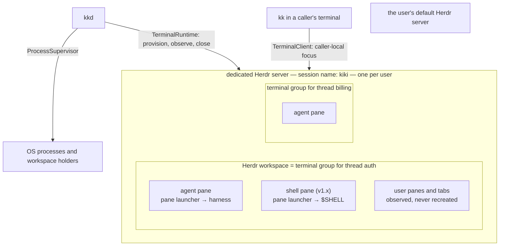

# Terminal runtime

Kiki hosts every thread's terminals in [Herdr](https://github.com/herdrdev/herdr), a terminal multiplexer with a background server. Herdr owns PTYs, layouts, input, rendering, and its native sidebar. `kkd` remains a separate coordinator. This chapter defines how the two meet: the topology, the identities, the three modules that touch the runtime or the OS, and the provisioning, restore, and close protocols. [D-0004](https://github.com/skeswa/kiki/blob/main/journal/decisions/0004-use-herdr-as-terminal-runtime.md) records the choice.

Behavioral truth still lives in [Invariants](../02-invariants.md) and [Threads](../03-threads.md). This chapter makes those promises implementable against a runtime that does not make them itself.

## Ownership

| Concern                                                                                    | Owner                                                                   |
| ------------------------------------------------------------------------------------------ | ----------------------------------------------------------------------- |
| Thread identity, SQLite, lifecycle journals, approvals, follows, sync intents              | `kkd`                                                                   |
| jj workspace creation, forgetting, and directory deletion                                  | `kkd`, through `JjBackend`                                              |
| Harness launch gating, exclusive hooks, readiness, delivery, acknowledgement               | `kkd`, the pane launcher, and the [harness adapter](harness-adapter.md) |
| OS process identity, freeze, verified resume, verified exit, workspace-holder inventory    | `kkd`, through `ProcessSupervisor`                                      |
| PTYs, panes, tabs, layout, scrollback, copy mode, input, rendering, native sidebar, toasts | Herdr                                                                   |
| Which terminal a human is looking at                                                       | each Herdr client; requested through `TerminalClient`                   |

Herdr is integrated across its process boundary: the `herdr` executable, its JSON socket API, its configuration file, and, for v1.x UI, its plugin and keybinding facilities. Kiki does not fork Herdr, link its crates, or speak its private client protocol. Kiki never calls Herdr's `worktree.*` methods. Those methods create and delete Git worktrees under Git ownership rules; a kiki thread's checkout is a jj workspace that only kiki creates and deletes.

## Topology



- **One dedicated server.** Kiki runs one named Herdr server per user. A Herdr _session_ is a server namespace with its own socket and persisted state; it is not the per-thread unit, and kiki never creates one per thread or per repo. The session name defaults to `kiki`. Kiki starts the server with that session name and a kiki-owned configuration root (`[paths] herdr_dir`, by default `~/.config/kiki/herdr/`). The explicit configuration root is mandatory, not a preference: a named Herdr session otherwise shares the default configuration file. Herdr derives the session's socket and saved state beneath that root; kiki records the derived socket path and does not also override it. The adapter refuses to start, with a clear error, when the derived socket path would exceed the platform's Unix socket path limit. Kiki never reads or changes the configuration, state, or terminals of the user's default Herdr server.
- **One terminal group per thread.** A **terminal group** is kiki's name for the per-thread terminal home. With Herdr it is one Herdr workspace. In this book an unqualified "workspace" always means a jj workspace; the terminal object is written "Herdr workspace" or "terminal group".
- **Role panes.** Inside the group's first tab, kiki provisions panes by role: `agent` (required), `shell` (v1.x, default on), and `ui` (v1.x, optional). Every role pane's direct PTY child is the kiki pane launcher. Panes and tabs the user adds natively are `user` panes: kiki never recreates them, but close observes and accounts for every process in them.
- **Generated configuration.** Kiki owns the dedicated server's configuration file. It sets `[session] resume_agents_on_restore = false`, configures the sidebar tokens kiki publishes, and binds the v1.x keybindings. Kiki never runs Herdr's agent-integration installer against a managed harness's launch-scoped settings; the pre-tool boundary belongs to kiki alone.

Launch environment is explicit and per pane. Herdr does not copy one pane's explicit environment into a split, and it does not persist launch environment. Kiki therefore passes each role pane's working directory, argv, and environment in the provisioning call and never assumes a pane inherited them.

## Identity

A thread's terminal presence is a ladder of separate identities. Each rung is recorded separately, and no lower rung can stand in for a higher one.

| Identity              | What it is                                                           | Lifetime                                                 | Authority                                                                                       |
| --------------------- | -------------------------------------------------------------------- | -------------------------------------------------------- | ----------------------------------------------------------------------------------------------- |
| `thread_id`           | kiki's stable identity                                               | the thread                                               | kiki SQLite                                                                                     |
| `server_instance_id`  | one lifetime of the dedicated server process                         | until that process exits                                 | socket peer process identity `(pid, start_time)`, verified per connection                       |
| `terminal_binding_id` | one provisioned terminal group for one thread on one server instance | until closed, replaced, or the instance ends             | kiki journal, proven by launcher handshakes                                                     |
| Herdr refs            | workspace, tab, and pane ids (`w3`, `w3:t1`, `w3:p2`)                | reused across server lifetimes; restored on cold restore | none — a locator valid only within one `server_instance_id`                                     |
| Herdr `terminal_id`   | Herdr's per-terminal marker                                          | reallocated on restore                                   | none — a change hint                                                                            |
| role                  | `agent`, `shell`, or `ui`                                            | the claiming process's life                              | the launcher's gate claim, bound to the claiming process identity; never pane position or label |
| process identity      | `(pid, start_time)` with session and process-group ids               | one OS process                                           | the OS, read by `ProcessSupervisor`                                                             |
| `agent_session_id`    | one managed harness incarnation                                      | one harness process                                      | the ready handshake                                                                             |
| `harness_session_id`  | the harness's resumable conversation                                 | may span incarnations                                    | the harness                                                                                     |

Rules that follow from the ladder:

- A Herdr ref is meaningful only together with the `server_instance_id` it was read under. Herdr workspace ids restart from a counter and recur; a cold restore returns the same public ids with new processes. A matching ref on a different instance is a coincidence, not a binding.
- Labels, working directories, mutable metadata tokens, pane titles, and pane placement are presentation. Any process on the server's socket, including any process inside a pane, can change them. They may help a human or seed a repair plan's display. They never bind a thread, authorize a mutation, or prove that a directory is safe to delete.
- A role belongs to the process identity that claimed it. That identity survives the `shell` or `ui` launcher replacing itself with the shell or UI program, and it ends when that process ends. A pane with no live claiming process has no role, whatever its id or label says; it is a `user` pane. `user` is the absence of a role, not a role.
- Entering `Active` requires a current binding on the current server instance, a live `agent` role launcher, and a ready handshake from the incarnation it started. Staying `Active` requires the binding and the live `agent` launcher. Existence of a Herdr workspace or pane proves none of these.
- The `agent` launcher outlives incarnations. When the harness exits, the incarnation is retired without acknowledgement and `AgentStatus` becomes `Crashed`; the role, the binding, and the lifecycle state are unchanged, and no surface shows the agent as working. A replacement incarnation is a new `agent_sessions` row and a new one-use gate awaited by the same launcher, after the orphan scan. Only the end of the launcher itself, of its binding, or of its server instance ends the `agent` role and raises `TerminalMissing`.

## Three modules

Three modules face the runtime and the OS. Each has a real second adapter — an in-process fake that drives the deep-module tests — so each interface is a real seam rather than a speculative one. Harness safety and delivery are deliberately not in any of them; they stay with the [harness adapter](harness-adapter.md) and the cascade protocol.

### `TerminalRuntime`

Lives in `kkd`. Provisions, observes, and closes terminal groups, and publishes presentation. It reports observations; it never claims agent readiness, process absence, or delivery.

```
trait TerminalRuntime {
    fn capabilities(&self) -> RuntimeCapabilities;
    fn instance(&self) -> Result<ServerInstance>;
    fn provision(&self, plan: &ProvisionPlan) -> Result<ProvisionObservation>;
    fn snapshot(&self) -> Result<RuntimeSnapshot>;
    fn close_group(&self, group: &GroupHandle) -> Result<CloseRequested>;
    fn publish(&self, group: &GroupHandle, presentation: &Presentation) -> Result<()>;
}
```

- `RuntimeCapabilities` is derived from Herdr's reported version, protocol number, and capability list. Herdr ignores unknown request parameters, so an adapter must never detect an extension by sending it and seeing no error.
- `GroupHandle` and every pane handle carry the `server_instance_id` they were observed under. A handle from another instance is rejected before any call is made.
- `provision` is not idempotent at the runtime and says so: a lost reply may have created resources. Idempotency comes from the protocol in [Provisioning](#provisioning).
- `snapshot` is the only authoritative observation. Events are wake-up hints.
- `close_group` returns `CloseRequested`, not "closed". Herdr's success reply does not establish that any process exited.

`RuntimeCapabilities` includes at least `direct_argv_launch`, `client_targeted_focus`, `mutation_fence`, `request_keys`, `termination_receipt`, and `live_handoff`. Callers branch on these values, never on a version string.

### `TerminalClient`

Lives in `kk`, because focus belongs to a viewer and not to the daemon. It performs caller-local navigation and caller-local notices with an explicit caller identity.

```
trait TerminalClient {
    fn caller(&self) -> Result<CallerClient>;
    fn focus(&self, caller: &CallerClient, target: &PaneTarget) -> Result<FocusOutcome>;
    fn attach(&self, initial: Option<&PaneTarget>) -> Result<()>;
    fn focus_all_clients(&self, target: &PaneTarget) -> Result<()>;
}
```

`focus_all_clients` is the explicitly global operation behind `kk switch --all-clients`; nothing else calls it. `caller` resolves which attached Herdr client issued the command. `focus` moves that client and no other. `attach` starts a new client on the dedicated server with kiki's configuration root; it places that new client on `initial` only where the runtime can place one client without moving others, and otherwise attaches at Herdr's default location and says so. `FocusOutcome` is `Focused | NoCallerClient | Unsupported`. The contract and its required Herdr extension are in [Caller-local focus](#caller-local-focus).

### `ProcessSupervisor`

Lives in `kkd` and faces the local OS, not Herdr. It owns process identity, descendant and holder inventory, freeze, verified resume, and verified exit.

```
trait ProcessSupervisor {
    fn inventory(&self, roots: &[ProcessIdentity], workspace: &Path) -> Inventory;
    fn freeze(&self, roots: &[ProcessIdentity], workspace: &Path) -> FreezeResult;
    fn resume(&self, frozen: &FrozenSet) -> ResumeResult;
    fn terminate(&self, frozen: &FrozenSet) -> ExitResult;
    fn survivors(&self, recorded: &[ProcessIdentity], workspace: &Path) -> Survivors;
}
```

Every result carries evidence — the identities sampled, the samples compared, the holders found — and every result type has an `Unknown` outcome. `Unknown` always preserves files. The algorithms are in [Process supervision](#process-supervision). A Herdr reply is never an input to these proofs except as one source of root process ids, which the supervisor re-reads from the OS before trusting.

## Provisioning

Herdr's create and layout calls start processes and have no request key, no create-if-absent, and no label uniqueness. A repeated call after a lost reply creates a second group. Kiki makes provisioning exactly-once in effect with a journal and a gate that only one launcher can claim.

**The pane launcher.** Every role pane is created with a direct argv command — never text typed into a shell — whose executable is the kiki pane launcher. Its argv names a `provision_id` and a role. Its environment carries the thread's context variables and a one-use provision nonce; the nonce is never placed in argv, because the runtime saves launch argv. `kkd` computes everything the launcher will run; the launcher only executes it. The launcher is a pure client of `kkd`. On start it presents the nonce and reports its own process identity, which `kkd` re-reads from the OS through the connection's peer credentials rather than trusting the report, and the Herdr workspace, tab, and pane ids from its environment, then blocks on a database-backed, one-use gate. It does nothing else until the gate opens.

- For the `agent` role, the gate is the launch gate defined in [Threads](../03-threads.md#creation). When it opens, the launcher starts the harness as its child in the pane's foreground and stays alive as the role's supervisor. It reports the harness's exit and then waits for the next gate, so a replacement incarnation needs no new pane. Each gate is one-use and belongs to one incarnation. Staying alive matters: Herdr removes a pane when its direct command exits, so a launcher that replaced itself with the harness would erase the pane, and the exit report, the moment the agent stopped.
- For the `shell` and `ui` roles, the launcher claims its role binding and then removes the spent nonce from its environment, and replaces itself with the user's shell or the kiki UI process. The `agent` launcher likewise never passes the nonce to the harness. The role stays with that process identity until the process ends.

**The protocol.** Provisioning one terminal group is one journaled step sequence inside the owning lifecycle saga:

1. Persist the `provision_id`, the intended roles, the exact jj workspace path, and the current `server_instance_id`. Mark the step `Started`.
2. Call Herdr to create the Herdr workspace with an explicit working directory and label, then apply the role layout into that workspace's first tab, replacing it. Herdr's create call always starts a default shell in the new workspace's first pane, so an unmanaged shell exists in the jj workspace from the create call until the layout replaces it; if the sequence stops between the two calls, that shell is a `user` pane like any other and the quiescence roots rule covers it. The label is the repo's directory name, the thread's display name, and a short `provision_id` tag. It is for people and for discovery hints only.
3. Wait for launcher reports. Each report binds `(provision_id, role)` to an observed `(server_instance_id, Herdr refs, process identity)`.
4. In one transaction, accept exactly one launcher per `(provision_id, role)`, record its process identity and the pane rows, and mark the binding `Bound` and the step `Completed`. The nonce admits exactly one claim per role. For the `agent` role, a second transaction later records the process incarnation and activates its launch gate; the gate requires a `Bound` binding.
5. Refuse every other launcher that reports the same `(provision_id, role)`. A refused launcher exits without starting anything, which closes its pane.

**Lost replies and duplicates.** If the reply to step 2 is lost, or `kkd` crashes anywhere before step 4, recovery does not blindly repeat the call. It takes a fresh snapshot, collects launcher reports for the `provision_id`, and then either accepts a complete reported set, waits for a bounded time for launchers that are still starting, or issues one new create call. If two groups ever report the same `provision_id`, exactly one is accepted and the other's launchers are refused. Kiki closes a duplicate group only after `ProcessSupervisor` shows its panes hold nothing but refused, exited launchers; otherwise the duplicate stays and is reported as an unbound group. A duplicate group can therefore exist briefly, but a duplicate harness cannot: the gate is claimed once.

**What is never evidence.** A successful create or layout reply, an accepted `agent.start`, text accepted into a pane's input queue, a visible prompt, and Herdr's agent-status detection each prove only that Herdr accepted a request or drew a screen. None proves that the launcher ran, that the harness is configured, or that anything was delivered. Readiness is the settings-bound ready handshake, and delivery is the [cascade protocol](../05-cascade.md#delivery-protocol).

## Observation and presentation

Herdr's event stream is bounded and held in memory, carries no resumable cursor, and can report that events were lost. Its metadata tokens are mutable by any socket peer and vanish on server restart. Neither is durable, and neither is authority.

- `kkd` subscribes to events and then takes a full snapshot. An event wakes the reconciler; the snapshot is what it reconciles against. After `events_lost`, any connection error, a reconnect, or a changed `server_instance_id`, `kkd` resubscribes, takes a fresh snapshot, reconciles every binding, and republishes presentation.
- Reconciliation compares each binding's recorded handles and launcher identities with the snapshot and the OS. Differences become projection issues under the rules in [Threads](../03-threads.md#projection-divergence-and-repair). A terminal change that an in-flight lifecycle journal expected belongs to that journal.
- Presentation is one-way. `kkd` publishes only to a terminal group with a current binding; a remnant container keeps whatever label the runtime restored and receives nothing from kiki. For a bound group, `kkd` publishes the Herdr workspace label — the repo's directory name, the thread's display name, and the short provisioning tag — and, in v1.x, sidebar tokens for lifecycle, cascade state, agent display state, and follows parent. Kiki never reads a decision back out of a label or token. Tokens are republished after every resync and on every state change, so a clobbered or expired token heals without becoming an input.
- Kiki's journals and jj's operation history remain the durable record. Nothing is reconstructed from Herdr's event history.

Herdr's own agent detection (`idle | working | blocked | done | unknown`) is a screen-and-process heuristic. It may be shown as a hint beside kiki's state. It is not `AgentStatus`, it never admits a tool boundary, and `agent.wait` or a detected idle screen never substitutes for quiescence, soft-delivery proof, or acknowledgement.

## Runtime changes are reconciliation

Four different events can sit behind "the terminal came back". Kiki distinguishes them and treats none as a ready agent.

| Event                    | What Herdr preserves                                                                                                                                  | What kiki does                                                                                                                                                                                                                                                                                                                                                                                                 |
| ------------------------ | ----------------------------------------------------------------------------------------------------------------------------------------------------- | -------------------------------------------------------------------------------------------------------------------------------------------------------------------------------------------------------------------------------------------------------------------------------------------------------------------------------------------------------------------------------------------------------------- |
| **Client reconnect**     | everything; processes never stopped                                                                                                                   | Nothing changes in kiki's state. Only the caller identity used by `TerminalClient` is new.                                                                                                                                                                                                                                                                                                                     |
| **Pane exit**            | the server and other panes; the exited command's pane is removed                                                                                      | The claiming process identity is gone, so its role ends. An ended `agent` role — the launcher itself exited — retires any live incarnation without acknowledgement and raises `TerminalMissing`. A harness that exits under a live launcher is not this case: the incarnation is retired and the role continues. A pane id that later hosts a different process has no role until a launcher claims one in it. |
| **Cold restore**         | layout, labels, working directories, and public ids; every process is new; launch argv is saved but not rerun, and launch env and tokens are not kept | A new `server_instance_id`. Every binding from the old instance is ended and every incarnation retired. Restored panes are plain shells with no role. `kkd` runs the [orphan scan](#orphans), then raises `TerminalMissing` for each affected thread. A restart is a `kk repair` plan with fresh credentials, launch settings, gate, and handshake.                                                            |
| **Planned live handoff** | processes and PTYs move to a new server process                                                                                                       | Unsupported until its acceptance gate passes. Kiki never initiates it. An observed instance change with surviving recorded processes blocks boundary mutation and raises `TerminalMissing` with that evidence; repair re-proves or restarts.                                                                                                                                                                   |

A restored Herdr workspace is a container, not a binding. Its panes are **remnant panes**: plain shells the runtime started, usually with their working directory inside the thread's jj workspace. They are accounted for, not orphans, because the current runtime snapshot names each one's pane and root process and `ProcessSupervisor` can read that process from the OS. Kiki ties a remnant to a thread only by that OS evidence — a pane process that holds the thread's workspace — never by the container's id or label.

Repair plans handle remnants explicitly. A restart plan either reuses a container, replacing its first tab with the role layout and leaving any other restored panes as `user` panes, or closes it. A `close-without-terminal` plan lists every remnant container whose processes hold the workspace and closes them as approved steps, with verified exit, before the workspace is forgotten. Reuse grants nothing: the new binding is established only by new launchers and their handshakes, and a wrong guess costs a layout, never a file. Kiki does not let Herdr resume agents. Automatic agent resume is disabled in the generated configuration, because a resumed process would run without kiki's credential, launch-scoped settings, gate, or exclusive-hook proof.

`kkd` restart is a fifth case with the opposite shape: the server and processes survive while kiki's in-memory state is lost. `kkd` reconnects, verifies the `server_instance_id` against its record, snapshots, and reconciles. Bindings and incarnations whose recorded process identities are still live under the same instance continue; the harness's next hook round-trip re-proves the incarnation as usual.

## Process supervision

Herdr reports a pane's direct child and foreground process group. Its close path signals the processes it sampled once from the child's session, logs a warning if any remain, and replies `ok` either way. That is useful teardown and no proof. Stock tmux gives no stronger proof, and the orphan behavior below was reproduced under both; none of this section is specific to Herdr.

### Quiescence proof

`freeze` establishes that nothing kiki can account for is running against the jj workspace. It proceeds in order:

1. **Roots.** Take every pane's direct child in the terminal group — role panes and `user` panes alike — from a fresh runtime snapshot, plus every process identity kiki recorded for the binding. Read each root's `(pid, start_time, session_id, process_group_id)` from the OS. A root whose start time disagrees with the record is a different process and is treated as unknown, not as the recorded one.
2. **Record prior state.** Before signalling anything, record each discovered process's current stop state. A process that was already stopped is recorded as such so that resume leaves it stopped.
3. **Fixed-point discovery.** Stop the known members. Then repeatedly enumerate descendants, session members, and process-group members of every known member, add and stop any new ones, and sample again. Discovery may grow the set on every round. The proof holds only when two consecutive complete samples are identical and every member is observed stopped. If the set has not stabilized within the bound, the result is `Unknown`.
4. **External holders.** Enumerate same-UID processes whose working directory, root, mapped file, or open file descriptor refers to the workspace. Any holder outside the frozen set makes the result `Unknown`.
5. **Arm the filesystem proof.** Start a filesystem watch on the workspace and record its generation with the workspace fingerprint. The watch stays armed until the terminal group is gone or the operation aborts.
6. **Fence terminal mutation.** The Herdr server is itself a parent that can start a new shell in the group at any time: a user split, a plugin, another API caller. Where `mutation_fence` is available, kiki fences the group for the duration. Where it is not, kiki records the group's pane and tab set with the frozen set and treats any difference at the final check as drift. Fencing is then detection, not prevention: it is always safe, and it can force a retry.

Two proofs bracket the work a close does while frozen. The **post-freeze recheck** runs immediately after the freeze and binds the decision to the approved fingerprint. The **final proof** runs after the checkpoint and all child work, immediately before the terminal-group close request — the first step that cannot be resumed from. It repeats the membership sample, the holder scan, the runtime snapshot comparison, the filesystem generation, and the fingerprint. Any unknown writer, any instability, and any drift found by either proof preserves files and takes the verified-resume path. A process that detaches from every tracked relationship and touches the workspace only after the final proof is outside the cooperative guarantee, exactly as [Workspaces are cooperative isolation](../02-invariants.md#workspaces-are-cooperative-isolation) says.

This **process quiescence proof** is used by close, destroy, and repair only. It is not the cascade's boundary. The cascade's non-hook boundary is **agent quiescence**, the harness adapter's `AgentStatus::Quiescent`, and neither kind of quiescence is ever inferred from a terminal observation.

### Verified resume

An aborted operation must leave the thread as it found it. `resume` continues exactly the members whose recorded prior state was running, leaves members that were already stopped untouched, and then verifies: every member still has its recorded identity, none is stopped that was running, the terminal group still has its bound role panes, and the `agent` launcher answers. Only a verified resume lets the lifecycle return to `Active`. A failed or unprovable resume is `CloseFailed` or the owning saga's failure state, with the workspace present.

### Verified exit before deletion

After the final proof, kiki asks the runtime to close the terminal group. It does not read the reply as an outcome. `terminate` then checks every member of the frozen set by `(pid, start_time)`. Members that survive Herdr's teardown are terminated by exact identity — they are the set the approval covered — and re-checked. The holder scan runs once more against the workspace path. Only when every frozen identity is gone and no holder remains may kiki forget the jj workspace and delete its directory. If exit cannot be verified, the files stay and the lifecycle fails loudly.

### Orphans

A terminal server that is killed leaves behind any process that ignored hangup, and a graceful stop leaves any process that escaped its session. Such a process is absent from every terminal view and can still be writing. Kiki therefore scans for survivors instead of trusting absence:

- at `kkd` start and whenever the `server_instance_id` changes;
- before provisioning a replacement terminal group or starting a replacement incarnation for a thread;
- before any step that forgets or deletes a jj workspace.

The scan asks `ProcessSupervisor` which recorded process identities for the thread are still alive and which same-UID processes hold the workspace. A recorded survivor without a current binding is an orphan. So is a holder that belongs to no pane in the current runtime snapshot. A holder that is a pane's root process or its descendant in the current snapshot is a terminal member — a `user` pane or a remnant pane — and is handled by close or by the repair plan rather than reported as an orphan. An orphan raises the `OrphanedProcess` projection issue with its identity as evidence. While it is unresolved, kiki starts no replacement agent in that workspace and deletes nothing. `kk repair` offers an approved plan to terminate the exact recorded identities and verify their exit, or to leave them and keep the thread blocked. Kiki signals only process identities it recorded itself — at launch, at a handshake, or during freeze discovery inside an approved operation. A holder it never recorded is reported, and the human resolves it.

## Caller-local focus

`kk switch` moves the caller's view and nobody else's. That contract is unchanged by the move to Herdr, and Herdr's public API cannot yet honor it: `workspace.focus`, `tab.focus`, and `pane.focus` set shared state and move every attached client, no public method names a client, and no process in a pane or keybinding command is told which client it serves.

Kiki does not weaken the contract to fit. It requires a small upstream extension, **client-targeted focus**:

1. a client list that reports each attached client's id, its current location, and which client is in the foreground;
2. an optional client target on the focus methods that routes into Herdr's existing per-client navigation instead of the broadcast;
3. the invoking client's id in the environment of keybinding commands and plugin actions;
4. an advertised capability, since unknown parameters are silently ignored.

With it, `TerminalClient::caller` resolves the caller in this order: the client id supplied to a keybinding or plugin invocation; otherwise, for a command typed in a pane, the foreground client, accepted only when that client is currently showing the pane the command runs in. A command with no such viewer — an agent's tool call, a script, a pane nobody is looking at — resolves `NoCallerClient` and moves no one.

Until `client_targeted_focus` is advertised, `kk switch <thread>` fails with a message that names the missing capability. `kk switch --all-clients <thread>` is the explicit, differently named operation that moves every attached client through the public focus method; it exists so that a single-viewer setup works today without pretending to be local. Kiki never falls back from the first form to the second on its own.

## Native and custom UI

Kiki reuses Herdr's UI where it already answers the product need and builds UI only where the need is kiki-specific.

| Need                                                                       | Surface                                                                                                   |
| -------------------------------------------------------------------------- | --------------------------------------------------------------------------------------------------------- |
| Panes, splits, tabs, scrollback, copy mode, mouse, resize                  | Herdr, unmodified                                                                                         |
| A cross-repo list of threads with attention state                          | Herdr's sidebar, fed by kiki's label and tokens                                                           |
| Ambient "something needs you" while heads-down                             | Herdr's sidebar tokens and toasts, plus OS notifications                                                  |
| Moving between threads                                                     | Herdr's own navigation, and `kk switch` through `TerminalClient`                                          |
| The follows tree, stack-aware log, transcript and diff preview, spawn form | custom: the `kk` overlay TUI, opened as a Herdr popup or pane                                             |
| Approval cards                                                             | custom, always: the plan is rendered by an enrolled `ApprovalPresenter` that owns its foreground terminal |
| A permanently visible Stack tree                                           | custom and optional: a `ui` role pane                                                                     |

A Herdr plugin action, keybinding, or sidebar click may open a kiki surface or request navigation. It is never an approval, and it never carries more authority than the `kk` process it starts.

## What exists, what kiki builds, what Herdr must add

The candidate revision is Herdr source commit `ee5bfb5041bb` (package 0.9.5), revalidated on 2026-11-16 by source reading and by running the released 0.9.5 binary, which is a different, older revision. "Available" below means present at the candidate revision.

| Capability                                        | Available in Herdr                                                                     | Kiki adapter work                                               | Upstream extension                                | Acceptance gate still unproven                                                                                       |
| ------------------------------------------------- | -------------------------------------------------------------------------------------- | --------------------------------------------------------------- | ------------------------------------------------- | -------------------------------------------------------------------------------------------------------------------- |
| Dedicated server and configuration                | named sessions; explicit config and socket paths                                       | generate config; start, find, and verify the server             | none                                              | isolation from the default server on every supported platform                                                        |
| Direct argv launch with cwd/env                   | layout application with per-pane command, cwd, env                                     | pane launcher; replace the default first tab                    | none                                              | real Claude Code and Codex behind the launcher: input, resize, signals, copy                                         |
| Exactly-once provisioning                         | no request key; duplicate labels accepted                                              | journal, launcher reports, single gate claim, duplicate cleanup | optional request key on create and layout         | lost-reply and crash injection never yields two harnesses                                                            |
| Server instance identity                          | none in the public API                                                                 | socket peer `(pid, start_time)`                                 | optional boot id in the ping and snapshot replies | restart with recurring ids is always detected                                                                        |
| Durable bindings                                  | labels persist; launch argv is saved but not rerun; launch env and tokens are not kept | bindings live in kiki SQLite; labels are hints                  | none required                                     | cold restore never binds or reports the wrong thread                                                                 |
| Events and resync                                 | event stream with bounded history and a loss signal; full snapshot                     | subscribe-then-snapshot; resync on loss or reconnect            | optional wire sequence and cursor                 | loss injection                                                                                                       |
| Presentation                                      | labels, sidebar tokens, agent states, toasts                                           | one-way publisher with republish; tokens are v1.x               | none                                              | the label heals after loss or overwrite; provisioning, restart, and duplicate cleanup move no attached client's view |
| Popups, keybinding commands, plugin panes, toasts | present in source at the candidate revision; not run                                   | generated keybindings and the overlay entry point (v1.x)        | none known                                        | each behaves as the [Interface](../10-interface/spec.md) chapter assumes, with several clients attached              |
| Caller-local focus                                | per-client navigation exists only on the private client protocol                       | `TerminalClient` caller resolution                              | **required:** client-targeted focus               | two clients; only the invoker moves                                                                                  |
| Restore policy                                    | layout restore; agent auto-resume can be disabled                                      | reconciliation, orphan scan, repair restart                     | none required                                     | no restored pane is ever reported `Active`                                                                           |
| Quiescence and verified exit                      | signal escalation on close; bare success reply                                         | all of `ProcessSupervisor`                                      | optional termination receipt                      | multiple panes, background jobs, escaped and daemonized writers                                                      |
| Terminal mutation fence                           | none                                                                                   | snapshot comparison as drift detection                          | optional group mutation fence                     | a split or input during freeze aborts or is prevented                                                                |
| macOS terminal-application quit                   | fix present at the candidate revision, absent from release 0.9.5                       | pin a build that contains it                                    | **required:** a release containing the fix        | quit the terminal application; agents keep running                                                                   |
| Live handoff                                      | Unix-only, experimental                                                                | none in v1                                                      | a stability commitment                            | handoff with a managed agent and re-proven incarnation                                                               |

Two rows are required before the Herdr-backed acceptance gate can pass: client-targeted focus, and a release containing the macOS fix. Every other extension is an optimization of something the adapter already makes safe.

## Platform scope

The v1 runtime is local: `kkd`, the dedicated Herdr server, and every thread's processes run on one host under one user. `ProcessSupervisor` needs local OS process and file-holder inspection, so a remote Herdr endpoint cannot supply kiki's deletion proof, and remote terminal hosting stays out of scope. macOS and Linux are the supported platforms once their gates pass. Herdr runs on Windows, but kiki's freeze, holder inventory, and verified-exit proofs have no Windows evidence; Windows support is a [roadmap](../16-roadmap.md) item gated on that evidence, not a consequence of Herdr's support.
