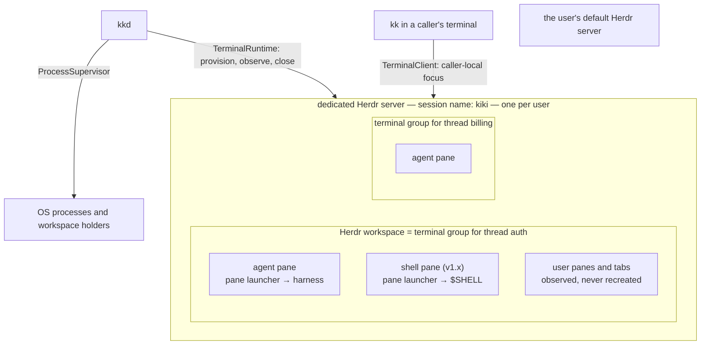

# Terminal runtime

Kiki hosts every [thread](../appendix-a-glossary.md#thread)'s terminals in [Herdr](https://github.com/herdrdev/herdr). Herdr is a [terminal multiplexer](https://en.wikipedia.org/wiki/Terminal_multiplexer): a program that runs many terminals inside one window and keeps them alive on a background server.

Herdr owns the terminal itself. That means the PTYs ([pseudoterminals](https://en.wikipedia.org/wiki/Pseudoterminal), the operating-system objects that connect a program to a terminal), the layouts, the input, the rendering, and Herdr's native sidebar. [`kkd`](../appendix-a-glossary.md#kkd), kiki's background program, remains a separate coordinator.

This chapter defines how the two meet. It covers:

- the topology (what runs where);
- the identities kiki records;
- the three modules that touch the runtime or the operating system (OS);
- the protocols for provisioning (setting up), restoring, and closing terminals.

[D-0004](https://github.com/skeswa/kiki/blob/main/journal/decisions/0004-use-herdr-as-terminal-runtime.md) records the choice of Herdr.

Behavioral truth still lives in [Invariants](../02-invariants.md) and [Threads](../03-threads.md). Herdr does not make those promises itself. This chapter shows how kiki can keep them anyway.

## Ownership

This table says which program is responsible for each concern.

| Concern                                                                                                                                                                                                        | Owner                                                                                                              |
| -------------------------------------------------------------------------------------------------------------------------------------------------------------------------------------------------------------- | ------------------------------------------------------------------------------------------------------------------ |
| Thread identity, [SQLite](https://www.sqlite.org/) (kiki's database), [lifecycle journals](../appendix-a-glossary.md#lifecycle-journal), approvals, [follows](../appendix-a-glossary.md#follows), sync intents | `kkd`                                                                                                              |
| Creating a [jj workspace](https://docs.jj-vcs.dev/latest/working-copy/), forgetting it, and deleting its directory                                                                                             | `kkd`, through `JjBackend`                                                                                         |
| [Harness](../appendix-a-glossary.md#harness) launch gating, exclusive hooks, readiness, delivery, acknowledgement                                                                                              | `kkd`, the [pane launcher](../appendix-a-glossary.md#pane-launcher), and the [harness adapter](harness-adapter.md) |
| OS process identity, freeze, [verified resume](../appendix-a-glossary.md#verified-resume), termination, inventory of [workspace holders](../appendix-a-glossary.md#holder)                                     | `kkd`, through `ProcessSupervisor`                                                                                 |
| PTYs, panes, tabs, layout, scrollback, copy mode, input, rendering, native sidebar, toasts (pop-up notices)                                                                                                    | Herdr                                                                                                              |
| Which terminal a human is looking at                                                                                                                                                                           | each Herdr client; requested through `TerminalClient`                                                              |

Kiki uses Herdr only from the outside, as a separate program. It uses four parts of Herdr:

- the `herdr` executable;
- its [JSON](https://en.wikipedia.org/wiki/JSON) socket API, a set of text messages sent over a local [socket](https://en.wikipedia.org/wiki/Unix_domain_socket);
- its configuration file;
- for the v1.x UI, its plugin and keybinding facilities.

Kiki does not fork Herdr (keep a changed copy of its code). Kiki does not link Herdr's [crates](https://doc.rust-lang.org/cargo/reference/workspaces.html) (its Rust code libraries). Kiki does not speak Herdr's private client protocol.

Kiki never calls Herdr's `worktree.*` methods. Those methods create and delete [Git worktrees](https://git-scm.com/docs/git-worktree) under Git ownership rules. A kiki thread's checkout is a jj workspace, and only kiki creates and deletes it.

## Topology

The diagram shows the pieces and which module connects them.



- **One dedicated server.** Kiki runs one named Herdr server per user. This is the [dedicated Herdr server](../appendix-a-glossary.md#dedicated-herdr-server).
  - A Herdr _session_ is a server namespace with its own socket and its own saved state.
  - A Herdr session is not the per-thread unit. Kiki never creates one per thread or per repo.
  - The session name defaults to `kiki`.
- **One terminal group per thread.** A **[terminal group](../appendix-a-glossary.md#terminal-group)** is kiki's name for the per-thread terminal home. With Herdr it is one Herdr workspace.
  - In this book, the word "[workspace](../appendix-a-glossary.md#workspace)" with nothing in front of it always means a jj workspace.
  - The terminal object is written "Herdr workspace" or "terminal group".
- **Role panes.** Inside the group's tab, kiki provisions panes by role. A pane set up this way is a [role pane](../appendix-a-glossary.md#role-pane).
  - The roles are `agent` (required), `shell` (v1.x, on by default), and `ui` (v1.x, optional).
  - Every role pane's direct PTY child is the kiki [pane launcher](../appendix-a-glossary.md#pane-launcher). "Direct PTY child" means the first program the terminal starts.
  - Any other pane or tab in the group is a [`user` pane](../appendix-a-glossary.md#user-pane). Kiki never recreates a `user` pane. But close observes and accounts for every process in it.

### Starting and addressing the server

Only `kkd` starts the dedicated server. `kkd` does two things to select it:

- It names the server with Herdr's session name.
- It points Herdr at one configuration file that kiki generates: `<herdr_dir>/config.toml`. The directory comes from `[paths] herdr_dir`, and its default is `<user_state_dir>/herdr/`.

The explicit configuration file is mandatory. Without it, a named Herdr session shares the user's default configuration.

Herdr has no option to move the rest of its files:

- Herdr keeps the named session's socket, saved layout, and logs in its own directories, keyed by the session name.
- Herdr shares its plugin registry and miscellaneous state with the user's other Herdr use.

So kiki's isolation claim is exact and limited. Kiki's server has a separate server process, socket, saved session, and configuration file. It does not have a separate directory tree.

Kiki **must not** relocate Herdr by redirecting the [XDG base-directory](https://specifications.freedesktop.org/basedir-spec/latest/) variables. These are [environment variables](https://en.wikipedia.org/wiki/Environment_variable) that tell programs where to keep configuration and state. Panes inherit the server's whole environment. So every shell, jj, git, and gh in every thread would then read its configuration from the wrong place.

For the same reason, `kkd` starts the server with an environment that it builds on purpose. That environment is the user's login baseline. It is not the environment of whatever terminal happened to run the first `kk`. Each role pane then adds its explicit variables on top. The path of kiki's generated Herdr configuration is visible inside panes. It is not a secret.

- **Generated configuration.** The file does these things:
  - It turns off agent resume on restore, onboarding, and update checks.
  - It turns on Herdr [toasts](../appendix-a-glossary.md#toast).
  - It sizes the sidebar for kiki's label.
  - In v1.x, it declares kiki's [sidebar tokens](../appendix-a-glossary.md#sidebar-token) and keybindings.

  Two facts make the file fragile. Herdr's own client can rewrite it. And when the file fails to parse, Herdr silently falls back to defaults, which have agent resume on. So `kkd` does three things immediately before every server start:
  - It regenerates the file.
  - It validates the file with its own parser.
  - It refuses to start the server on any diagnostic.

  Hand edits are overwritten.

- **Placement.** On macOS, a server that lives inside the terminal application's [launchd](https://en.wikipedia.org/wiki/Launchd) job dies when that application quits. (launchd is the macOS service manager, the system program that starts and restarts background programs.)
  - So `kk` bootstraps `kkd` as a launchd user agent. On Linux it uses a [systemd](https://en.wikipedia.org/wiki/Systemd) user unit, the Linux equivalent.
  - `kk` does not fork `kkd` from the terminal. "Fork" here means start it as a child of the terminal.
  - `kkd` starts the server from there.
  - Herdr has its own fix for this problem. That fix applies only to servers Herdr auto-spawns, and kiki never uses those.
- **Attaching.** `kk attach` asks `kkd` to ensure the server is running. Then it connects with Herdr's connect-only client for the named session. It never uses a client entry point that would start a server itself.
- **Verification.** `kkd` checks the server before using it:
  - It checks the server's reported version and protocol against its supported range.
  - It records the [server instance](../appendix-a-glossary.md#server-instance).
  - It refuses, with a clear error, when the longest socket name Herdr derives for the session would exceed the platform's limit.

  A running server that `kkd` did not start is unverified, because its configuration is unknown. Threads bound to it read [`TerminalMissing`](../appendix-a-glossary.md#terminalmissing) until `kkd` restarts the server under an approved plan.

Kiki never runs Herdr's agent-integration installer against a managed harness's launch-scoped settings. The pre-tool boundary belongs to kiki alone. Kiki never reads or changes the configuration or terminals of the user's default Herdr server.

Launch environment is explicit and per pane. Herdr does not copy one pane's explicit environment into a split. Herdr does not persist (save) launch environment. So kiki passes each role pane's [working directory](https://en.wikipedia.org/wiki/Working_directory), argv (the command and its arguments), and environment in the provisioning call. Kiki never assumes a pane inherited them.

## Identity

A thread's terminal presence is a ladder of separate identities. Each rung is recorded separately. No lower rung can stand in for a higher one.

In the table, "Authority" means the one source kiki trusts for that identity.

| Identity              | What it is                                                           | Lifetime                                             | Authority                                                                                       |
| --------------------- | -------------------------------------------------------------------- | ---------------------------------------------------- | ----------------------------------------------------------------------------------------------- |
| `thread_id`           | kiki's stable identity                                               | the thread                                           | kiki SQLite                                                                                     |
| `server_instance_id`  | kiki's record of one lifetime of the dedicated server process        | until that process exits                             | socket peer process identity `(pid, start_time)`, checked on each connection                    |
| `terminal_binding_id` | one provisioned terminal group for one thread on one server instance | until closed, replaced, or the instance ends         | kiki journal, proven by launcher handshakes                                                     |
| Herdr refs            | workspace, tab, and pane ids (`w3`, `w3:t1`, `w3:p2`)                | may recur across server lifetimes; reused on restore | none — a locator valid only within one `server_instance_id`                                     |
| Herdr `terminal_id`   | Herdr's per-terminal marker                                          | reallocated on restore                               | none — a change hint                                                                            |
| role                  | `agent`, `shell`, or `ui`                                            | the claiming process's life                          | the launcher's gate claim, bound to the claiming process identity; never pane position or label |
| process identity      | `(pid, start_time)` with OS session and process-group ids            | one OS process                                       | the OS, read by `ProcessSupervisor`                                                             |
| `agent_session_id`    | one managed harness incarnation                                      | one harness process                                  | the ready handshake                                                                             |
| `harness_session_id`  | the harness's resumable conversation                                 | may span incarnations                                | the harness                                                                                     |

Some terms from the table:

- A **pid** is a [process id](https://en.wikipedia.org/wiki/Process_identifier), the number the OS gives a running program. The OS reuses pids, so kiki pairs a pid with the process's start time.
- **Socket peer process identity** is what the OS reports about the program on the other end of a [Unix domain socket](https://en.wikipedia.org/wiki/Unix_domain_socket). See [socket peer credentials](https://man7.org/linux/man-pages/man7/unix.7.html).
- An **OS session** and a **[process group](https://en.wikipedia.org/wiki/Process_group)** are the OS's ways of grouping related processes, such as everything started from one terminal.
- A **[terminal binding](../appendix-a-glossary.md#terminal-binding)** is kiki's record that a terminal group belongs to a thread.
- An **[incarnation](../appendix-a-glossary.md#incarnation)** is one run of a harness process that kiki manages.
- The **[ready handshake](../appendix-a-glossary.md#ready-handshake)** is the report that proves a harness started with kiki's settings.

Rules that follow from the ladder:

- **A Herdr ref means something only together with the `server_instance_id` it was read under.**
  - Workspace ids come from a counter. A new server lifetime resumes that counter above the highest surviving id. So an id may be issued again.
  - A [cold restore](../appendix-a-glossary.md#cold-restore) returns the same public ids with new processes.
  - A native pane move can also leave a process holding stale ids in its environment.
  - A matching ref on a different instance is a coincidence, not a binding.
- **Presentation is not identity.** Labels, working directories, mutable [metadata tokens](../appendix-a-glossary.md#sidebar-token), pane titles, and pane placement are presentation.
  - Any process on the server's socket can change them. That includes any process inside a pane.
  - They **may** help a human or seed a repair plan's display.
  - They never bind a thread, authorize a mutation, or prove that a directory is safe to delete.
- **A role belongs to the process identity that claimed it.**
  - That identity survives when the `shell` or `ui` launcher replaces itself with the shell or UI program.
  - The identity ends when that process ends.
  - A pane with no live claiming process has no role, whatever its id or label says. It is a `user` pane.
  - `user` is the absence of a role, not a role.
- **A process identity is trusted only as far as it was checked.**
  - Kiki accepts a pane's root process only when its parent is the current server process.
  - Kiki sends a [signal](<https://en.wikipedia.org/wiki/Signal_(IPC)>) (a short OS message such as "stop" or "die") to a process only after re-reading its identity.
  - Kiki terminates a process only while that process is stopped and re-verified. Where the OS offers a process handle, kiki terminates through it. A [process handle](https://man7.org/linux/man-pages/man2/pidfd_open.2.html) is a reference that keeps pointing at the same process even if its pid is reused.
- **Entering `Active` needs three things:** a current binding on the current server instance, a live `agent` role launcher, and a ready handshake from the incarnation that launcher started.
  - Staying `Active` needs the binding and the live `agent` launcher.
  - The existence of a Herdr workspace or pane proves none of these.
- **The `agent` launcher outlives incarnations.**
  - When the harness exits, the incarnation is retired without acknowledgement, and [`AgentStatus`](../appendix-a-glossary.md#agentstatus) becomes `Crashed`. (`AgentStatus` is the harness adapter's status value for an agent.)
  - The role, the binding, and the lifecycle state are unchanged. No surface shows the agent as working.
  - Only three things end the `agent` role and raise [`TerminalMissing`](../appendix-a-glossary.md#terminalmissing): the end of the launcher itself, the end of its binding, or the end of its server instance.
  - Herdr removes a Herdr workspace when its last pane's command exits. So in a group with only an agent pane, the launcher's exit removes the whole terminal group.

## Three modules

Three modules face the runtime and the OS. Each is described below as a [Rust trait](https://doc.rust-lang.org/book/ch10-02-traits.html), a named list of functions that each implementation provides.

Each module has a real second adapter (a second implementation): an in-process fake that drives the deep-module tests. Because the second adapter really exists, each interface is a real seam, not a speculative one. A seam is a place where one implementation can be swapped for another.

Harness safety and delivery are deliberately not in any of the three. They stay with the [harness adapter](harness-adapter.md) and the cascade protocol.

### `TerminalRuntime`

`TerminalRuntime` lives in `kkd`. It does three jobs:

- It starts and observes the server.
- It provisions and closes terminal groups.
- It publishes presentation.

It reports observations. It never claims agent readiness, process absence, or delivery.

```
trait TerminalRuntime {
    fn ensure_server(&self) -> Result<ServerInstance>;
    fn capabilities(&self) -> RuntimeCapabilities;
    fn provision(&self, plan: &ProvisionPlan) -> Result<ProvisionObservation>;
    fn snapshot(&self) -> Result<RuntimeSnapshot>;
    fn subscribe(&self) -> Result<EventStream>;
    fn fence(&self, group: &GroupHandle) -> Result<Fence>;
    fn close_group(&self, group: &GroupHandle) -> Result<CloseRequested>;
    fn publish(&self, group: &GroupHandle, presentation: &Presentation) -> Result<()>;
    fn notify(&self, notice: &Notice) -> Result<NotifyRequested>;
}
```

- **`RuntimeCapabilities`.** The adapter derives this value from three things Herdr reports: its version, its protocol number, and its object of named capability flags.
  - Herdr ignores request parameters it does not know. So an adapter **must** never detect an extension by sending it and seeing no error.
  - Herdr already reports its live-handoff flag as true. That flag is not evidence that kiki supports handoff.
- **Handles.** `GroupHandle` and every pane handle carry the `server_instance_id` they were observed under. A handle from another instance is rejected before any call is made.
- **`provision`** is not [idempotent](https://en.wikipedia.org/wiki/Idempotence) at the runtime, and it says so. (An idempotent call can be repeated safely with the same result.) A lost reply may have created resources. The exactly-once effect comes from the protocol in [Provisioning](#provisioning).
- **`snapshot`** is the only authoritative runtime observation, and it is not atomic. That is, it is not taken at one single instant.
  - Herdr's session snapshot names panes but not their processes. So the adapter asks for each pane's process information separately.
  - `ProcessSupervisor` then re-reads every reported pid from the OS.
  - A process in a Herdr popup appears in no listing at all.
- **`subscribe`** yields wake-up hints only.
- **`fence`** exists only where the runtime advertises [`mutation_fence`](../appendix-a-glossary.md#mutation-fence). It returns a guard. Dropping the guard releases the fence.
- **`close_group`** returns `CloseRequested`, and **`notify`** returns `NotifyRequested`. Neither reply is an outcome.
  - Herdr's close reply does not establish that any process exited.
  - Herdr's toast reply does not establish that anyone saw the toast.

`RuntimeCapabilities` includes at least `direct_argv_launch`, [`client_targeted_focus`](../appendix-a-glossary.md#client-targeted-focus), `mutation_fence`, `request_keys`, `termination_receipt`, and `live_handoff`. Callers branch on these values, never on a version string. The adapter reports `live_handoff` as false throughout v1, whatever Herdr's own flag says.

### `TerminalClient`

`TerminalClient` lives in `kk`, because focus belongs to a viewer and not to the daemon. It performs caller-local navigation with an explicit caller identity. "Caller-local" means it moves only the [Herdr client](../appendix-a-glossary.md#herdr-client) that issued the command.

```
trait TerminalClient {
    fn caller(&self) -> Result<CallerClient>;
    fn focus(&self, caller: &CallerClient, target: &PaneTarget) -> Result<FocusOutcome>;
    fn attach(&self, initial: Option<&PaneTarget>) -> Result<()>;
    fn focus_all_clients(&self, target: &PaneTarget) -> Result<()>;
}
```

- `caller` resolves which attached Herdr client issued the command.
- `focus` moves that client and no other. `FocusOutcome` is `Focused | NoCallerClient | Unsupported`.
- `focus_all_clients` is the explicitly global operation behind `kk switch --all-clients`. Nothing else calls it.
- `attach` connects a new client to the dedicated server.
  - It places that client on `initial` only where the runtime can place one client without moving others.
  - Otherwise it attaches at Herdr's default location and says so.
- A `PaneTarget` carries the server's peer `(pid, start_time)` as well as the Herdr refs. So `kk` verifies that it is talking to the instance the target was issued for, before it asks for anything.

The contract and its required Herdr extension are in [Caller-local focus](#caller-local-focus).

### `ProcessSupervisor`

`ProcessSupervisor` lives in `kkd` and faces the local OS, not Herdr. It owns:

- process identity;
- the inventory of descendants (child processes, their children, and so on) and of [holders](../appendix-a-glossary.md#holder);
- freeze;
- verified resume;
- termination.

```
trait ProcessSupervisor {
    fn inventory(&self, roots: &[ProcessIdentity], workspace: &Path) -> Inventory;
    fn freeze(&self, roots: &[ProcessIdentity], workspace: &Path, journal: &mut FreezeJournal) -> FreezeResult;
    fn reprove(&self, frozen: &FrozenSet) -> ProofResult;
    fn resume(&self, frozen: &FrozenSet) -> ResumeResult;
    fn terminate(&self, recorded: &[ProcessIdentity]) -> ExitResult;
    fn survivors(&self, recorded: &[ProcessIdentity], workspace: &Path) -> Survivors;
}
```

- **Every result carries evidence:** the identities sampled, the samples compared, and the holders found.
- **Every result type has an `Unknown` outcome.**
  - `Unknown` always preserves files.
  - `Unknown` always names each offending process by pid and command line, together with the step that would clear it.
  - A bare "unknown" is not an acceptable result.
- **`freeze` writes ahead through its journal.** It records what it is about to do before it does it.
- **The `FrozenSet`** owns the armed filesystem watch. It can be rebuilt from journaled rows.

The algorithms are in [Process supervision](#process-supervision).

A Herdr reply is never an input to these proofs, with one exception. A reply may be one source of root process ids. The supervisor re-reads those ids from the OS before trusting them.

## Provisioning

Provisioning means creating a thread's terminal group and starting kiki's pane launcher in each role pane.

Herdr's create and layout calls start processes. They have no request key, no create-if-absent, and no rule that labels are unique. So a repeated call after a lost reply creates a second group.

Kiki makes provisioning exactly-once in effect with two tools: a journal, and a gate that only one launcher per role can claim.

**The pane launcher.** Every role pane is created with a direct argv command. That is, Herdr starts the program directly with a list of arguments. It is never text typed into a shell. The executable is the kiki [pane launcher](../appendix-a-glossary.md#pane-launcher).

- The launcher's argv names a `provision_id` and a role.
- Its environment carries the thread's context variables and a [provision nonce](../appendix-a-glossary.md#provision-nonce). A [nonce](https://en.wikipedia.org/wiki/Cryptographic_nonce) is a random value made to be used once. This one is usable once per role.
- `kkd` computes everything the launcher will run. The launcher only executes it.

On start, the launcher does this:

1. It calls `ReportLauncherStarted`. In that call it presents the nonce and reports the Herdr workspace, tab, and pane ids from its environment.
2. It then blocks on a database-backed gate. It does nothing else until the gate opens.

The `agent` launcher waits on its gate through `SuperviseLauncher`. This is a stream (a long-lived connection) that it keeps open for its whole life.

**Why the nonce is safe.** The nonce is never placed in argv, because Herdr saves and exposes launch argv. No Herdr method or saved file exposes launch environment. But any same-UID process can read another process's initial environment through the OS. ("Same-UID" means running as the same [user id](https://en.wikipedia.org/wiki/User_identifier), that is, as the same user.)

So the nonce is not a secret to lean on. It is safe only for two reasons: it is one-use per role, and `kkd` binds the claim to the caller's process identity.

`kkd` accepts a launcher's report only when both of these hold:

- the caller's OS identity, read from the connection's [peer credentials](https://man7.org/linux/man-pages/man7/unix.7.html) and not from the report, has the current server instance's process as its parent;
- a fresh per-pane process query on a verified connection shows that the reported pane's root process is that caller.

A report that fails either check is refused and binds nothing. One example is a stale launcher from an earlier server lifetime that names a recycled id.

What happens when the gate opens depends on the role:

- **For the `agent` role,** the gate is the [launch gate](../appendix-a-glossary.md#launch-gate) defined in [Threads](../03-threads.md#creation). When it opens:
  1. The launcher creates the harness child process, held before it runs.
  2. The launcher reports the child through `ReportHarnessStarted`.
  3. `kkd` verifies from the OS that the child is that launcher's child, and records its identity.
  4. Only then does the launcher release the child.

  So the harness identity is durable (saved) before the harness executes anything.

  The launcher never passes the nonce or any `HERDR_*` variable to the harness.

  The launcher stays alive as the role's supervisor. It keeps `SuperviseLauncher` open, reports the harness's exit, and then waits for the next gate. So a replacement incarnation needs no new pane. Each gate is one-use and belongs to one incarnation.

- **For the `shell` and `ui` roles,** the role-claim [transaction](https://en.wikipedia.org/wiki/Database_transaction) itself releases the gate. (A transaction is a group of database changes that all happen or all do not.)
  - The launcher removes the spent nonce from its environment.
  - The launcher replaces itself with the user's shell or the kiki UI process.
  - The role stays with that process identity until the process ends.

Wherever this book requires that "the `agent` launcher answers", it means two things together:

- its OS identity is alive and not stopped; and
- its `SuperviseLauncher` stream to `kkd` is open.

The `shell` and `ui` roles hold no stream. For them kiki checks the recorded process identity only.

**The protocol.** Provisioning one terminal group is one journaled step sequence inside the owning lifecycle [saga](../appendix-a-glossary.md#saga). A saga is a multi-step operation that records each step so it can recover after a crash.

1. Persist the `provision_id`, the nonce's [hash](https://en.wikipedia.org/wiki/Cryptographic_hash_function), the intended roles, the exact jj workspace path, and the current `server_instance_id`. Mark the step `Started`.
2. Call Herdr to create the Herdr workspace with an explicit working directory and label. Then apply the role layout over that Herdr workspace's first tab.
   - Herdr appends the layout as a new tab with new ids and closes the old one.
   - The label is the repo's directory name, the thread's display name, and a short `provision_id` tag.
   - The label is for people and for discovery hints only.
3. Wait for launcher reports. Each accepted report binds `(provision_id, role)` to an observed `(server_instance_id, Herdr refs, process identity)`.
4. In one transaction, accept exactly one launcher per role, record its process identity and the pane rows, and mark the binding `Bound` and the step `Completed`.
   - The first accepted launcher fixes the binding's Herdr workspace. A launcher reporting from any other Herdr workspace is refused.
   - For the `agent` role, a second transaction later records the process incarnation and activates its launch gate. The gate requires a `Bound` binding.
5. Refuse every other launcher that presents the same nonce for a claimed role. A refused launcher exits without starting anything.

**Unbound containers.** Herdr's create call always starts the user's login shell in the new Herdr workspace's first pane. That shell runs its startup files in the jj workspace before the layout replaces it.

If the sequence stops between the two calls of step 2, the shell remains in an **[unbound container](../appendix-a-glossary.md#unbound-container)**: a Herdr workspace with no binding.

- Unbound containers are never adopted.
- Close, restart, and cleanup plans list and close any unbound container whose processes hold the thread's workspace.

**Lost replies and duplicates.** Suppose the reply to step 2 is lost, or `kkd` crashes anywhere before step 4. Recovery does not blindly repeat the call. It takes a fresh snapshot and collects launcher reports for the `provision_id`. Then it does one of three things:

- it accepts a complete reported set; or
- it waits, for a bounded time, for launchers that are still starting; or
- it rotates the nonce and issues one new create call.

If two groups ever report the same `provision_id`, exactly one is accepted. The other group's launchers are refused.

- A duplicate group whose every pane held only a refused launcher removes itself. This happens because Herdr removes a Herdr workspace when its last pane's command exits. Kiki confirms the removal from a snapshot and from the OS. It does not assume it.
- A duplicate that does not disappear is an unbound container.

So a duplicate group can exist briefly, but a duplicate harness cannot: the gate is claimed once.

**What is never evidence.** Each of the following proves only that Herdr accepted a request or drew a screen:

- a successful create or layout reply;
- an accepted `agent.start`;
- text accepted into a pane's input queue;
- a visible prompt;
- Herdr's agent-status detection.

None proves that the launcher ran, that the harness is configured, or that anything was delivered.

Readiness is the settings-bound ready handshake. [`kk-hook`](../appendix-a-glossary.md#kk-hook) sends it from the harness's session-start hook event. The transaction that commits it re-reads the launcher's OS identity and the server instance. Delivery is the [cascade protocol](../05-cascade.md#delivery-protocol).

**Compensation is limited.** Compensation means undoing the steps a saga already completed, after a later step fails. A failed creation or reopen **may** automatically close the group it provisioned and remove the jj workspace it created, but only while all three of these hold:

- the launch gate was never activated;
- `ProcessSupervisor` shows the group contains nothing but kiki's own blocked launchers; and
- the workspace still equals its initial [materialization](../appendix-a-glossary.md#materialization) (the files as kiki first wrote them).

Otherwise the saga stops in its failure state with every [projection](../appendix-a-glossary.md#projection) intact. Cleanup is then an approved [repair plan](../appendix-a-glossary.md#repair-plan), either [`cleanup-failed-create`](../appendix-a-glossary.md#cleanup-failed-create) or [`cleanup-failed-reopen`](../appendix-a-glossary.md#cleanup-failed-reopen). That plan uses the close machinery below.

An automatic undo never sweeps away a harness that ran. It also never sweeps away a pane the user opened while the thread was still `Creating`.

## Observation and presentation

This section covers how `kkd` learns what Herdr is doing, and how `kkd` shows thread state in Herdr.

Two Herdr features are neither durable nor authority:

- **Herdr's event stream** is bounded and held in memory. It carries no resumable cursor, so a reader cannot pick up where it left off. It can report that events were lost.
- **Herdr's [metadata tokens](../appendix-a-glossary.md#sidebar-token)** can be changed by any socket peer (any program connected to the socket). They vanish on server restart.

The rules:

- **Subscribe, then snapshot.** `kkd` subscribes to events and then takes a full snapshot. An event wakes the reconciler, the part of `kkd` that compares records with reality. The snapshot is what the reconciler reconciles against.
  - `kkd` resyncs after any of these: a loss signal, any connection error, a reconnect, or a changed `server_instance_id`.
  - To resync, `kkd` resubscribes, takes a fresh snapshot, reconciles every binding, and republishes presentation.
  - A Herdr workspace that vanished because its last pane exited produces only a pane-exit event. So the reconciler never waits for a group-closed event.
- **Reconciliation.** Reconciliation compares each binding's recorded handles and launcher identities with the snapshot and the OS.
  - Differences become [projection issues](../appendix-a-glossary.md#projection-issue) under the rules in [Threads](../03-threads.md#projection-divergence-and-repair).
  - A terminal change that an in-flight [lifecycle journal](../appendix-a-glossary.md#lifecycle-journal) expected belongs to that journal.
- **Presentation is one-way.** `kkd` publishes only to a terminal group with a current binding.
  - A [remnant](../appendix-a-glossary.md#remnant-container) or unbound container keeps whatever label the runtime has. It receives nothing from kiki.
  - For a bound group, `kkd` publishes the [Herdr workspace label](../appendix-a-glossary.md#sidebar-label). In v1.x it also publishes sidebar tokens for lifecycle, cascade state, [agent display state](../appendix-a-glossary.md#agent-display-states), and follows parent.
  - Kiki never reads a decision back out of a label or token.
  - Presentation is republished after every resync and on every state change. So a clobbered (overwritten) value heals without becoming an input.
- **The durable record is elsewhere.** Kiki's journals and jj's [operation history](https://docs.jj-vcs.dev/latest/operation-log/) remain the durable record. Nothing is reconstructed from Herdr's event history.

Herdr has its own agent detection, with values `idle | working | blocked | done | unknown`. It is a heuristic (an educated guess) based on the screen and the process.

- It **may** be shown as a hint beside kiki's state.
- It is not [`AgentStatus`](../appendix-a-glossary.md#agentstatus).
- It never admits a tool boundary.
- `agent.wait` or a detected idle screen never substitutes for [agent quiescence](../appendix-a-glossary.md#agent-quiescence), soft-delivery proof, or acknowledgement.

## Runtime changes are reconciliation

Several different events can sit behind "the terminal came back". Kiki tells them apart. It treats none of them as a ready agent.

| Event                    | What Herdr preserves                                                                                                                               | What kiki does                                                                                                                                                                                                                                                                                                                                   |
| ------------------------ | -------------------------------------------------------------------------------------------------------------------------------------------------- | ------------------------------------------------------------------------------------------------------------------------------------------------------------------------------------------------------------------------------------------------------------------------------------------------------------------------------------------------ |
| **Client reconnect**     | Everything. Processes never stopped.                                                                                                               | Nothing changes in kiki's state. Only the caller identity used by `TerminalClient` is new.                                                                                                                                                                                                                                                       |
| **Pane exit**            | The server and other panes. The pane of the command that exited is removed. The Herdr workspace is removed with it if that was its last pane.      | The claiming process identity is gone, so its role ends. If the ended role is `agent` (the launcher itself exited), kiki retires any live incarnation without acknowledgement and raises `TerminalMissing`. A harness that exits under a live launcher is not this case: the incarnation is retired and the role continues.                      |
| **Cold restore**         | Layout, labels, working directories, and public ids. Every process is new. Launch argv is saved but not rerun. Launch env and tokens are not kept. | There is a new `server_instance_id`. Every binding from the old instance is ended, and every incarnation is retired. Restored panes have no role. `kkd` runs the [orphan scan](#orphans), then raises `TerminalMissing` for each affected thread. A restart is a `kk repair` plan with a fresh credential, launch settings, gate, and handshake. |
| **Planned live handoff** | Processes and PTYs move to a new server process.                                                                                                   | Unsupported until its acceptance gate passes. Kiki never initiates it. An observed instance change with surviving recorded processes blocks boundary mutation and raises `TerminalMissing` with that evidence. Repair re-proves or restarts.                                                                                                     |
| **`kkd` restart**        | Everything. The server and processes never stopped.                                                                                                | `kkd` reconnects, verifies the `server_instance_id` against its record, snapshots, and reconciles. A binding or incarnation continues if its recorded process identities are still live under the same instance. The harness's next hook round-trip re-proves the incarnation as usual. In-flight sagas resume from their journals.              |

A restored Herdr workspace is a **[remnant container](../appendix-a-glossary.md#remnant-container)**, not a binding. Its panes are **[remnant panes](../appendix-a-glossary.md#remnant-pane)**. A remnant pane is usually a plain shell that the runtime started in the saved working directory. It has no process at all when that directory is gone.

- Kiki never adopts a remnant container.
- Kiki never reuses one.
- Kiki never binds from its id or label.
- Kiki ties a remnant to a thread only by OS evidence: a pane process that holds the thread's workspace.

Repair plans dispose of remnants explicitly. The [`restart-terminal`](../appendix-a-glossary.md#restart-terminal) plan and the [`close-without-terminal`](../appendix-a-glossary.md#close-without-terminal) plan both list, for approval, every remnant or unbound container whose processes hold the workspace, together with those processes. Then, in order:

1. Each listed container is frozen, its processes are terminated with [verified exit](../appendix-a-glossary.md#verified-exit), and its close is requested, exactly as [Process supervision](#process-supervision) describes.
2. The holder scan runs again.
3. Only then does a restart provision a fresh terminal group, or a close forget the workspace.

A human may have started anything in a restored pane, including a second copy of the agent. That is why the plan lists processes instead of assuming they are shells.

Kiki does not let Herdr resume agents. A resumed process would run without kiki's credential, launch-scoped settings, gate, or exclusive-hook proof.

## Process supervision

Kiki deletes a thread's files only after proving that every program it can see using them is stopped, or was accepted by name in the approved plan. This section says how `ProcessSupervisor` builds that proof.

Herdr alone cannot prove it:

- Herdr reports a pane's direct child and its [foreground process group](<https://en.wikipedia.org/wiki/Job_control_(Unix)>) (the group of processes currently using the terminal).
- Herdr's close path sends [signals](<https://en.wikipedia.org/wiki/Signal_(IPC)>) to the processes it sampled once from the child's OS [session](https://en.wikipedia.org/wiki/Process_group). It logs a warning if any remain. It replies `ok` either way.

That is useful cleanup and no proof. Stock [tmux](https://github.com/tmux/tmux) gives no stronger proof. The orphan behavior below was reproduced under both. None of this section is specific to Herdr.

The proofs below see same-UID processes on the local host. That is, they see processes running as the same user on the same machine. Two kinds of writer are invisible to them:

- a writer under another UID;
- a writer that reaches the files through another mount (a second path to the same storage).

For those, the filesystem recheck after exit is the only check that can still notice the writes.

### Process quiescence proof

"Quiescence" means being quiet: nothing is running. `freeze` establishes that nothing kiki can account for is running against the jj workspace. It proceeds in this order:

1. **Roots.** Take every pane's direct child in every listed terminal container, from a fresh runtime snapshot. This covers role panes and `user` panes alike. Add every process identity kiki recorded for the binding.
   - Read each root's `(pid, start_time, os_session_id, process_group_id)` from the OS.
   - A root is treated as unknown, not as the process kiki expected, in two cases: its parent is not the current server process, or its start time disagrees with a record.
2. **Write ahead.** Before signalling any process, commit three things to `process_records`: its identity, its current stop state, and the freeze's lifecycle operation id. (This is [write-ahead logging](https://en.wikipedia.org/wiki/Write-ahead_logging): record the plan before acting.)
   - A process that was already stopped is recorded as such, so that resume leaves it stopped.
   - A crash at any point in a freeze is therefore recoverable. Recovery resumes exactly the journaled rows.
3. **Fixed-point discovery.** This step repeats until nothing new turns up.
   - Stop the journaled members.
   - After each stop, re-read the identity. On a mismatch, continue that process and treat it as unknown.
   - Then repeatedly enumerate descendants, OS-session members, and process-group members of every known member. Journal and stop any new ones, and sample again.
   - Discovery may grow the set on every round.
   - The proof holds only when two consecutive complete samples are identical and every member is observed stopped.
   - A [zombie](https://en.wikipedia.org/wiki/Zombie_process) (a process that has ended but is still listed) counts as exited.
   - The result is `Unknown` in two cases: a member is stopped by a tracer (a debugger-like program controlling it), or the set has not stabilized within the bound.
4. **Holders.** Enumerate same-UID processes that refer to the workspace through their working directory, root, mapped file, or open [file descriptor](https://en.wikipedia.org/wiki/File_descriptor) (the OS's handle for an open file).
   - Exclude `kkd`, `kkd`'s own child processes, and the invoking `kk`.
   - A holder outside the [frozen set](../appendix-a-glossary.md#frozen-set) makes the result `Unknown`, unless the approved plan names that exact process identity as an [accepted holder](../appendix-a-glossary.md#accepted-holder). One example is an editor the human chose to leave open.
5. **Repository locks.** Confirm that no frozen member has an open file descriptor under the repository's `.jj` directory.
   - A jj command frozen mid-flight would hold repository-wide locks that the checkpoint and every other thread need.
   - Finding one takes verified resume.
6. **Arm the filesystem proof.** Start a filesystem watch on the workspace. Record its generation with the workspace fingerprint. (The watch reports file changes, the generation identifies the watch's state, and the fingerprint is a compact summary of the files.)
7. **Fence terminal mutation.** The Herdr server is itself a parent that can start a new shell in the group at any time. A user split, a plugin, or another API caller can cause this.
   - Where [`mutation_fence`](../appendix-a-glossary.md#mutation-fence) is available, kiki fences the group for the duration.
   - Where it is not, kiki records the group's pane and tab set with the frozen set. It treats any difference at a later proof as drift.
   - Without a fence, kiki detects a changed pane or tab set. It does not detect terminal input, and it does not claim to.

Every step taken while processes are frozen has a deadline. An expired deadline takes verified resume.

**Two proofs bracket the work a close does while frozen.**

- The **[post-freeze recheck](../appendix-a-glossary.md#post-freeze-recheck)** runs immediately after the freeze. It binds the decision to the approved fingerprint.
- The **[final proof](../appendix-a-glossary.md#final-proof)** runs after the checkpoint and all child work, immediately before the first step that cannot be resumed from. It does all of these:
  - It re-asserts that every member is still stopped.
  - It confirms, from a fresh runtime observation, that each listed container still holds the recorded launcher or the exact processes the plan listed for it.
  - It repeats the membership sample, the holder scan, the runtime snapshot comparison, the filesystem generation, and the fingerprint.
  - It journals the generation and fingerprint it saw.

If either proof finds any unknown writer, any instability, or any drift, kiki preserves files and takes the verified-resume path.

One case is outside the guarantee. A process may detach from every tracked relationship and touch the workspace only after the final proof. That process is outside the cooperative guarantee, exactly as [Workspaces are cooperative isolation](../02-invariants.md#workspaces-are-cooperative-isolation) says.

**What the approval covers.** The approval that authorizes a freeze covers every process in the listed terminal containers at freeze time. The rendered plan shows the preflight process inventory and says exactly that. A process that joins a listed container between preflight and freeze is covered. It is not drift.

**Where this proof is used.** This **[process quiescence proof](../appendix-a-glossary.md#process-quiescence-proof)** is used by close, destroy, and repair only. It is not the cascade's boundary. The cascade's non-hook boundary is **[agent quiescence](../appendix-a-glossary.md#agent-quiescence)**, the harness adapter's `AgentStatus::Quiescent`. Neither kind of quiescence is ever inferred from a terminal observation.

### Verified resume

An aborted operation **must** leave the thread able to continue. `resume` lets the processes kiki froze run again.

- `resume` continues exactly the members whose recorded prior state was running.
- It continues children before parents, and session leaders last. This way a shell does not see its foreground job as stopped.
- It leaves members that were already stopped untouched.

It then verifies what kiki needs:

- every role process still has its recorded identity;
- the `agent` launcher answers; and
- the terminal group still has its bound role panes.

Processes in `user` panes that exited during the freeze are reported. They are not treated as failure.

If a [tool batch](../appendix-a-glossary.md#tool-batch) was in flight when the freeze began, the incarnation's batch state is unknown afterwards. The existing unknown-batch rule applies: files are left untouched, and the incarnation is restarted to a clean boundary.

Only a verified resume lets the lifecycle return to `Active`. A failed or unprovable resume is `CloseFailed` or the owning saga's failure state, with the workspace present.

### Termination and verified exit before deletion

Kiki ends the frozen set itself, while it is still stopped, before it asks the runtime to close anything. The reason:

- A stopped process cannot act on a hangup or a termination request. (A hangup is the [signal](<https://en.wikipedia.org/wiki/Signal_(IPC)>) a process gets when its terminal closes.)
- But a hangup can wake it.
- A process that woke with a handler could write into the workspace after the final proof.

So, after the final proof, `terminate` takes each frozen identity in turn:

1. It confirms the process is still stopped and still the recorded identity.
2. It kills it outright.
3. It verifies that it is gone.

Only then does kiki ask the runtime to close the terminal group. That close is now cleanup. Its reply is not read as an outcome.

After termination and the close request, two checks run:

- The **[post-exit filesystem recheck](../appendix-a-glossary.md#post-exit-filesystem-recheck)** confirms that the workspace's filesystem generation and fingerprint still equal the values the final proof journaled.
- The holder scan runs once more.

After a `kkd` crash the watch is gone. So recovery re-reads the fingerprint and compares it with the journaled value before going further.

Kiki **may** forget the jj workspace and delete its directory only when all three of these are true:

- every frozen identity is verified gone;
- the recheck matches; and
- no unaccepted holder remains.

Otherwise the files stay and the lifecycle fails loudly.

The same order applies wherever kiki removes a terminal container. That means the thread's own terminal group, and each remnant or unbound container a repair plan lists.

### Orphans

Some processes outlive the thing that started them (see [orphan process](https://en.wikipedia.org/wiki/Orphan_process)):

- A terminal server that is killed leaves behind any process that ignored hangup.
- A graceful stop leaves any process that escaped its session.
- A harness that is killed leaves behind the tool it was running.

Such a process can be absent from every terminal view and still be writing. So kiki scans for survivors instead of trusting absence. It scans at these times:

- at `kkd` start, before any thread is reported `Active`, and whenever the `server_instance_id` changes;
- before provisioning a replacement terminal group or opening a gate for a replacement incarnation;
- before any step that forgets or deletes a jj workspace, where it runs together with the holder scan.

An **[orphan](../appendix-a-glossary.md#orphan)** is a process kiki recorded that is alive where kiki's records say none should be:

- a recorded process identity that is alive without a current binding; or
- a **[harness remnant](../appendix-a-glossary.md#harness-remnant)**: any process other than the launcher itself found in an inventory rooted at the `agent` launcher when no incarnation is live.
  - Stopping or [hard-pausing](../appendix-a-glossary.md#hard-pause) a harness records and covers the harness's whole process tree.
  - The gate for a replacement incarnation opens only when that inventory is empty.

An orphan raises the [`OrphanedProcess`](../appendix-a-glossary.md#orphanedprocess) [projection issue](../appendix-a-glossary.md#projection-issue), with its identity as evidence. While it is unresolved, kiki:

- starts no replacement agent in that workspace;
- materializes nothing into it; and
- deletes nothing.

`kk repair` offers two choices: an approved plan that terminates the exact recorded identities and verifies their exit, or leaving them and keeping the thread blocked.

A recorded role process that is still a pane member on the current instance is a terminal member, not an orphan.

**Holders kiki never recorded.** A workspace holder that kiki never recorded is not an orphan and is not a standing issue.

- Examples are an editor, a file watcher, or a shell in another terminal that has changed into the workspace.
- Such a holder never blocks an `Active` thread's boundaries.
- It matters only to an operation that deletes the workspace. There the [holder rule](#process-quiescence-proof) applies: the plan names it as accepted, or the result is `Unknown` and reports it.

Kiki signals only process identities it recorded itself. It records them at launch, at a handshake, or during freeze discovery inside an approved operation.

## Caller-local focus

`kk switch` moves the caller's view and nobody else's. This is [caller-local focus](../appendix-a-glossary.md#caller-local-focus). The move to Herdr does not change that contract.

Herdr's public API cannot yet honor it, for three reasons:

- `workspace.focus`, `tab.focus`, and `pane.focus` set shared state and move every attached client.
- No public method names a client.
- No process in a pane, and no keybinding command, is told which client it serves.

Kiki does not weaken the contract to fit. It requires a small upstream extension (a change made in Herdr itself), called **[client-targeted focus](../appendix-a-glossary.md#client-targeted-focus)**:

1. a client list that reports each attached client's id, its current location, and which client is in the foreground;
2. an optional client target on the focus methods that routes into Herdr's existing per-client navigation instead of the broadcast;
3. the invoking client's id in the environment of keybinding commands and plugin actions;
4. an advertised capability flag, since unknown parameters are silently ignored.

With the extension, `TerminalClient::caller` resolves the caller in this order:

1. The client id supplied to a keybinding or plugin invocation.
2. Otherwise, for a command typed in a pane, the foreground client. It is accepted only when that client is currently showing the pane the command runs in.

A command with no such viewer resolves `NoCallerClient` and moves no one. Examples are an agent's tool call, a script, or a pane nobody is looking at.

Until `client_targeted_focus` is advertised, `kk switch <thread>` fails with a message that names the missing capability.

`kk switch --all-clients <thread>` is the explicit, differently named operation. It moves every attached client through the public focus method. It exists so that a single-viewer setup works today without pretending to be local.

Kiki never falls back from the first form to the second on its own.

Kiki's own terminal operations **must not** move anyone either. Provisioning, duplicate cleanup, and restart are expected to leave every attached client where it was. There are known exceptions that follow from Herdr's shared focus:

- the first Herdr workspace created on an empty server takes focus;
- applying a layout over a tab someone is viewing moves that view to the new tab; and
- a client viewing a tab that is replaced, or a container that closes, falls back to Herdr's default location.

This is an open gate, not an established fact. That is, it still has to be proven by a test.

## Native and custom UI

Kiki reuses Herdr's UI where it already answers the product need. Kiki builds UI only where the need is specific to kiki.

| Need                                                                       | Surface                                                                                                                                                  |
| -------------------------------------------------------------------------- | -------------------------------------------------------------------------------------------------------------------------------------------------------- |
| Panes, splits, tabs, scrollback, copy mode, mouse, resize                  | Herdr, unmodified                                                                                                                                        |
| A cross-repo list of threads with attention state                          | Herdr's sidebar, fed by kiki's label and tokens                                                                                                          |
| Ambient "something needs you" while heads-down                             | Herdr's sidebar and toasts, plus OS notifications                                                                                                        |
| Moving between threads                                                     | Herdr's own navigation, and `kk switch` through `TerminalClient`                                                                                         |
| The follows tree, stack-aware log, transcript and diff preview, spawn form | custom: the `kk` [overlay TUI](../appendix-a-glossary.md#overlay-tui), opened as a Herdr popup or pane                                                   |
| Approval cards                                                             | custom, always: the plan is rendered by an enrolled [`ApprovalPresenter`](../appendix-a-glossary.md#approvalpresenter) that owns its foreground terminal |
| A permanently visible Stack tree                                           | custom and optional: a [`ui` role pane](../appendix-a-glossary.md#ui-role-pane)                                                                          |

(A TUI is a [text-based user interface](https://en.wikipedia.org/wiki/Text-based_user_interface): an interactive screen drawn in a terminal.)

**The sidebar.** Herdr's sidebar is the user's to hide, collapse, or resize. Kiki never relies on it being visible.

**Popups.** A Herdr popup has four properties:

- there is one per server;
- it is shown to every client viewing its owner tab;
- it closes when that tab goes; and
- it runs a process that no snapshot lists.

So the overlay changes directory out of the jj workspace when it starts. That way it is not an unlisted holder of the files it helps close.

**Approval in a pane.** A pane's PTY is a [controlling terminal](<https://en.wikipedia.org/wiki/Job_control_(Unix)>) for its child. So an `ApprovalPresenter` running in a pane can own its foreground terminal.

**Herdr actions carry no authority.** A Herdr plugin action, keybinding, or sidebar click **may** open a kiki surface or request navigation. It is never an approval. It never carries more authority than the `kk` process it starts.

Two measures narrow accidents:

- `kkd` refuses a confirmation from a presenter process that is a descendant or session member of any `agent` launcher.
- The harness is started with every `HERDR_*` variable removed from its environment.

Neither is a security boundary.

## What exists, what kiki builds, what Herdr must add

The candidate revision is Herdr source commit `ee5bfb5041bb` (package 0.9.5). It was checked on 2026-11-16 in two ways:

- by reading the source; and
- by running the released 0.9.5 binary. That binary is a different, older revision. It was run headless (with no screen) and with no attached client.

"Available" below means present at the candidate revision. An "[acceptance gate](../appendix-a-glossary.md#acceptance-gate)" is a test that has to pass before kiki relies on the behavior.

| Capability                                        | Available in Herdr                                                                     | Kiki adapter work                                                                   | Upstream extension                                | Acceptance gate still unproven                                                             |
| ------------------------------------------------- | -------------------------------------------------------------------------------------- | ----------------------------------------------------------------------------------- | ------------------------------------------------- | ------------------------------------------------------------------------------------------ |
| Dedicated server and configuration                | named sessions; an explicit configuration file; no way to relocate other state         | generate and validate config; construct the server environment; start, find, verify | optional state-root option not exported to panes  | the user's default server and configuration are undisturbed; panes see a clean environment |
| Direct argv launch with cwd/env                   | layout application with per-pane command, cwd, env                                     | pane launcher; replace the default first tab                                        | none                                              | real Claude Code and Codex behind the launcher: input, resize, signals, copy               |
| Exactly-once provisioning                         | no request key; duplicate labels accepted                                              | journal, verified launcher reports, single gate claim, unbound-container cleanup    | optional request key on create and layout         | lost-reply and crash injection never yields two harnesses                                  |
| Server instance identity                          | none in the public API; the API socket is served by the server process itself          | socket peer `(pid, start_time)`                                                     | optional boot id in the ping and snapshot replies | restart with recurring ids is always detected, on each platform                            |
| Durable bindings                                  | labels persist; launch argv is saved but not rerun; launch env and tokens are not kept | bindings live in kiki SQLite; labels are hints                                      | none required                                     | cold restore never binds or reports the wrong thread                                       |
| Events and resync                                 | event stream with bounded history and a loss signal; snapshot without process ids      | subscribe-then-snapshot with per-pane process queries; resync on loss or reconnect  | optional wire sequence and cursor                 | loss injection                                                                             |
| Presentation                                      | labels, sidebar tokens, agent states, toasts (off by default)                          | one-way publisher with republish; tokens are v1.x                                   | none                                              | the label heals after loss or overwrite; kiki's operations move no attached client         |
| Popups, keybinding commands, plugin panes, toasts | present in source at the candidate revision; not run with a client                     | generated keybindings and the overlay entry point (v1.x)                            | none known                                        | each behaves as the [Interface](../10-interface/spec.md) chapter assumes                   |
| Caller-local focus                                | per-client navigation exists only on the private client protocol                       | `TerminalClient` caller resolution                                                  | **required:** client-targeted focus               | two clients; only the invoker moves                                                        |
| Restore policy                                    | layout restore; agent auto-resume can be disabled; layout restore cannot               | reconciliation, orphan scan, remnant disposal, repair restart                       | none required                                     | no restored pane is ever reported `Active`                                                 |
| Process quiescence and verified exit              | signal escalation on close; bare success reply                                         | all of `ProcessSupervisor`                                                          | optional termination receipt                      | multiple panes, background jobs, escaped and daemonized writers, crash mid-freeze          |
| Terminal mutation fence                           | none                                                                                   | pane-set comparison as drift detection                                              | optional group mutation fence                     | a split during freeze aborts or is prevented                                               |
| Surviving the terminal application quitting       | only for servers Herdr auto-spawns                                                     | run `kkd` and the server under the user's service manager                           | none                                              | quit the terminal application; agents keep running                                         |
| Live handoff                                      | Unix-only, experimental                                                                | none in v1                                                                          | a stability commitment                            | handoff with a managed agent and re-proven incarnation                                     |

One row is required upstream before the Herdr-backed acceptance gate can pass: [client-targeted focus](../appendix-a-glossary.md#client-targeted-focus). Every other extension is an optimization of something the adapter already makes safe.

## Platform scope

The v1 runtime is local. `kkd`, the dedicated Herdr server, and every thread's processes run on one host (one machine) under one user.

`ProcessSupervisor` needs to inspect local OS processes and file holders. So a remote Herdr endpoint cannot supply kiki's deletion proof, and remote terminal hosting stays out of scope.

macOS and Linux are the supported platforms once their gates pass.

Herdr runs on Windows. But kiki's freeze, holder inventory, and verified-exit proofs have no Windows evidence. Windows support is a [roadmap](../16-roadmap.md) item gated on that evidence. It is not a consequence of Herdr's support.
