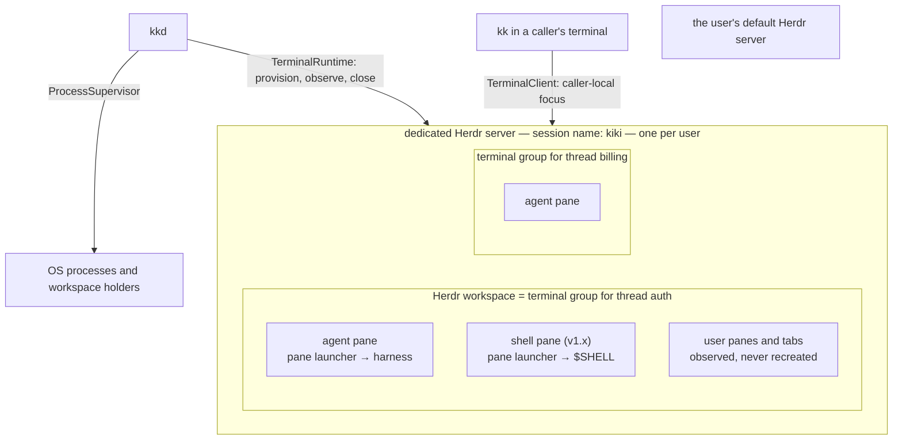

# Terminal runtime

Kiki hosts every thread's terminals in [Herdr](https://github.com/herdrdev/herdr), a terminal multiplexer with a background server. Herdr owns PTYs, layouts, input, rendering, and its native sidebar. `kkd` remains a separate coordinator. This chapter defines how the two meet: the topology, the identities, the three modules that touch the runtime or the OS, and the provisioning, restore, and close protocols. [D-0004](https://github.com/skeswa/kiki/blob/main/journal/decisions/0004-use-herdr-as-terminal-runtime.md) records the choice.

Behavioral truth still lives in [Invariants](../02-invariants.md) and [Threads](../03-threads.md). This chapter makes those promises implementable against a runtime that does not make them itself.

## Ownership

| Concern                                                                                    | Owner                                                                   |
| ------------------------------------------------------------------------------------------ | ----------------------------------------------------------------------- |
| Thread identity, SQLite, lifecycle journals, approvals, follows, sync intents              | `kkd`                                                                   |
| jj workspace creation, forgetting, and directory deletion                                  | `kkd`, through `JjBackend`                                              |
| Harness launch gating, exclusive hooks, readiness, delivery, acknowledgement               | `kkd`, the pane launcher, and the [harness adapter](harness-adapter.md) |
| OS process identity, freeze, verified resume, termination, workspace-holder inventory      | `kkd`, through `ProcessSupervisor`                                      |
| PTYs, panes, tabs, layout, scrollback, copy mode, input, rendering, native sidebar, toasts | Herdr                                                                   |
| Which terminal a human is looking at                                                       | each Herdr client; requested through `TerminalClient`                   |

Herdr is integrated across its process boundary: the `herdr` executable, its JSON socket API, its configuration file, and, for v1.x UI, its plugin and keybinding facilities. Kiki does not fork Herdr, link its crates, or speak its private client protocol. Kiki never calls Herdr's `worktree.*` methods. Those methods create and delete Git worktrees under Git ownership rules; a kiki thread's checkout is a jj workspace that only kiki creates and deletes.

## Topology



- **One dedicated server.** Kiki runs one named Herdr server per user. A Herdr _session_ is a server namespace with its own socket and persisted state; it is not the per-thread unit, and kiki never creates one per thread or per repo. The session name defaults to `kiki`.
- **One terminal group per thread.** A **terminal group** is kiki's name for the per-thread terminal home. With Herdr it is one Herdr workspace. In this book an unqualified "workspace" always means a jj workspace; the terminal object is written "Herdr workspace" or "terminal group".
- **Role panes.** Inside the group's tab, kiki provisions panes by role: `agent` (required), `shell` (v1.x, default on), and `ui` (v1.x, optional). Every role pane's direct PTY child is the kiki pane launcher. Any other pane or tab in the group is a `user` pane: kiki never recreates it, but close observes and accounts for every process in it.

### Starting and addressing the server

Only `kkd` starts the dedicated server. It selects the server with Herdr's session name and points Herdr at one configuration file that kiki generates, `<herdr_dir>/config.toml` (`[paths] herdr_dir`, by default `<user_state_dir>/herdr/`). The explicit configuration file is mandatory: a named Herdr session otherwise shares the user's default configuration. Herdr has no option for relocating the rest of its files. It keeps the named session's socket, saved layout, and logs in its own directories, keyed by the session name, and it shares its plugin registry and miscellaneous state with the user's other Herdr use. Kiki's isolation claim is therefore exact and limited: a separate server process, socket, saved session, and configuration file. It is not a separate directory tree.

Kiki must not relocate Herdr by redirecting the XDG base-directory variables. Panes inherit the server's whole environment, so every shell, jj, git, and gh in every thread would then read its configuration from the wrong place.

For the same reason `kkd` starts the server with an environment it constructs deliberately — the user's login baseline, not whatever terminal happened to run the first `kk` — and each role pane adds its explicit variables on top. The path of kiki's generated Herdr configuration is visible inside panes; it is not a secret.

- **Generated configuration.** The file disables agent resume on restore, onboarding, and update checks; enables Herdr toasts; sizes the sidebar for kiki's label; and, in v1.x, declares kiki's sidebar tokens and keybindings. Herdr's own client can rewrite the file, and Herdr silently falls back to defaults — agent resume on — when the file fails to parse. So `kkd` regenerates the file and validates it with its own parser immediately before every server start, and refuses to start on any diagnostic. Hand edits are overwritten.
- **Placement.** On macOS a server that lives inside the terminal application's launchd job dies when that application quits. `kk` therefore bootstraps `kkd` as a launchd user agent (a systemd user unit on Linux) instead of forking it from the terminal, and `kkd` starts the server from there. Herdr's own fix for this applies only to servers Herdr auto-spawns, which kiki never uses.
- **Attaching.** `kk attach` asks `kkd` to ensure the server is running and then connects with Herdr's connect-only client for the named session. It never uses a client entry point that would start a server itself.
- **Verification.** `kkd` checks the server's reported version and protocol against its supported range, records the server instance, and refuses, with a clear error, when the longest socket name Herdr derives for the session would exceed the platform's limit. A running server that `kkd` did not start is unverified: its configuration is unknown, so threads bound to it read `TerminalMissing` until `kkd` restarts the server under an approved plan.

Kiki never runs Herdr's agent-integration installer against a managed harness's launch-scoped settings; the pre-tool boundary belongs to kiki alone. Kiki never reads or changes the configuration or terminals of the user's default Herdr server.

Launch environment is explicit and per pane. Herdr does not copy one pane's explicit environment into a split, and it does not persist launch environment. Kiki therefore passes each role pane's working directory, argv, and environment in the provisioning call and never assumes a pane inherited them.

## Identity

A thread's terminal presence is a ladder of separate identities. Each rung is recorded separately, and no lower rung can stand in for a higher one.

| Identity              | What it is                                                           | Lifetime                                             | Authority                                                                                       |
| --------------------- | -------------------------------------------------------------------- | ---------------------------------------------------- | ----------------------------------------------------------------------------------------------- |
| `thread_id`           | kiki's stable identity                                               | the thread                                           | kiki SQLite                                                                                     |
| `server_instance_id`  | kiki's record of one lifetime of the dedicated server process        | until that process exits                             | socket peer process identity `(pid, start_time)`, verified per connection                       |
| `terminal_binding_id` | one provisioned terminal group for one thread on one server instance | until closed, replaced, or the instance ends         | kiki journal, proven by launcher handshakes                                                     |
| Herdr refs            | workspace, tab, and pane ids (`w3`, `w3:t1`, `w3:p2`)                | may recur across server lifetimes; reused on restore | none — a locator valid only within one `server_instance_id`                                     |
| Herdr `terminal_id`   | Herdr's per-terminal marker                                          | reallocated on restore                               | none — a change hint                                                                            |
| role                  | `agent`, `shell`, or `ui`                                            | the claiming process's life                          | the launcher's gate claim, bound to the claiming process identity; never pane position or label |
| process identity      | `(pid, start_time)` with OS session and process-group ids            | one OS process                                       | the OS, read by `ProcessSupervisor`                                                             |
| `agent_session_id`    | one managed harness incarnation                                      | one harness process                                  | the ready handshake                                                                             |
| `harness_session_id`  | the harness's resumable conversation                                 | may span incarnations                                | the harness                                                                                     |

Rules that follow from the ladder:

- A Herdr ref is meaningful only together with the `server_instance_id` it was read under. Workspace ids come from a counter that a new server lifetime resumes above the highest surviving id, so an id may be issued again, and a cold restore returns the same public ids with new processes. A native pane move can also leave a process holding stale ids in its environment. A matching ref on a different instance is a coincidence, not a binding.
- Labels, working directories, mutable metadata tokens, pane titles, and pane placement are presentation. Any process on the server's socket, including any process inside a pane, can change them. They may help a human or seed a repair plan's display. They never bind a thread, authorize a mutation, or prove that a directory is safe to delete.
- A role belongs to the process identity that claimed it. That identity survives the `shell` or `ui` launcher replacing itself with the shell or UI program, and it ends when that process ends. A pane with no live claiming process has no role, whatever its id or label says; it is a `user` pane. `user` is the absence of a role, not a role.
- A process identity is trusted only as far as it was checked. A pane's root process is accepted only when its parent is the current server process. Kiki signals a process only after re-reading its identity, and it terminates a process only while that process is stopped and re-verified, through a process handle where the OS offers one.
- Entering `Active` requires a current binding on the current server instance, a live `agent` role launcher, and a ready handshake from the incarnation it started. Staying `Active` requires the binding and the live `agent` launcher. Existence of a Herdr workspace or pane proves none of these.
- The `agent` launcher outlives incarnations. When the harness exits, the incarnation is retired without acknowledgement and `AgentStatus` becomes `Crashed`; the role, the binding, and the lifecycle state are unchanged, and no surface shows the agent as working. Only the end of the launcher itself, of its binding, or of its server instance ends the `agent` role and raises `TerminalMissing`. Herdr removes a Herdr workspace when its last pane's command exits, so in a group with only an agent pane the launcher's exit removes the whole terminal group.

## Three modules

Three modules face the runtime and the OS. Each has a real second adapter — an in-process fake that drives the deep-module tests — so each interface is a real seam rather than a speculative one. Harness safety and delivery are deliberately not in any of them; they stay with the [harness adapter](harness-adapter.md) and the cascade protocol.

### `TerminalRuntime`

Lives in `kkd`. Starts and observes the server, provisions and closes terminal groups, and publishes presentation. It reports observations; it never claims agent readiness, process absence, or delivery.

```
trait TerminalRuntime {
    fn ensure_server(&self) -> Result<ServerInstance>;
    fn capabilities(&self) -> RuntimeCapabilities;
    fn provision(&self, plan: &ProvisionPlan) -> Result<ProvisionObservation>;
    fn snapshot(&self) -> Result<RuntimeSnapshot>;
    fn subscribe(&self) -> Result<EventStream>;
    fn fence(&self, group: &GroupHandle) -> Result<Fence>;
    fn close_group(&self, group: &GroupHandle) -> Result<CloseRequested>;
    fn publish(&self, group: &GroupHandle, presentation: &Presentation) -> Result<()>;
    fn notify(&self, notice: &Notice) -> Result<NotifyRequested>;
}
```

- `RuntimeCapabilities` is derived by the adapter from Herdr's reported version, protocol number, and its object of named capability flags. Herdr ignores unknown request parameters, so an adapter must never detect an extension by sending it and seeing no error. Herdr already reports its live-handoff flag as true; that flag is not evidence that kiki supports handoff.
- `GroupHandle` and every pane handle carry the `server_instance_id` they were observed under. A handle from another instance is rejected before any call is made.
- `provision` is not idempotent at the runtime and says so: a lost reply may have created resources. Exactly-once effect comes from the protocol in [Provisioning](#provisioning).
- `snapshot` is the only authoritative runtime observation, and it is not atomic. Herdr's session snapshot names panes but not their processes, so the adapter queries each pane's process information separately, and `ProcessSupervisor` re-reads every reported pid from the OS. A process in a Herdr popup appears in no listing at all.
- `subscribe` yields wake-up hints only. `fence` exists only where the runtime advertises `mutation_fence`; it returns a guard, and dropping the guard releases the fence.
- `close_group` returns `CloseRequested`, and `notify` returns `NotifyRequested`. Neither reply is an outcome: Herdr's close reply does not establish that any process exited, and its toast reply does not establish that anyone saw the toast.

`RuntimeCapabilities` includes at least `direct_argv_launch`, `client_targeted_focus`, `mutation_fence`, `request_keys`, `termination_receipt`, and `live_handoff`. Callers branch on these values, never on a version string. The adapter reports `live_handoff` as false throughout v1, whatever Herdr's own flag says.

### `TerminalClient`

Lives in `kk`, because focus belongs to a viewer and not to the daemon. It performs caller-local navigation with an explicit caller identity.

```
trait TerminalClient {
    fn caller(&self) -> Result<CallerClient>;
    fn focus(&self, caller: &CallerClient, target: &PaneTarget) -> Result<FocusOutcome>;
    fn attach(&self, initial: Option<&PaneTarget>) -> Result<()>;
    fn focus_all_clients(&self, target: &PaneTarget) -> Result<()>;
}
```

`caller` resolves which attached Herdr client issued the command. `focus` moves that client and no other. `FocusOutcome` is `Focused | NoCallerClient | Unsupported`. `focus_all_clients` is the explicitly global operation behind `kk switch --all-clients`; nothing else calls it. `attach` connects a new client to the dedicated server; it places that client on `initial` only where the runtime can place one client without moving others, and otherwise attaches at Herdr's default location and says so. A `PaneTarget` carries the server's peer `(pid, start_time)` as well as the Herdr refs, so `kk` verifies it is talking to the instance the target was issued for before it asks for anything. The contract and its required Herdr extension are in [Caller-local focus](#caller-local-focus).

### `ProcessSupervisor`

Lives in `kkd` and faces the local OS, not Herdr. It owns process identity, descendant and holder inventory, freeze, verified resume, and termination.

```
trait ProcessSupervisor {
    fn inventory(&self, roots: &[ProcessIdentity], workspace: &Path) -> Inventory;
    fn freeze(&self, roots: &[ProcessIdentity], workspace: &Path, journal: &mut FreezeJournal) -> FreezeResult;
    fn reprove(&self, frozen: &FrozenSet) -> ProofResult;
    fn resume(&self, frozen: &FrozenSet) -> ResumeResult;
    fn terminate(&self, recorded: &[ProcessIdentity]) -> ExitResult;
    fn survivors(&self, recorded: &[ProcessIdentity], workspace: &Path) -> Survivors;
}
```

Every result carries evidence — the identities sampled, the samples compared, the holders found — and every result type has an `Unknown` outcome. `Unknown` always preserves files, and it always names each offending process by pid and command line together with the step that would clear it; a bare "unknown" is not an acceptable result. `freeze` writes ahead through its journal. The `FrozenSet` owns the armed filesystem watch and can be rebuilt from journaled rows. The algorithms are in [Process supervision](#process-supervision). A Herdr reply is never an input to these proofs except as one source of root process ids, which the supervisor re-reads from the OS before trusting.

## Provisioning

Herdr's create and layout calls start processes and have no request key, no create-if-absent, and no label uniqueness. A repeated call after a lost reply creates a second group. Kiki makes provisioning exactly-once in effect with a journal and a gate that only one launcher per role can claim.

**The pane launcher.** Every role pane is created with a direct argv command — never text typed into a shell — whose executable is the kiki pane launcher. Its argv names a `provision_id` and a role. Its environment carries the thread's context variables and a provision nonce, usable once per role. `kkd` computes everything the launcher will run; the launcher only executes it. On start the launcher calls `ReportLauncherStarted`, presenting the nonce and reporting the Herdr workspace, tab, and pane ids from its environment. It then blocks on a database-backed gate and does nothing else until the gate opens. The `agent` launcher waits on its gate through `SuperviseLauncher`, a stream it keeps open for its whole life.

The nonce is never placed in argv, because Herdr saves and exposes launch argv. No Herdr method or saved file exposes launch environment, but any same-UID process can read another process's initial environment through the OS. The nonce is therefore not a secret to lean on: it is safe only because it is one-use per role and `kkd` binds the claim to the caller's process identity. `kkd` accepts a launcher's report only when both of these hold:

- the caller's OS identity, read from the connection's peer credentials and not from the report, has the current server instance's process as its parent;
- a fresh per-pane process query on a verified connection shows that the reported pane's root process is that caller.

A report that fails either check — a stale launcher from an earlier server lifetime naming a recycled id, for example — is refused and binds nothing.

- For the `agent` role, the gate is the launch gate defined in [Threads](../03-threads.md#creation). When it opens, the launcher creates the harness child held before it runs, reports the child through `ReportHarnessStarted`, and releases it only after `kkd` has verified from the OS that the child is that launcher's child and recorded its identity. The harness identity is therefore durable before the harness executes anything. The launcher never passes the nonce or any `HERDR_*` variable to the harness. It stays alive as the role's supervisor, keeps `SuperviseLauncher` open, reports the harness's exit, and then waits for the next gate, so a replacement incarnation needs no new pane. Each gate is one-use and belongs to one incarnation.
- For the `shell` and `ui` roles, the gate is released by the role-claim transaction itself. The launcher removes the spent nonce from its environment and replaces itself with the user's shell or the kiki UI process. The role stays with that process identity until the process ends.

"The `agent` launcher answers", wherever this book requires it, means two things together: its OS identity is alive and not stopped, and its `SuperviseLauncher` stream to `kkd` is open. The `shell` and `ui` roles hold no stream; for them kiki checks the recorded process identity only.

**The protocol.** Provisioning one terminal group is one journaled step sequence inside the owning lifecycle saga:

1. Persist the `provision_id`, the nonce's hash, the intended roles, the exact jj workspace path, and the current `server_instance_id`. Mark the step `Started`.
2. Call Herdr to create the Herdr workspace with an explicit working directory and label, then apply the role layout over that Herdr workspace's first tab. Herdr appends the layout as a new tab with new ids and closes the old one. The label is the repo's directory name, the thread's display name, and a short `provision_id` tag. It is for people and for discovery hints only.
3. Wait for launcher reports. Each accepted report binds `(provision_id, role)` to an observed `(server_instance_id, Herdr refs, process identity)`.
4. In one transaction, accept exactly one launcher per role, record its process identity and the pane rows, and mark the binding `Bound` and the step `Completed`. The first accepted launcher fixes the binding's Herdr workspace; a launcher reporting from any other Herdr workspace is refused. For the `agent` role, a second transaction later records the process incarnation and activates its launch gate; the gate requires a `Bound` binding.
5. Refuse every other launcher that presents the same nonce for a claimed role. A refused launcher exits without starting anything.

Herdr's create call always starts the user's login shell in the new Herdr workspace's first pane, and that shell runs its startup files in the jj workspace before the layout replaces it. If the sequence stops between the two calls, the shell remains in an **unbound container**: a Herdr workspace with no binding. Unbound containers are never adopted. Close, restart, and cleanup plans list and close any unbound container whose processes hold the thread's workspace.

**Lost replies and duplicates.** If the reply to step 2 is lost, or `kkd` crashes anywhere before step 4, recovery does not blindly repeat the call. It takes a fresh snapshot, collects launcher reports for the `provision_id`, and then either accepts a complete reported set, waits for a bounded time for launchers that are still starting, or rotates the nonce and issues one new create call. If two groups ever report the same `provision_id`, exactly one is accepted and the other's launchers are refused. A duplicate group whose every pane held only a refused launcher removes itself, because Herdr removes a Herdr workspace when its last pane's command exits; kiki confirms that from a snapshot and from the OS rather than assuming it. A duplicate that does not disappear is an unbound container. A duplicate group can therefore exist briefly, but a duplicate harness cannot: the gate is claimed once.

**What is never evidence.** A successful create or layout reply, an accepted `agent.start`, text accepted into a pane's input queue, a visible prompt, and Herdr's agent-status detection each prove only that Herdr accepted a request or drew a screen. None proves that the launcher ran, that the harness is configured, or that anything was delivered. Readiness is the settings-bound ready handshake, which `kk-hook` sends from the harness's session-start hook event; the transaction that commits it re-reads the launcher's OS identity and the server instance. Delivery is the [cascade protocol](../05-cascade.md#delivery-protocol).

**Compensation is limited.** A failed creation or reopen may automatically close the group it provisioned and remove the jj workspace it created only while all three hold: the launch gate was never activated; `ProcessSupervisor` shows the group contains nothing but kiki's own blocked launchers; and the workspace still equals its initial materialization. Otherwise the saga stops in its failure state with every projection intact, and cleanup is an approved repair plan — `cleanup-failed-create` or `cleanup-failed-reopen` — that uses the close machinery below. A harness that ran, or a pane the user opened while the thread was still `Creating`, is never swept away by an automatic undo.

## Observation and presentation

Herdr's event stream is bounded and held in memory, carries no resumable cursor, and can report that events were lost. Its metadata tokens are mutable by any socket peer and vanish on server restart. Neither is durable, and neither is authority.

- `kkd` subscribes to events and then takes a full snapshot. An event wakes the reconciler; the snapshot is what it reconciles against. After a loss signal, any connection error, a reconnect, or a changed `server_instance_id`, `kkd` resubscribes, takes a fresh snapshot, reconciles every binding, and republishes presentation. A Herdr workspace that vanished because its last pane exited produces only a pane-exit event, so the reconciler never waits for a group-closed event.
- Reconciliation compares each binding's recorded handles and launcher identities with the snapshot and the OS. Differences become projection issues under the rules in [Threads](../03-threads.md#projection-divergence-and-repair). A terminal change that an in-flight lifecycle journal expected belongs to that journal.
- Presentation is one-way. `kkd` publishes only to a terminal group with a current binding; a remnant or unbound container keeps whatever label the runtime has and receives nothing from kiki. For a bound group, `kkd` publishes the Herdr workspace label and, in v1.x, sidebar tokens for lifecycle, cascade state, agent display state, and follows parent. Kiki never reads a decision back out of a label or token. Presentation is republished after every resync and on every state change, so a clobbered value heals without becoming an input.
- Kiki's journals and jj's operation history remain the durable record. Nothing is reconstructed from Herdr's event history.

Herdr's own agent detection (`idle | working | blocked | done | unknown`) is a screen-and-process heuristic. It may be shown as a hint beside kiki's state. It is not `AgentStatus`, it never admits a tool boundary, and `agent.wait` or a detected idle screen never substitutes for agent quiescence, soft-delivery proof, or acknowledgement.

## Runtime changes are reconciliation

Several different events can sit behind "the terminal came back". Kiki distinguishes them and treats none as a ready agent.

| Event                    | What Herdr preserves                                                                                                                              | What kiki does                                                                                                                                                                                                                                                                                                                      |
| ------------------------ | ------------------------------------------------------------------------------------------------------------------------------------------------- | ----------------------------------------------------------------------------------------------------------------------------------------------------------------------------------------------------------------------------------------------------------------------------------------------------------------------------------- |
| **Client reconnect**     | everything; processes never stopped                                                                                                               | Nothing changes in kiki's state. Only the caller identity used by `TerminalClient` is new.                                                                                                                                                                                                                                          |
| **Pane exit**            | the server and other panes; the exited command's pane is removed, and the Herdr workspace with it if that was its last pane                       | The claiming process identity is gone, so its role ends. An ended `agent` role — the launcher itself exited — retires any live incarnation without acknowledgement and raises `TerminalMissing`. A harness that exits under a live launcher is not this case: the incarnation is retired and the role continues.                    |
| **Cold restore**         | layout, labels, working directories, and public ids; every process is new; launch argv is saved but not rerun; launch env and tokens are not kept | A new `server_instance_id`. Every binding from the old instance is ended and every incarnation retired. Restored panes have no role. `kkd` runs the [orphan scan](#orphans), then raises `TerminalMissing` for each affected thread. A restart is a `kk repair` plan with a fresh credential, launch settings, gate, and handshake. |
| **Planned live handoff** | processes and PTYs move to a new server process                                                                                                   | Unsupported until its acceptance gate passes. Kiki never initiates it. An observed instance change with surviving recorded processes blocks boundary mutation and raises `TerminalMissing` with that evidence; repair re-proves or restarts.                                                                                        |
| **`kkd` restart**        | everything; the server and processes never stopped                                                                                                | `kkd` reconnects, verifies the `server_instance_id` against its record, snapshots, and reconciles. Bindings and incarnations whose recorded process identities are still live under the same instance continue; the harness's next hook round-trip re-proves the incarnation as usual. In-flight sagas resume from their journals.  |

A restored Herdr workspace is a **remnant container**, not a binding. Its panes are **remnant panes**: usually a plain shell the runtime started in the saved working directory, or no process at all when that directory is gone. Kiki never adopts a remnant container, never reuses one, and never binds from its id or label. Kiki ties a remnant to a thread only by OS evidence — a pane process that holds the thread's workspace.

Repair plans dispose of remnants explicitly. The `restart-terminal` plan and the `close-without-terminal` plan both list every remnant or unbound container whose processes hold the workspace, with those processes, for approval. Each listed container is frozen, its processes terminated with verified exit, and its close requested, exactly as [Process supervision](#process-supervision) describes. The holder scan runs again. Only then does a restart provision a fresh terminal group, or a close forget the workspace. A human may have started anything in a restored pane, including a second copy of the agent; that is why the plan lists processes instead of assuming shells.

Kiki does not let Herdr resume agents. A resumed process would run without kiki's credential, launch-scoped settings, gate, or exclusive-hook proof.

## Process supervision

Herdr reports a pane's direct child and foreground process group. Its close path signals the processes it sampled once from the child's session, logs a warning if any remain, and replies `ok` either way. That is useful cleanup and no proof. Stock tmux gives no stronger proof, and the orphan behavior below was reproduced under both; none of this section is specific to Herdr.

The proofs below see same-UID processes on the local host. A writer under another UID, or one that reaches the files through another mount, is invisible to them; the filesystem recheck after exit is the only check that can still notice its writes.

### Process quiescence proof

`freeze` establishes that nothing kiki can account for is running against the jj workspace. It proceeds in order:

1. **Roots.** Take every pane's direct child in every listed terminal container — role panes and `user` panes alike — from a fresh runtime snapshot, plus every process identity kiki recorded for the binding. Read each root's `(pid, start_time, os_session_id, process_group_id)` from the OS. A root whose parent is not the current server process, or whose start time disagrees with a record, is treated as unknown, not as the process kiki expected.
2. **Write ahead.** Before signalling any process, commit its identity, its current stop state, and the freeze's lifecycle operation id to `process_records`. A process that was already stopped is recorded as such so that resume leaves it stopped. A crash at any point in a freeze is therefore recoverable: recovery resumes exactly the journaled rows.
3. **Fixed-point discovery.** Stop the journaled members. After each stop, re-read the identity; on a mismatch, continue that process and treat it as unknown. Then repeatedly enumerate descendants, OS-session members, and process-group members of every known member, journal and stop any new ones, and sample again. Discovery may grow the set on every round. The proof holds only when two consecutive complete samples are identical and every member is observed stopped. A zombie counts as exited. A member stopped by a tracer, or a set that has not stabilized within the bound, makes the result `Unknown`.
4. **Holders.** Enumerate same-UID processes whose working directory, root, mapped file, or open file descriptor refers to the workspace, excluding `kkd`, `kkd`'s own child processes, and the invoking `kk`. A holder outside the frozen set makes the result `Unknown` unless the approved plan names that exact process identity as an accepted holder — an editor the human chose to leave open, for example.
5. **Repository locks.** Confirm that no frozen member has an open file descriptor under the repository's `.jj` directory. A jj command frozen mid-flight would hold repository-wide locks that the checkpoint and every other thread need; finding one takes verified resume.
6. **Arm the filesystem proof.** Start a filesystem watch on the workspace and record its generation with the workspace fingerprint.
7. **Fence terminal mutation.** The Herdr server is itself a parent that can start a new shell in the group at any time: a user split, a plugin, another API caller. Where `mutation_fence` is available, kiki fences the group for the duration. Where it is not, kiki records the group's pane and tab set with the frozen set and treats any difference at a later proof as drift. Without a fence kiki detects a changed pane or tab set; it does not detect terminal input, and it does not claim to.

Every step taken while processes are frozen has a deadline. An expired deadline takes verified resume.

Two proofs bracket the work a close does while frozen. The **post-freeze recheck** runs immediately after the freeze and binds the decision to the approved fingerprint. The **final proof** runs after the checkpoint and all child work, immediately before the first step that cannot be resumed from. It re-asserts that every member is still stopped, confirms from a fresh runtime observation that each listed container still holds the recorded launcher or the exact processes the plan listed for it, and repeats the membership sample, the holder scan, the runtime snapshot comparison, the filesystem generation, and the fingerprint, and it journals the generation and fingerprint it saw. Any unknown writer, any instability, and any drift found by either proof preserves files and takes the verified-resume path. A process that detaches from every tracked relationship and touches the workspace only after the final proof is outside the cooperative guarantee, exactly as [Workspaces are cooperative isolation](../02-invariants.md#workspaces-are-cooperative-isolation) says.

The approval that authorizes a freeze covers every process in the listed terminal containers at freeze time. The rendered plan shows the preflight process inventory and says exactly that. A process that joins a listed container between preflight and freeze is covered; it is not drift.

This **process quiescence proof** is used by close, destroy, and repair only. It is not the cascade's boundary. The cascade's non-hook boundary is **agent quiescence**, the harness adapter's `AgentStatus::Quiescent`, and neither kind of quiescence is ever inferred from a terminal observation.

### Verified resume

An aborted operation must leave the thread able to continue. `resume` continues exactly the members whose recorded prior state was running, children before parents and session leaders last, so that a shell does not see its foreground job as stopped. It leaves members that were already stopped untouched. It then verifies what kiki needs: every role process still has its recorded identity, the `agent` launcher answers, and the terminal group still has its bound role panes. Processes in `user` panes that exited during the freeze are reported, not treated as failure. If a tool batch was in flight when the freeze began, the incarnation's batch state is unknown afterwards, and the existing unknown-batch rule applies: files are left untouched and the incarnation is restarted to a clean boundary. Only a verified resume lets the lifecycle return to `Active`. A failed or unprovable resume is `CloseFailed` or the owning saga's failure state, with the workspace present.

### Termination and verified exit before deletion

Kiki ends the frozen set itself, while it is still stopped, before it asks the runtime to close anything. A stopped process cannot act on a hangup or a termination request, and a hangup can wake it; a process that woke with a handler could write into the workspace after the final proof. So, after the final proof, `terminate` takes each frozen identity in turn: it confirms the process is still stopped and still the recorded identity, kills it outright, and verifies that it is gone. Only then does kiki ask the runtime to close the terminal group, which is now cleanup; its reply is not read as an outcome.

After termination and the close request, the **post-exit filesystem recheck** confirms that the workspace's filesystem generation and fingerprint still equal the values the final proof journaled, and the holder scan runs once more. After a `kkd` crash the watch is gone, so recovery re-reads the fingerprint and compares it with the journaled value before going further. Only when every frozen identity is verified gone, the recheck matches, and no unaccepted holder remains may kiki forget the jj workspace and delete its directory. Otherwise the files stay and the lifecycle fails loudly.

The same order applies wherever kiki removes a terminal container: the thread's own terminal group, and each remnant or unbound container a repair plan lists.

### Orphans

A terminal server that is killed leaves behind any process that ignored hangup, and a graceful stop leaves any process that escaped its session. A harness that is killed leaves behind the tool it was running. Such a process can be absent from every terminal view and still be writing. Kiki therefore scans for survivors instead of trusting absence:

- at `kkd` start, before any thread is reported `Active`, and whenever the `server_instance_id` changes;
- before provisioning a replacement terminal group or opening a gate for a replacement incarnation;
- before any step that forgets or deletes a jj workspace, where it runs together with the holder scan.

An **orphan** is a process kiki recorded that is alive where kiki's records say none should be:

- a recorded process identity that is alive without a current binding; or
- a **harness remnant**: any process other than the launcher itself found in an inventory rooted at the `agent` launcher when no incarnation is live. Stopping or hard-pausing a harness records and covers the harness's whole process tree, and the gate for a replacement incarnation opens only when that inventory is empty.

An orphan raises the `OrphanedProcess` projection issue with its identity as evidence. While it is unresolved, kiki starts no replacement agent in that workspace, materializes nothing into it, and deletes nothing. `kk repair` offers an approved plan to terminate the exact recorded identities and verify their exit, or to leave them and keep the thread blocked. A recorded role process that is still a pane member on the current instance is a terminal member, not an orphan.

A workspace holder that kiki never recorded is not an orphan and is not a standing issue. An editor, a file watcher, or a shell in another terminal that has changed into the workspace never blocks an `Active` thread's boundaries. It matters only to an operation that deletes the workspace, and there the [holder rule](#process-quiescence-proof) applies: the plan names it as accepted, or the result is `Unknown` and reports it. Kiki signals only process identities it recorded itself — at launch, at a handshake, or during freeze discovery inside an approved operation.

## Caller-local focus

`kk switch` moves the caller's view and nobody else's. That contract is unchanged by the move to Herdr, and Herdr's public API cannot yet honor it: `workspace.focus`, `tab.focus`, and `pane.focus` set shared state and move every attached client, no public method names a client, and no process in a pane or keybinding command is told which client it serves.

Kiki does not weaken the contract to fit. It requires a small upstream extension, **client-targeted focus**:

1. a client list that reports each attached client's id, its current location, and which client is in the foreground;
2. an optional client target on the focus methods that routes into Herdr's existing per-client navigation instead of the broadcast;
3. the invoking client's id in the environment of keybinding commands and plugin actions;
4. an advertised capability flag, since unknown parameters are silently ignored.

With it, `TerminalClient::caller` resolves the caller in this order: the client id supplied to a keybinding or plugin invocation; otherwise, for a command typed in a pane, the foreground client, accepted only when that client is currently showing the pane the command runs in. A command with no such viewer — an agent's tool call, a script, a pane nobody is looking at — resolves `NoCallerClient` and moves no one.

Until `client_targeted_focus` is advertised, `kk switch <thread>` fails with a message that names the missing capability. `kk switch --all-clients <thread>` is the explicit, differently named operation that moves every attached client through the public focus method; it exists so that a single-viewer setup works today without pretending to be local. Kiki never falls back from the first form to the second on its own.

Kiki's own terminal operations must not move anyone either. Provisioning, duplicate cleanup, and restart are expected to leave every attached client where it was, with known exceptions that follow from Herdr's shared focus: the first Herdr workspace created on an empty server takes focus; applying a layout over a tab someone is viewing moves that view to the new tab; and a client viewing a tab that is replaced, or a container that closes, falls back to Herdr's default location. This is an open gate, not an established fact.

## Native and custom UI

Kiki reuses Herdr's UI where it already answers the product need and builds UI only where the need is kiki-specific.

| Need                                                                       | Surface                                                                                                   |
| -------------------------------------------------------------------------- | --------------------------------------------------------------------------------------------------------- |
| Panes, splits, tabs, scrollback, copy mode, mouse, resize                  | Herdr, unmodified                                                                                         |
| A cross-repo list of threads with attention state                          | Herdr's sidebar, fed by kiki's label and tokens                                                           |
| Ambient "something needs you" while heads-down                             | Herdr's sidebar and toasts, plus OS notifications                                                         |
| Moving between threads                                                     | Herdr's own navigation, and `kk switch` through `TerminalClient`                                          |
| The follows tree, stack-aware log, transcript and diff preview, spawn form | custom: the `kk` overlay TUI, opened as a Herdr popup or pane                                             |
| Approval cards                                                             | custom, always: the plan is rendered by an enrolled `ApprovalPresenter` that owns its foreground terminal |
| A permanently visible Stack tree                                           | custom and optional: a `ui` role pane                                                                     |

Herdr's sidebar is the user's to hide, collapse, or resize; kiki never relies on it being visible. A Herdr popup is one per server, is shown to every client viewing its owner tab, closes when that tab goes, and runs a process that no snapshot lists. The overlay therefore changes directory out of the jj workspace when it starts, so that it is not an unlisted holder of the files it helps close. A pane's PTY is a controlling terminal for its child, so an `ApprovalPresenter` running in a pane can own its foreground terminal.

A Herdr plugin action, keybinding, or sidebar click may open a kiki surface or request navigation. It is never an approval, and it never carries more authority than the `kk` process it starts. `kkd` refuses a confirmation from a presenter process that is a descendant or session member of any `agent` launcher, and the harness is started with every `HERDR_*` variable removed from its environment. Both narrow accidents; neither is a security boundary.

## What exists, what kiki builds, what Herdr must add

The candidate revision is Herdr source commit `ee5bfb5041bb` (package 0.9.5), checked on 2026-11-16 by source reading and by running the released 0.9.5 binary, which is a different, older revision, headless and with no attached client. "Available" below means present at the candidate revision.

| Capability                                        | Available in Herdr                                                                     | Kiki adapter work                                                                   | Upstream extension                                | Acceptance gate still unproven                                                             |
| ------------------------------------------------- | -------------------------------------------------------------------------------------- | ----------------------------------------------------------------------------------- | ------------------------------------------------- | ------------------------------------------------------------------------------------------ |
| Dedicated server and configuration                | named sessions; an explicit configuration file; no way to relocate other state         | generate and validate config; construct the server environment; start, find, verify | optional state-root option not exported to panes  | the user's default server and configuration are undisturbed; panes see a clean environment |
| Direct argv launch with cwd/env                   | layout application with per-pane command, cwd, env                                     | pane launcher; replace the default first tab                                        | none                                              | real Claude Code and Codex behind the launcher: input, resize, signals, copy               |
| Exactly-once provisioning                         | no request key; duplicate labels accepted                                              | journal, verified launcher reports, single gate claim, unbound-container cleanup    | optional request key on create and layout         | lost-reply and crash injection never yields two harnesses                                  |
| Server instance identity                          | none in the public API; the API socket is served by the server process itself          | socket peer `(pid, start_time)`                                                     | optional boot id in the ping and snapshot replies | restart with recurring ids is always detected, on each platform                            |
| Durable bindings                                  | labels persist; launch argv is saved but not rerun; launch env and tokens are not kept | bindings live in kiki SQLite; labels are hints                                      | none required                                     | cold restore never binds or reports the wrong thread                                       |
| Events and resync                                 | event stream with bounded history and a loss signal; snapshot without process ids      | subscribe-then-snapshot with per-pane process queries; resync on loss or reconnect  | optional wire sequence and cursor                 | loss injection                                                                             |
| Presentation                                      | labels, sidebar tokens, agent states, toasts (off by default)                          | one-way publisher with republish; tokens are v1.x                                   | none                                              | the label heals after loss or overwrite; kiki's operations move no attached client         |
| Popups, keybinding commands, plugin panes, toasts | present in source at the candidate revision; not run with a client                     | generated keybindings and the overlay entry point (v1.x)                            | none known                                        | each behaves as the [Interface](../10-interface/spec.md) chapter assumes                   |
| Caller-local focus                                | per-client navigation exists only on the private client protocol                       | `TerminalClient` caller resolution                                                  | **required:** client-targeted focus               | two clients; only the invoker moves                                                        |
| Restore policy                                    | layout restore; agent auto-resume can be disabled; layout restore cannot               | reconciliation, orphan scan, remnant disposal, repair restart                       | none required                                     | no restored pane is ever reported `Active`                                                 |
| Process quiescence and verified exit              | signal escalation on close; bare success reply                                         | all of `ProcessSupervisor`                                                          | optional termination receipt                      | multiple panes, background jobs, escaped and daemonized writers, crash mid-freeze          |
| Terminal mutation fence                           | none                                                                                   | pane-set comparison as drift detection                                              | optional group mutation fence                     | a split during freeze aborts or is prevented                                               |
| Surviving the terminal application quitting       | only for servers Herdr auto-spawns                                                     | run `kkd` and the server under the user's service manager                           | none                                              | quit the terminal application; agents keep running                                         |
| Live handoff                                      | Unix-only, experimental                                                                | none in v1                                                                          | a stability commitment                            | handoff with a managed agent and re-proven incarnation                                     |

One row is required upstream before the Herdr-backed acceptance gate can pass: client-targeted focus. Every other extension is an optimization of something the adapter already makes safe.

## Platform scope

The v1 runtime is local: `kkd`, the dedicated Herdr server, and every thread's processes run on one host under one user. `ProcessSupervisor` needs local OS process and file-holder inspection, so a remote Herdr endpoint cannot supply kiki's deletion proof, and remote terminal hosting stays out of scope. macOS and Linux are the supported platforms once their gates pass. Herdr runs on Windows, but kiki's freeze, holder inventory, and verified-exit proofs have no Windows evidence; Windows support is a [roadmap](../16-roadmap.md) item gated on that evidence, not a consequence of Herdr's support.
