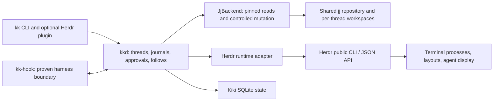

<script setup>
import { withBase } from "vitepress";
</script>

# Herdr foundations and jj integration

Herdr can already host a jj workspace through its ordinary workspace interface. The most useful first foundation for kiki is its terminal runtime, agent display, and CLI/socket interface. Kiki would still own jj, thread identity, lifecycle journals, follows relationships, and safe agent reconciliation. Start by composing those modules; a fork becomes worthwhile if native jj controls or tighter runtime guarantees justify maintaining one.

The follow-up [terminal runtime comparison](herdr-terminal-runtime.md) tests Herdr lifecycle behavior against tmux and details the replacement decision.

This is research, dated 2026-10-30, rather than an amendment to the [reference contract](../reference/README.md). In particular, adopting Herdr as the terminal runtime changes kiki's current tmux commitment. Four Sol agents covered runtime architecture, Git coupling, jj experiments, and independent review; the primary agent also ran a Herdr/jj smoke test.

## Evidence and versions

| Evidence | Version and scope |
| --- | --- |
| Herdr source | Full clone at `/Users/skeswa/repos/herdr-research/herdr`; commit [`ee5bfb5041bb3e4a49d591c72308aae3c81ecdde`](https://github.com/herdrdev/herdr/tree/ee5bfb5041bb3e4a49d591c72308aae3c81ecdde), dated 2026-10-29; package version 0.9.5 |
| Herdr execution | Official macOS arm64 0.9.5 binary, SHA-256 checked against the cloned distribution manifest; release tag resolves to `2ecf19a92fc3a7fff75b6ce3655ef04f4625ec01`, distinct from the source checkout |
| jj execution | Installed jj 0.44.0; isolated disposable repositories and command-local author configuration |
| Kiki contract | Commit `fa7eea200661075d6396f26bcaf4ad8c41a85b72`; implementation remains a placeholder |
| Validation limits | Herdr's source tests were inspected, not executed. The released binary was exercised headlessly. No live coding agent, full cascade, source build, or crash-recovery integration was tested. |

The [experiment results](/research/herdr-jj/results.json), <a :href="withBase('/research/herdr-jj/jj_semantics.py')" download>jj experiment script</a>, and <a :href="withBase('/research/herdr-jj/herdr_smoke.py')" download>Herdr smoke script</a> preserve the executable evidence. The source clone remains unchanged. Mutable online jj documentation corroborates concepts; compatibility claims here are limited to the tested version.

## How Herdr works

Herdr is a Rust terminal multiplexer with a background server. A normal launch finds or starts a server and attaches a terminal client. Named sessions have separate servers and persisted state. The server owns terminals and processes; closing a client leaves them running. Its current client/server separation includes a stable client endpoint, while the server still owns terminal surfaces and substantial application state. See [startup](https://github.com/herdrdev/herdr/blob/ee5bfb5041bb3e4a49d591c72308aae3c81ecdde/src/server/autodetect.rs#L206), [headless bootstrap](https://github.com/herdrdev/herdr/blob/ee5bfb5041bb3e4a49d591c72308aae3c81ecdde/src/server/headless/bootstrap.rs#L34), and [server state](https://github.com/herdrdev/herdr/blob/ee5bfb5041bb3e4a49d591c72308aae3c81ecdde/src/server/headless.rs#L201).

Its hierarchy is **session → workspace → tab → pane**. A Herdr workspace groups terminal layouts; it is not inherently a VCS checkout. A pane combines process and PTY ownership with Ghostty terminal emulation. Agent detection observes process identity, terminal signals, screen patterns, and integration reports. This produces useful attention states, but those states do not prove that tools or background writers have stopped. See [pane runtime](https://github.com/herdrdev/herdr/blob/ee5bfb5041bb3e4a49d591c72308aae3c81ecdde/src/pane.rs#L1497) and [detection](https://github.com/herdrdev/herdr/blob/ee5bfb5041bb3e4a49d591c72308aae3c81ecdde/src/detect/mod.rs#L330).

Herdr saves a versioned JSON snapshot of workspaces, tabs, layouts, pane directories, and supported agent-session references. Writes use temporary files, synchronization, and replacement. A cold restart creates new terminal processes and may resume saved conversations; it does not preserve the original processes. Live update handoff is a separate mechanism with PTY ownership transfer. These are useful terminal recovery foundations, but they do not implement kiki's durable cross-system lifecycle sagas. See [snapshot model](https://github.com/herdrdev/herdr/blob/ee5bfb5041bb3e4a49d591c72308aae3c81ecdde/src/persist/snapshot.rs#L12), [atomic write path](https://github.com/herdrdev/herdr/blob/ee5bfb5041bb3e4a49d591c72308aae3c81ecdde/src/persist/io.rs#L49), and [restore](https://github.com/herdrdev/herdr/blob/ee5bfb5041bb3e4a49d591c72308aae3c81ecdde/src/persist/restore.rs#L65).

The CLI and newline-delimited JSON socket expose workspace, tab, pane, agent, metadata, event, and plugin operations. This is the strongest existing reuse seam. JSON clients should tolerate additive fields and unsupported methods. The stable client endpoint generation is separate from the private binary protocol; building a replacement frontend or tmux-backed server would require implementing its terminal/input contracts, not just connecting kiki's gRPC socket. See the [method registry](https://github.com/herdrdev/herdr/blob/ee5bfb5041bb3e4a49d591c72308aae3c81ecdde/src/api/schema.rs#L46), [endpoint contract](https://github.com/herdrdev/herdr/blob/ee5bfb5041bb3e4a49d591c72308aae3c81ecdde/src/protocol/endpoint.rs#L1), and [protocol documentation](https://github.com/herdrdev/herdr/blob/ee5bfb5041bb3e4a49d591c72308aae3c81ecdde/docs/next/website/src/content/docs/socket-api.mdx#L942).

Plugins are executable commands declared in a manifest. They can add actions, startup/event handlers, and terminal panes or popups, and call the existing CLI/socket interface. They can provide a kiki launcher, status projection, or a pane running a kiki TUI. They do not offer an in-process Rust extension interface, arbitrary native UI widgets, or synchronous interception of agent tools. Event handlers run asynchronously with bounded concurrency and transient logs. See [plugin execution](https://github.com/herdrdev/herdr/blob/ee5bfb5041bb3e4a49d591c72308aae3c81ecdde/src/app/api/plugins/runtime.rs#L11).

Herdr is packaged as an application with private modules rooted in `main.rs`, not an embeddable runtime library. Extracting its TUI or process runtime would be an architectural project. Its foundations are most immediately reusable as a running program. See [module layout](https://github.com/herdrdev/herdr/blob/ee5bfb5041bb3e4a49d591c72308aae3c81ecdde/src/main.rs#L14) and [Cargo workspace](https://github.com/herdrdev/herdr/blob/ee5bfb5041bb3e4a49d591c72308aae3c81ecdde/Cargo.toml).

## Where Git is coupled

The distinction between `workspace.*` and `worktree.*` is central. Plain workspace creation accepts a directory, label, and environment; plain closure removes terminals. Managed worktree operations create and delete Git checkouts.

| Surface | Implemented behavior | Implication for jj |
| --- | --- | --- |
| Plain workspace | Opens an explicit directory and creates a terminal; Git metadata is optional. [Creation](https://github.com/herdrdev/herdr/blob/ee5bfb5041bb3e4a49d591c72308aae3c81ecdde/src/app/api/workspaces.rs#L39), [closure](https://github.com/herdrdev/herdr/blob/ee5bfb5041bb3e4a49d591c72308aae3c81ecdde/src/app/api/workspaces.rs#L311) | Already usable for a kiki-owned jj workspace. Closing the terminal is separate from forgetting/deleting the jj workspace. |
| Repository discovery | Reads `.git`, `HEAD`, `commondir`, loose/packed refs; common Git directory identifies a group. [Discovery](https://github.com/herdrdev/herdr/blob/ee5bfb5041bb3e4a49d591c72308aae3c81ecdde/src/workspace/git/discovery.rs#L186) | A `.jj`-only directory lacks native grouping/branch display. Ascending discovery can also find an enclosing Git repository. |
| Status | Caches branch and upstream ahead/behind, keyed by Git metadata; uses `git rev-list`. [Status](https://github.com/herdrdev/herdr/blob/ee5bfb5041bb3e4a49d591c72308aae3c81ecdde/src/workspace/git/status.rs#L16) | This is not a dirty-file or jj freshness check. jj needs workspace-specific heads, operation views, conflicts, and optional bookmarks. |
| Managed creation/list/open | Runs `git worktree add`, probes branches, parses `git worktree list --porcelain`, and revalidates Git grouping. [Commands](https://github.com/herdrdev/herdr/blob/ee5bfb5041bb3e4a49d591c72308aae3c81ecdde/src/worktree.rs#L239), [source policy](https://github.com/herdrdev/herdr/blob/ee5bfb5041bb3e4a49d591c72308aae3c81ecdde/src/app/api/worktrees.rs#L167) | Bypass these operations in the first integration. A jj workspace name, path, base commit, and checkpoint are separate values. |
| Managed removal | Uses Git dirty/removal checks; forced fallback proves ownership through Git worktree metadata before deleting files. [Removal](https://github.com/herdrdev/herdr/blob/ee5bfb5041bb3e4a49d591c72308aae3c81ecdde/src/worktree.rs#L175) | Requires a jj-specific removal plan and kiki lifecycle journal. Replacing command names would invalidate the ownership proof. |
| Persistence/grouping | Saves explicit Git group membership and revalidates it after restore. [Restore validation](https://github.com/herdrdev/herdr/blob/ee5bfb5041bb3e4a49d591c72308aae3c81ecdde/src/persist/restore.rs#L474) | Flat repository groups do not represent kiki follows relationships. Keep those in kiki. |
| Publishing | No production repository diff/commit/push/PR workflow was found in `src`. | There is no publishing implementation to port; retain kiki's jj/gh plans. |
| Plugin distribution | Git fetch/checkout installs plugin packages. [Installer](https://github.com/herdrdev/herdr/blob/ee5bfb5041bb3e4a49d591c72308aae3c81ecdde/src/cli/plugin.rs#L631) | Independent of project VCS; it can continue using Git. |

For native support in a fork, place a semantic checkout module at the discovery/lifecycle seam. Return repository identity, checkout identity/path, an explicit head descriptor, publication references, and capabilities. Implement Git and jj adapters with their own validation. Do not disguise a jj change or thread as `branch: String`, or reinterpret existing destructive methods with a backend field older servers might ignore. New methods/capabilities and persisted-schema changes must follow Herdr's [compatibility rules](https://github.com/herdrdev/herdr/blob/ee5bfb5041bb3e4a49d591c72308aae3c81ecdde/AGENTS.md#L81).

## What the experiments establish

| Experiment | Observed result | Consequence |
| --- | --- | --- |
| Herdr opens a jj-only child | Released 0.9.5 accepted `workspace.create`, launched a shell in the exact child directory, and exposed custom metadata tokens. | A useful integration can begin without modifying Herdr. |
| Herdr closes that workspace | `.jj` and an unsnapshotted file remained on disk; isolated server shutdown exited successfully. | Runtime close and VCS lifecycle can have separate owners. |
| Ancestor rewrite | Parent and child retained change IDs but acquired new commit IDs; child files stayed stale. | Let jj evolve repository history; defer file materialization to kiki's proven safe point. |
| Clean stale update | Files updated without changing the operation-head set. | An op-log watcher alone cannot prove current working-copy freshness. |
| Dirty stale update | Exit status was zero; a local file disappeared from the visible tree, but was preserved in another divergent successor. | Success is not an edit-preservation proof. Save, enumerate successors, and verify before resuming. |
| Parent adds a revision | `jj new` advanced the parent head; checkpoint and child stayed behind. An explicit exact-child rebase then moved the child. | A follows edge needs a distinct parent-advance path. |
| Ordinary status query | `jj status` snapshotted edits, changed the commit ID, and advanced operation history. | UI polling must use deliberate observation semantics. |
| Operation branches | Two mutations from the same historical view produced two heads; a later integrating operation had both parents. | Store a DAG/frontier, not a timestamp or scalar cursor. |
| Pinned inspection | `--at-op=@` failed with two heads. `--ignore-working-copy` alone did not prevent an ordinary op-log query from integrating them. | Sample the complete frontier and inspect exact operation IDs. |
| Git compatibility | An added jj workspace had no `.git`, even when the main workspace was colocated; Git discovery in the child failed. | Git-backed jj storage does not make every workspace a Git worktree. |
| Staged metadata operation | `--no-integrate-operation` left the frontier unchanged until `jj op integrate`. | Promising staging primitive; planned rebases, conflicts, concurrent integration, and crash recovery remain untested. |

These results support the reference book's distinction between native evolution and parent advance. They do not prove the full reconciliation protocol. Official references: [working copies](https://docs.jj-vcs.dev/latest/working-copy/), [operation history](https://docs.jj-vcs.dev/latest/operation-log/), [concurrency](https://docs.jj-vcs.dev/latest/technical/concurrency/), [Git compatibility](https://docs.jj-vcs.dev/latest/git-compatibility/), and [CLI options](https://docs.jj-vcs.dev/latest/cli-reference/).

## Proposed kiki composition

The following is a proposed architecture if Herdr is chosen as the terminal runtime. It preserves the coordinator's responsibilities while changing the terminal adapter from the currently specified tmux arrangement.



Kiki retains a stable `thread_id`. Store the jj workspace name/path, observed exact head, checkpoint evidence, Herdr session/workspace/pane references, and harness process incarnation as separate projections. Change IDs survive many rewrites but can have divergent successors; they are not a substitute for either exact commit pins or thread identity. See the existing [identity invariants](../reference/book/02-invariants.md) and jj's [glossary](https://docs.jj-vcs.dev/latest/glossary/).

Use a small terminal-runtime interface for creating a terminal context, focusing it, inspecting its incarnation, and closing it. Keep jj mutation out of that interface. Treat input submission as queue admission; require the managed launcher and harness handshake to prove execution/readiness. The public API currently does not provide kiki's launch transaction.

A future `kk new auth` would proceed as a journaled operation: resolve an exact base; create the jj workspace and initial change; record its head/checkpoint; create the terminal workspace with an explicit label and launch environment; then run the managed launcher. Only a matching ready handshake may mark the thread active. On a crash, reconcile recorded external effects before retrying creation. Herdr's ordinary workspace API has no kiki operation-id deduplication guarantee, so blind retries can create duplicate terminal workspaces.

For display, publish tokens such as `kiki_thread`, `jj_head`, `follows`, and `sync_state` with `workspace.report_metadata`, and configure custom sidebar tokens. These are presentation only: they are mutable by local callers, expire when requested, and are not restored after server restart. Reconnect by subscribing, reading authoritative snapshots, reconciling the kiki mapping, and republishing. Herdr's event history is bounded and in memory; it cannot replace jj operation replay or kiki journals. See [metadata](https://github.com/herdrdev/herdr/blob/ee5bfb5041bb3e4a49d591c72308aae3c81ecdde/src/api/schema/workspaces.rs#L65), [token storage](https://github.com/herdrdev/herdr/blob/ee5bfb5041bb3e4a49d591c72308aae3c81ecdde/src/metadata_tokens.rs#L4), and [event history](https://github.com/herdrdev/herdr/blob/ee5bfb5041bb3e4a49d591c72308aae3c81ecdde/src/api/event_hub.rs#L7).

For a parent rewrite, record the exact base transition, wait for a proven harness boundary, inspect the actual workspace freshness/edits, and materialize the child's current evolved state. For a new parent revision, validate the child's exact owned chain and descendants before an explicit rebase. In both paths, persist delivery and acknowledgement separately from terminal status. The existing [cascade contract](../reference/book/05-cascade.md) remains the relevant design, with the unresolved issues below.

## Gaps that determine whether this is practical

**Agent status is not a tool barrier.** Current Herdr Claude and Codex integrations install session-start reporting and remove older lifecycle reporters, including their legacy pre-tool handlers. They do not provide exclusive hooks, complete tool-batch identity, denial delivery, or later-turn acknowledgement. Herdr's current integrations are not a confirmed competing pre-tool hook; they simply do not establish kiki's stronger guarantees. The public `agent.wait` operation and asynchronous plugin hooks cannot supply them. See [integration targets](https://github.com/herdrdev/herdr/blob/ee5bfb5041bb3e4a49d591c72308aae3c81ecdde/src/integration/targets.rs#L124) and kiki's [harness contract](../reference/book/13-architecture/harness-adapter.md).

**Automatic restore needs one owner.** Herdr normally resumes supported agents, but persisted pane snapshots do not include arbitrary launch environment, and ordinary restore constructs an empty extra environment. Supplying a credential path or isolated harness home on initial creation therefore does not prove it survives a restart. A prototype should disable Herdr agent auto-resume in its dedicated configuration and make kiki's launcher restore each managed incarnation after rechecking settings and delivery state. Additional panes also need explicit per-pane launch environment. Process-tree freeze, same-session resume after failed close, and duplicate-launch prevention still need evidence. See [pane snapshot fields](https://github.com/herdrdev/herdr/blob/ee5bfb5041bb3e4a49d591c72308aae3c81ecdde/src/persist/snapshot.rs#L99), [restore environment](https://github.com/herdrdev/herdr/blob/ee5bfb5041bb3e4a49d591c72308aae3c81ecdde/src/persist/restore.rs#L572), and [restore configuration](https://github.com/herdrdev/herdr/blob/ee5bfb5041bb3e4a49d591c72308aae3c81ecdde/src/config/model.rs#L268).

**The checkpoint spec has a concrete inconsistency.** jj bookmarks automatically follow rewrites. Our checkpoint moved to the parent's successor after a snapshot, without any bookmark command; it stayed behind when the parent subsequently ran `jj new`. The current [watcher contract](../reference/book/13-architecture/op-log-watcher.md) says the expected bookmark target remains `checkpoint_commit_id` until an explicit lifecycle checkpoint. The first ordinary edit and snapshot after thread creation can therefore be classified as `BookmarkMoved`. Before implementation, decide whether to accept uniquely evidenced successor evolution while retaining original placement history, or intentionally require repair. Do not silently change the contract, and do not conflate following a rewrite with following a new revision. See jj's [bookmark semantics](https://docs.jj-vcs.dev/latest/bookmarks/).

**Observation requires more than a CLI status command.** Pinned operation templates can expose repository views without snapshotting. They cannot by themselves establish whether the actual stale working tree contains unsnapshotted edits. `WorkspaceProbe` and `WorkspaceRecovery` remain hard implementation work, including untracked files, ignored files, sparse checkouts, modes, symlinks, and concurrent writers. In jj 0.44.0, operation-head files were under `.jj/repo/op_heads/heads/`; watch paths must account for the nested layout. Hide any internal-storage dependency behind a versioned adapter. A complete, side-effect-free frontier sampler through a stable interface remains unproven: the research helper reads version-specific internal filenames. `--at-op=@` is not a solution to discovering multiple heads.

**Runtime control has different authority.** Herdr's local socket controls the whole session; its request model does not implement kiki's per-thread credentials or plan-bound human approval. Kiki must enforce those rules on its own operations and classify external Herdr closure/restart as projection changes. A plugin action must not become an implicit approval for deleting a checkout or publishing work. This fits kiki's cooperative isolation model, but cannot be described as enforcement against all same-user processes. See [socket handling](https://github.com/herdrdev/herdr/blob/ee5bfb5041bb3e4a49d591c72308aae3c81ecdde/src/api/server.rs#L81) and [authority](../reference/book/04-authority.md).

## Choosing how much to reuse

| Approach | Benefit | Cost and fit |
| --- | --- | --- |
| External kiki coordinator + Herdr runtime + small plugin | Immediate terminal/UI reuse; public interfaces; first seam proven | Recommended research direction if Herdr may replace tmux. Requires a terminal-contract decision and managed launch/restore proofs. |
| Keep tmux and use Herdr as an optional outer terminal | Preserves current terminal ownership | Nested terminal behavior, detection, geometry, and recovery need testing; does not deliver native kiki controls automatically. |
| Fork Herdr into kiki with native jj support | One tailored application, native follows/status actions | Own Git/jj abstraction, persistence migrations, frontend changes, upstream merges, terminal regressions, and coordinator semantics. Larger commitment. |
| Extract Herdr libraries or implement its endpoint over tmux | Potentially reusable native UI/runtime modules | No ready library seam; requires terminal protocol, rendering/input, and ownership work before delivering kiki behavior. |

A useful fork would retain terminal ownership, detection/display, input/rendering, configuration, and CLI machinery; add the jj checkout adapter and kiki coordinator; and replace Git-specific controls where appropriate. The substantive new work is thread coordination and reliable recovery. A generic `git`→`jj` command substitution would not produce kiki.

Herdr declares Apache-2.0 while kiki currently declares MIT. If copying or distributing Herdr code, retain the applicable license and attribution material, mark modified files as required, and carry any applicable notices, including those of vendored dependencies. An external-process integration avoids copying its implementation into kiki. See [Herdr's license](https://github.com/herdrdev/herdr/blob/ee5bfb5041bb3e4a49d591c72308aae3c81ecdde/LICENSE) and [Apache redistribution terms](https://www.apache.org/licenses/LICENSE-2.0).

## Next experiments

1. **Settle the two design choices:** terminal ownership (tmux or Herdr) and checkpoint successor handling. Record them separately from this research before implementation depends on them.
2. **Prove managed launch and restart:** one thread, a durable launcher gate, isolated harness settings, explicit ready handshake, disabled competing auto-resume, and crashes between each step. Include a server restart that loses metadata and launch environment.
3. **Prove one full follows edge:** ancestor rewrite and parent advance, real agent tool admission, edit preservation, conflict handling, and acknowledged context delivery. Test each harness/version separately; Herdr detection is not evidence for either adapter.
4. **Broaden recovery cases:** dirty stale files, multiple operation heads, A→B→C evolution, foreign descendants, ambiguous topology, missing/replaced paths, event loss, and process-tree freeze/recovery. Use the existing [build sequencing](../reference/book/15-build-sequencing.md) as the gate, not a second feature checklist.
5. **Then add native workflow polish:** plugin commands and metadata first; a fork or upstream checkout abstraction only after the proofs show which missing runtime capabilities are actually necessary.

To rerun the research fixtures from the repository root:

```sh
python3 docs/public/research/herdr-jj/jj_semantics.py
python3 docs/public/research/herdr-jj/herdr_smoke.py --herdr /absolute/path/to/herdr
```

Both create disposable directories and retain their evidence. The Herdr fixture uses a dedicated configuration and socket, starts no coding agent, and stops its own server. Passing these fixtures establishes only the behaviors listed above; it is not the kiki acceptance gate.
