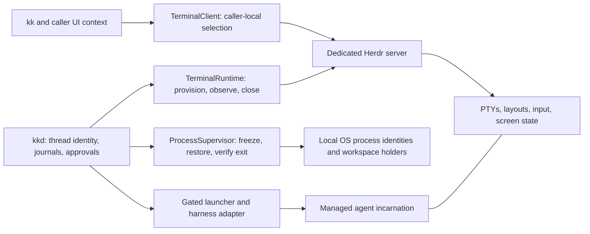

<script setup>
import { withBase } from "vitepress";
</script>

# Herdr as a replacement for tmux

Herdr can replace tmux's terminal-hosting role in kiki: it hosts PTYs, keeps work running across client detach, provides layouts and terminal I/O, and exposes programmatic control. Its agent interface and recovery features are reasons to choose it. It does not remove kiki's need for controlled agent launch, process supervision, or safe workspace reconciliation.

**Recommendation:** prototype Herdr as kiki's preferred terminal runtime, with one dedicated named server hosting one workspace per thread. Keep the existing tmux contract until caller-local switching, managed restart, and verified process cleanup pass explicit gates. A full fork is unnecessary for the initial prototype; a small public-interface extension may be needed for production navigation and lifecycle coordination.

This follow-up to [Herdr and jj integration](herdr-jj.md) is research dated 2026-10-30, not a change to the reference specification. It adds process lifecycle tests and a tmux baseline to the earlier directory-hosting experiment.

## What was examined and run

| Evidence | Scope |
| --- | --- |
| Herdr source | [`ee5bfb5041bb3e4a49d591c72308aae3c81ecdde`](https://github.com/herdrdev/herdr/tree/ee5bfb5041bb3e4a49d591c72308aae3c81ecdde), package 0.9.5 |
| Herdr executable | Official macOS arm64 0.9.5, verified SHA-256; release commit `2ecf19a92fc3a7fff75b6ce3655ef04f4625ec01` |
| tmux executable | Installed 3.7c on macOS; unique test sockets and empty configuration |
| tmux source baseline | Release 3.8, commit [`7f2a35ad3321f9ba57a1062ca73b1f3ff26aca53`](https://github.com/tmux/tmux/tree/7f2a35ad3321f9ba57a1062ca73b1f3ff26aca53), plus official manual and control-mode documentation |
| Live fixtures | Real Herdr terminal clients, Python workers and children, direct argv launch, detach, client death, stop/restart, workspace close, and server SIGKILL; tmux control clients and analogous lifecycle probes |
| Limits | No real coding agents, host reboot/logout, terminal-application quit, live handoff, Windows/Linux run, performance benchmark, or full process-freeze proof. Upstream tests were inspected rather than run. |

The [recorded results](/research/herdr-runtime/results.json) retain versions and observations. Download the <a :href="withBase('/research/herdr-runtime/herdr_runtime_probe.py')" download>Herdr lifecycle probe</a>, <a :href="withBase('/research/herdr-runtime/tmux_runtime_probe.py')" download>tmux baseline probe</a>, and <a :href="withBase('/research/herdr-runtime/tmux_orphan_probe.py')" download>tmux orphan probe</a>. All runs used disposable state; fixture-owned surviving workers were explicitly cleaned up.

## The runtime being substituted

Herdr's server owns a Ghostty terminal emulator, a PTY actor, and the direct child process for each terminal. On Unix, child setup creates a session and controlling terminal. Clients send input and receive presentation state while the server continues independently. This is the same broad separation kiki expects from an external terminal host. The `kkd` daemon can remain a separate coordinator that owns SQLite, jj operations, lifecycle journals, and harness policy. See [PTY construction](https://github.com/herdrdev/herdr/blob/ee5bfb5041bb3e4a49d591c72308aae3c81ecdde/src/pty/backend/unix.rs#L12), [child setup](https://github.com/herdrdev/herdr/blob/ee5bfb5041bb3e4a49d591c72308aae3c81ecdde/vendor/portable-pty/src/unix.rs#L228), and [kiki daemon ownership](../reference/book/13-architecture/daemon.md).

The organization levels need deliberate translation:

| Current kiki/tmux concept | Proposed Herdr representation |
| --- | --- |
| Terminal server/socket | Dedicated named Herdr session/server |
| Thread's tmux session | Herdr workspace |
| Window | Tab |
| Agent, human shell, sidebar | Role-associated panes |
| Stable kiki thread ID | Remains in kiki; all terminal IDs are projections |

A Herdr session is a server namespace, so creating one session per thread would create many servers and sockets. One named `kiki` server with many workspaces gives the natural cross-repository view. Per-repository servers reduce failure impact but complicate switching across repositories. Using the user's default Herdr server couples kiki's restart/configuration policy to unrelated terminals. See [session paths and identity](https://github.com/herdrdev/herdr/blob/ee5bfb5041bb3e4a49d591c72308aae3c81ecdde/src/session.rs#L31).

## Capability comparison

| Capability | tmux baseline | Herdr | Implication for kiki |
| --- | --- | --- | --- |
| Detached processes | Server owns PTYs independently of clients | Same broad model; live tests passed | Both can host long-running agent work. |
| Direct executable launch | Multiple argv arguments, explicit cwd/env; tested | `layout.apply` pane command/cwd/env; tested | A gated kiki launcher can be the direct PTY child in either runtime. |
| Programmatic control | CLI, formats, control mode, hooks | CLI, JSON API, snapshots, events, plugins | Herdr adds structured agent/display facts; tmux already has substantial automation. |
| Agent monitoring | Requires integration above terminal observations | Built-in process/screen/integration-based states | Valuable UX, not proof of safe tool admission. |
| Cold restart | Stock server does not restore the old session layout | Layout/cwd restore; optional conversation resume | Herdr saves reconstruction work, but kiki must govern agent restart. |
| Process incarnation | Respawn retains pane ID with a new PID; tested | Cold restore retains public pane IDs with new processes; tested | Both need kiki-owned incarnation identity. |
| Multiple clients | Explicit client selection and size policies | Client-local UI navigation; public focus broadcasts | Existing Herdr public focus is incompatible with caller-local `kk switch`. |
| Termination proof | No proof that every writer is gone | Escalating cleanup, but no structured all-processes-dead receipt | Workspace deletion needs a separate supervisor proof with either backend. |
| Native Windows | Outside tmux 3.8's listed native platforms | Windows terminal/process implementation exists | Potential product benefit; kiki's Windows safety obligations remain untested. |
| Embeddable library | External terminal program | Application with private Rust modules | Integrate through the executable/protocol first. |

Tmux facts are grounded in its [direct-launch implementation](https://github.com/tmux/tmux/blob/7f2a35ad3321f9ba57a1062ca73b1f3ff26aca53/spawn.c#L401), [control-mode guide](https://github.com/tmux/tmux/wiki/Control-Mode), [size policies](https://github.com/tmux/tmux/blob/7f2a35ad3321f9ba57a1062ca73b1f3ff26aca53/resize.c#L132), and [platform list](https://github.com/tmux/tmux/blob/7f2a35ad3321f9ba57a1062ca73b1f3ff26aca53/README). Herdr's corresponding surfaces are the [method registry](https://github.com/herdrdev/herdr/blob/ee5bfb5041bb3e4a49d591c72308aae3c81ecdde/src/api/schema.rs#L46), [launch schema](https://github.com/herdrdev/herdr/blob/ee5bfb5041bb3e4a49d591c72308aae3c81ecdde/src/api/schema/panes.rs#L168), and [restore implementation](https://github.com/herdrdev/herdr/blob/ee5bfb5041bb3e4a49d591c72308aae3c81ecdde/src/persist/restore.rs#L65).

## Lifecycle findings from real processes

| Event | Herdr 0.9.5 observation | Interpretation |
| --- | --- | --- |
| No client attached | Worker continued advancing its heartbeat | Hosting does not require an attached UI. |
| Client Ctrl+b q | Client exited 0; same worker continued | Normal detach works. |
| Client SIGKILL | Worker continued | Client process failure is separate from server failure. |
| Graceful server stop | Tested ordinary worker and child exited | Terminal-server stop ends running work; it is not a transparent restart. |
| Cold server restart | Public pane IDs returned with new shell processes; tokens and custom launch env were absent | Restored layout is not a ready managed agent. |
| Split without explicit env | New pane had no original custom environment tag | Thread settings must be supplied per managed launch. |
| Close one workspace | Worker in another workspace continued | Workspace is the useful per-thread teardown unit. |
| Close HUP-ignoring fixture | Tested worker and child exited | Herdr's escalation handles this particular ordinary session group. |
| Server SIGKILL | HUP-ignoring worker survived; heartbeat continued | Missing server/PTY projection does not establish absence of writers. |
| Direct layout command exits | Pane was removed | The tested direct-argv path does not provide an automatic persistent supervisor. |

The tmux comparison confirms detach continuity, literal argv/cwd/env launch, captured terminal output, control-mode responses, named synchronization, and 80×24 versus 120×40 sizing under explicit policies. `respawn-pane` kept `$0/@0/%0` while changing the process and its environment. In a second fixture, HUP-ignoring workers and children survived both `kill-server` and server SIGKILL. **The orphan-writer problem applies to both choices.** Herdr's successful graceful-cleanup sample should not be extrapolated to arbitrary daemonized descendants.

### A release caveat on macOS

Inspected master contains [`b431a063`](https://github.com/herdrdev/herdr/commit/b431a063e2cfdbfc3ca41bcd0dcbc329f92d217f), a fix after stable 0.9.5 for the server dying when the terminal application quits. The source explains that ordinary detachment did not escape the application's launchd coalition. The newer implementation uses a temporary launchd job; it does not install a persistent restart service. Our explicit client-detach/client-death tests used an independently started server and do not validate terminal-application quit or the newer startup fix. See [launchd spawning](https://github.com/herdrdev/herdr/blob/ee5bfb5041bb3e4a49d591c72308aae3c81ecdde/src/platform/macos/launchd_spawn.rs#L1).

A candidate version for adoption must include and pass that fix. Reboot, abrupt power loss, and live handoff require separate tests. Herdr's host-shutdown monitors save reconstruction state; they cannot preserve kernel processes across reboot. Its implemented Unix live-handoff path transfers PTY descriptors and can retain existing processes, but quiescing PTY I/O does not stop agents from writing files. See [handoff lifecycle](https://github.com/herdrdev/herdr/blob/ee5bfb5041bb3e4a49d591c72308aae3c81ecdde/src/server/headless/lifecycle.rs#L61).

## Managed launch is feasible; managed restore is new work

The useful launch seam is `layout.apply` with an explicit command array. The fixture passed a literal argument containing shell metacharacters and spaces, verified the exact argv and environment, and confirmed that the executable's PID was the PTY child reported by Herdr. There is no need to type a startup command into an arbitrary shell. The future command can be a kiki launcher that waits for a durable database-backed gate before executing the harness. See [direct command creation](https://github.com/herdrdev/herdr/blob/ee5bfb5041bb3e4a49d591c72308aae3c81ecdde/src/app/api/layouts.rs#L103).

This call starts processes and has no kiki operation-id deduplication contract. A lost response cannot be handled by blindly repeating it. Persist the lifecycle operation before provisioning; associate the gated launcher with that operation; make restart adoption prove whether the existing resources belong to it. An API extension for create-if-absent could simplify this, but it should follow evidence from the prototype.

Cold restore did not rerun the fixture's saved command. It started `/bin/sh`, with custom launch environment absent. Native conversation resume also constructs fresh processes and is enabled by default. For kiki's dedicated configuration, use:

```toml
[session]
resume_agents_on_restore = false
```

Kiki then reconstructs credentials, isolated harness configuration, pending delivery, and a fresh ready handshake. A restored pane is only a terminal projection. The database thread cannot become `Active` from that pane's existence. See [saved pane fields](https://github.com/herdrdev/herdr/blob/ee5bfb5041bb3e4a49d591c72308aae3c81ecdde/src/persist/snapshot.rs#L99), [empty restore environment](https://github.com/herdrdev/herdr/blob/ee5bfb5041bb3e4a49d591c72308aae3c81ecdde/src/persist/restore.rs#L572), and [native resume](https://github.com/herdrdev/herdr/blob/ee5bfb5041bb3e4a49d591c72308aae3c81ecdde/src/app/agent_resume.rs#L250).

The direct-command exit test closed its pane. Other launch paths can be configured internally to respawn a shell under the same terminal ID, again with a new process and empty extra environment. Track the launcher/harness incarnation independently of terminal IDs. Public workspace IDs can also recur across server lifetimes; the public JSON session snapshot lacks the client endpoint's boot token. The adapter needs to verify the server instance and process start identity. See [exit policy](https://github.com/herdrdev/herdr/blob/ee5bfb5041bb3e4a49d591c72308aae3c81ecdde/src/app/api.rs#L541), [respawn](https://github.com/herdrdev/herdr/blob/ee5bfb5041bb3e4a49d591c72308aae3c81ecdde/src/app/api.rs#L582), and [public snapshot](https://github.com/herdrdev/herdr/blob/ee5bfb5041bb3e4a49d591c72308aae3c81ecdde/src/api/schema/session.rs#L8).

## Two gaps that prevent a drop-in replacement

**Switching needs a caller-targeted interface.** Public `workspace.focus` deliberately projects focus to all connected shell clients. Herdr's own client navigation has a separate client-local path, so the capability exists internally, but the public JSON method cannot target the invoking client. Mapping `kk switch` directly to this method would move someone else's view. Add a supported client-targeted command/bridge or make an explicit product decision to reduce the semantics. A pane ID alone cannot identify which of several viewers issued a shell command; tmux also needs caller resolution, although it provides an explicit client target. See [broadcast focus](https://github.com/herdrdev/herdr/blob/ee5bfb5041bb3e4a49d591c72308aae3c81ecdde/src/server/headless/client_views.rs#L809), [client-local navigation](https://github.com/herdrdev/herdr/blob/ee5bfb5041bb3e4a49d591c72308aae3c81ecdde/src/server/headless/client_views.rs#L328), and [kiki navigation authority](../reference/book/04-authority.md).

**Safe close needs a process supervisor.** Herdr exposes the direct PTY child and foreground process group. Its cleanup snapshots session members, escalates signals, and logs a warning if processes remain. Public close still returns success. There is no public full descendant inventory, start-token set, stopped-state proof, or termination receipt. Its success response cannot authorize deleting a workspace. See [process information](https://github.com/herdrdev/herdr/blob/ee5bfb5041bb3e4a49d591c72308aae3c81ecdde/src/app/api/panes.rs#L526), [cleanup](https://github.com/herdrdev/herdr/blob/ee5bfb5041bb3e4a49d591c72308aae3c81ecdde/src/pane.rs#L1760), and [workspace closure](https://github.com/herdrdev/herdr/blob/ee5bfb5041bb3e4a49d591c72308aae3c81ecdde/src/app/api/workspaces.rs#L311).

Kiki's [close contract](../reference/book/03-threads.md#close) is substantially stronger: freeze every pane's roots and descendants to a fixed point, preserve prior stopped states, inspect external workspace holders, recheck the filesystem, and verify resume on failure. Tmux does not provide that proof either. Implement it as an OS-facing supervisor with evidence-bearing results. If group membership fails to stabilize, changes after the final proof, or a writer cannot be accounted for, return `Unknown` and preserve the files. Fencing terminal mutations during that interval may require a Herdr capability or tighter kiki-managed launch containment; it is not solved by two optimistic list calls.

After a server crash, scan for known surviving writers before starting replacements. After an approved close, verify process exit independently before forgetting or deleting the jj workspace. A process that disappeared from Herdr's UI can still be writing.

## Proposed module responsibilities



These are proposed interfaces, not new code. `TerminalRuntime` handles runtime groups and role-associated panes; it reports resource observations rather than claiming agent readiness. `TerminalClient` handles caller-local focus and notifications. `ProcessSupervisor` owns freeze/verified resume/exit evidence. The harness adapter remains responsible for tool admission, payload delivery, and acknowledgement. Neither terminal input queue admission nor screen-detected idle acknowledges a kiki synchronization intent.

Persist a thread's runtime kind/address, verified server incarnation, workspace/tab/pane references, pane roles, and process identity. Explicit labels are for people. Shell `cd`, automatic naming, a moved pane, or a restored public ID must not silently redefine the thread. Additional user panes are included in close observation even when kiki does not recreate them after restart.

Keep the initial adapter local. A remote Herdr terminal interface does not give local `kkd` the process and filesystem-holder proof required for safe deletion on another host.

## Adoption gates and specification impact

The next prototype should exercise one complete thread through direct launcher creation, readiness, client detach, daemon reconnection, cold terminal-server restart, and close with verified resume on rejection. Add a second client and second thread early: they reveal focus broadcasts, wrong-target actions, and shared-server failure effects that a single-pane demo misses.

Before replacing tmux in the acceptance contract, establish:

1. A version-pinned Herdr build that survives the supported terminal-application exit paths; layout/input/copy behavior with real Claude Code and Codex on each supported platform.
2. Caller-local `kk switch`, explicit client identity, remembered pane focus, and a deliberate shared-terminal geometry/input policy.
3. Creation recovery after a lost response, one authorized launcher incarnation, correct settings/env after every restart, and no competing automatic agent resume.
4. Verified freeze/resume/exit for multiple panes, background jobs, escaped processes, moved panes, unknown holders, and server failure. Preserve files whenever proof is incomplete.
5. Explicit handoff behavior if supported, reconnect/snapshot reconciliation after event loss, and real harness delivery tests independent of terminal status.

The bounded spec changes would cover terminal ownership and group terminology; typed runtime projection fields; context discovery and caller navigation; launch/restore/close behavior; pane roles/keybindings/notifications; and the runtime integration gate. Update [daemon architecture](../reference/book/13-architecture/daemon.md), [threads](../reference/book/03-threads.md), [schema](../reference/book/13-architecture/schema.md), [commands](../reference/book/09-commands.md), [interface](../reference/book/10-interface/spec.md), and [testing](../reference/book/14-testing.md) through a focused decision. The jj and harness safety contracts do not need to move into Herdr.

Choose Herdr if kiki should offer an integrated agent workspace experience and is willing to own these adapter proofs and version compatibility. Keep tmux if preserving direct tmux workflows and minimizing terminal integration changes matters more. The evidence supports a Herdr prototype now; it does not yet justify claiming production parity for kiki's lifecycle guarantees.

To rerun the fixtures from the repository root:

```sh
python3 docs/public/research/herdr-runtime/herdr_runtime_probe.py --herdr /absolute/path/to/herdr
python3 docs/public/research/herdr-runtime/tmux_runtime_probe.py
python3 docs/public/research/herdr-runtime/tmux_orphan_probe.py
```

These are Unix research probes. They retain results in temporary directories and deliberately stop their own terminal servers and fixture processes. They do not address the default tmux server or existing Herdr sessions.
